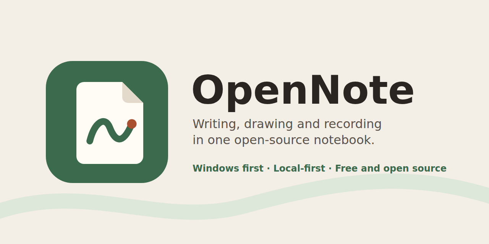
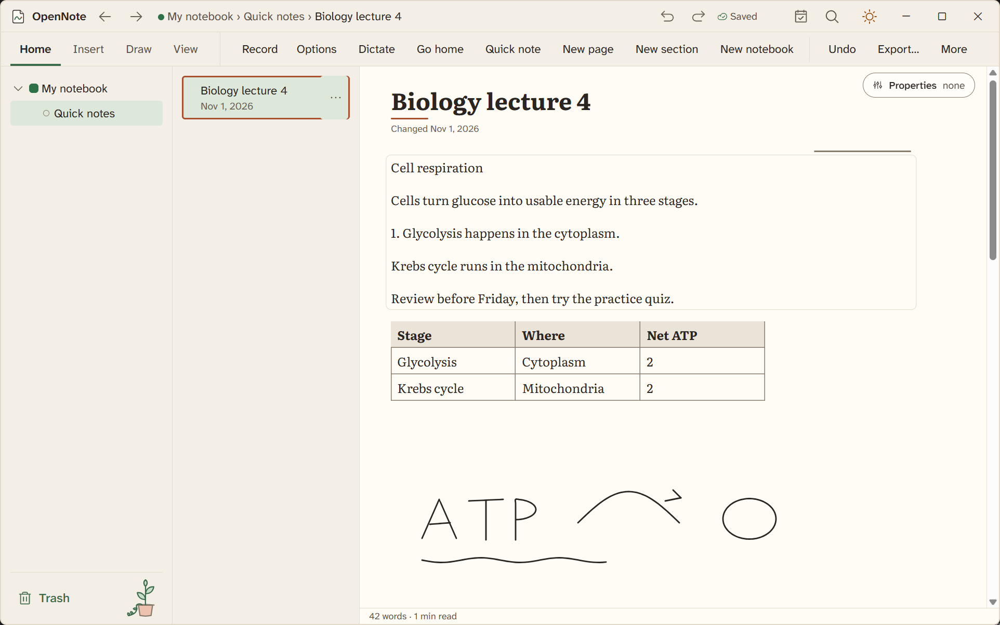
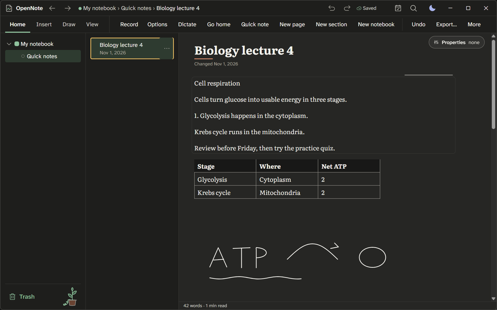
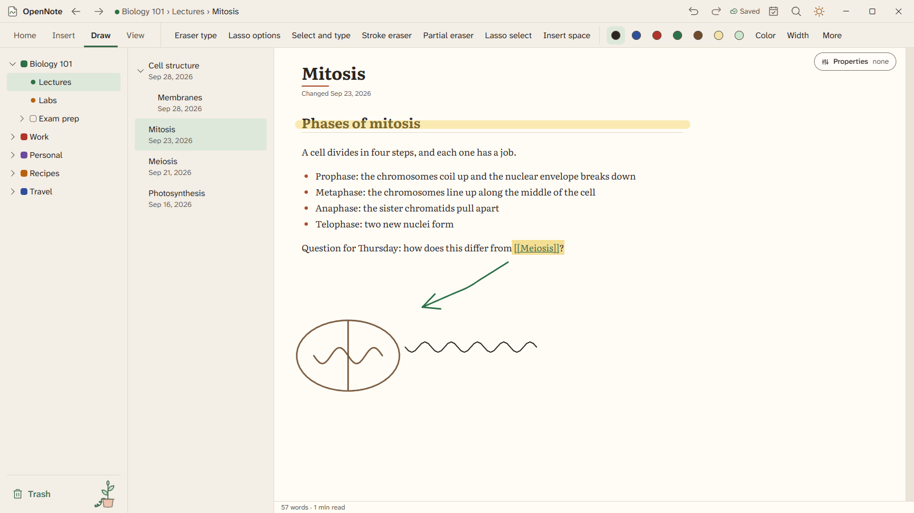
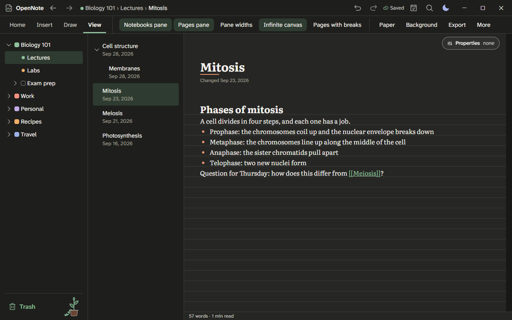
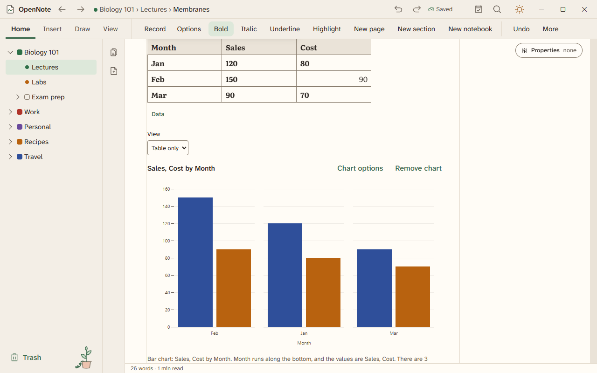
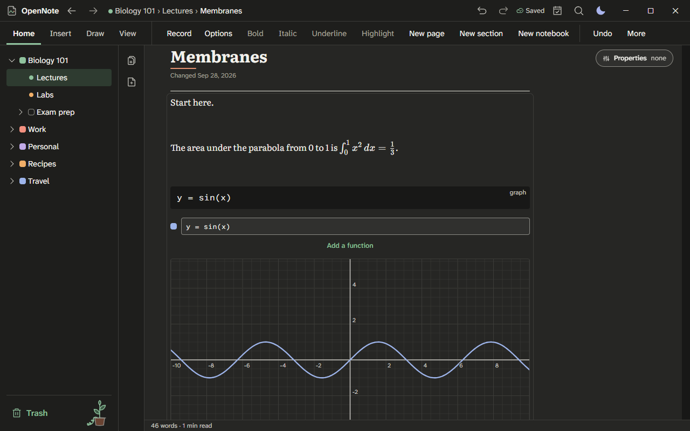
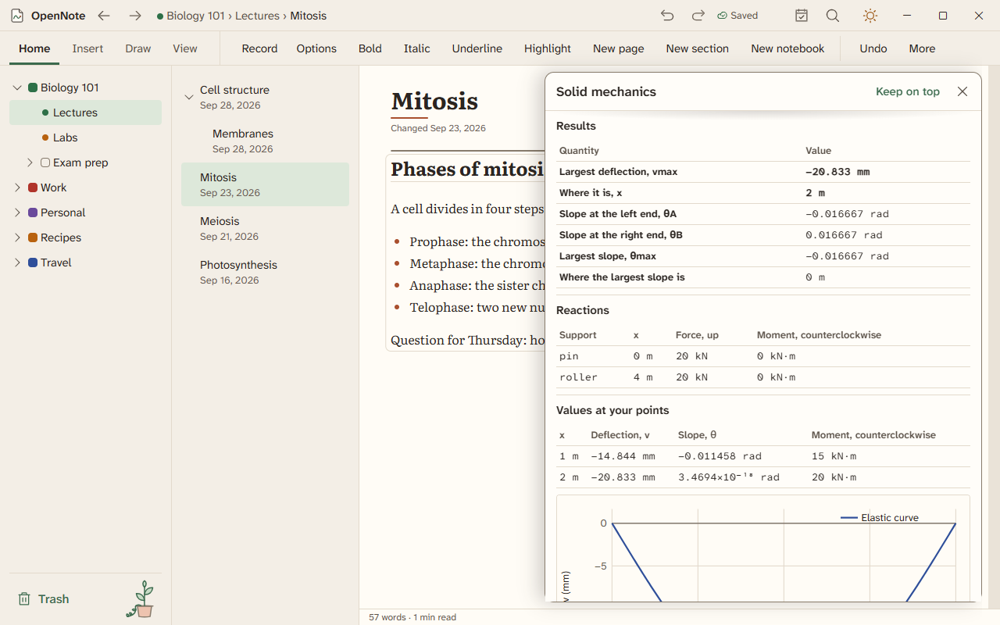
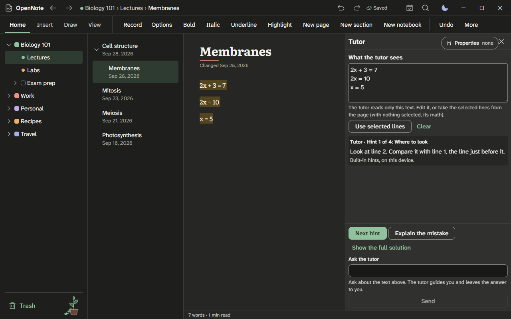

# OpenNote



OpenNote is an open-source note-taking app that combines your favorite writing, drawing, and recording features for professional and personal use. Windows comes first; macOS, Linux, iOS, and Android follow.

**New here?** The [help pages](docs/help/README.md) explain each part of the app. The [feature list](docs/FEATURE-LIST.md) names every tool, command, and feature, by category. The [project wiki](https://github.com/XrxcGH/OpenNote/wiki) holds the user guide, development updates, and the developer guide.

## Contents

- [Status](#status)
- [What the app does](#what-the-app-does)
- [Pictures](#pictures)
- [Try the beta](#try-the-beta)
- [Downloads](#downloads)
- [Quick start for contributors](#quick-start-for-contributors)
- [Repository map](#repository-map)
- [Documentation](#documentation)
- [License](#license)

## Status

OpenNote is in beta testing on Windows, with first builds for macOS and Linux. The current beta is beta 8. The version files still say 0.1.0-beta.7, and there is no public release yet.

Phases 0 to 4 of the [development plan](docs/DEVELOPMENT.md#5-phases) merged into `main` first. Phases 5 to 14 were built on branch `beta` and merged into `main` on 2026-10-29 through [pull request #16](https://github.com/XrxcGH/OpenNote/pull/16). Work since then goes to `beta` first. Branch `beta` holds the newest build.

Beta 8 is beta 7 plus these changes:

- The finish-all work brings the Mac and Linux builds close to Windows. They now have PDF and printing, read aloud, spell check, the command line, Mac updates, the Keychain and the Secret Service, and text in pictures and handwriting on the device.
- It also fixes the nightly crashes, sweeps 200,000 palm rejection cases, trims start-up, keeps tool windows from covering each other, and adds behavior and keyboard tests for every kit.
- Title bar and save fixes: the Windows title bar no longer stays above OpenNote's own, and the save status says Saving until an edit is written, then Saved, and Couldn't save opens a notice with the reason, Retry, and Copy text.
- A dark theme in neutral charcoal gray, not brown.
- A flaky test of the box around a stroke's ink is fixed. It now checks the shape the renderer fills, and the macOS counterexample runs every time.
- Ink fixes from the full walk: the ruler stays in view and you can draw along it from inside, shapes are reachable at every width and held curves snap, and the Draw tab's pens fit at every width and touch size.

Beta 7 added ink fixes and smoother shapes, layout fixes, more course and subject kits, and a start-up wait that fixes ink missing after a crash restart. The school tools now include 24 subject and engineering kit windows, Check my work, the tutor, practice exams, document structure, and code cells.

| Phase                                     | Focus                                                                                    | Status                                                                                                     |
| ----------------------------------------- | ---------------------------------------------------------------------------------------- | ---------------------------------------------------------------------------------------------------------- |
| 0                                         | Project foundation                                                                       | Done and merged                                                                                            |
| 1                                         | Spikes that test ink, text, PDF export, and audio                                        | Done and merged                                                                                            |
| 2                                         | [App shell and navigation](https://github.com/XrxcGH/OpenNote/pull/8)                    | Done and merged 2026-10-02                                                                                 |
| 3                                         | [Document model and storage](https://github.com/XrxcGH/OpenNote/pull/9)                  | Done and merged 2026-10-03                                                                                 |
| 4                                         | [Typed notes (text, Markdown, tables, code)](https://github.com/XrxcGH/OpenNote/pull/15) | Done and merged 2026-10-03                                                                                 |
| [5 to 12](docs/DEVELOPMENT.md#5-phases)   | Ink, page views, export, tables, charts, search, audio, math, import, and intelligence   | Built, merged 2026-10-29 ([pull request #16](https://github.com/XrxcGH/OpenNote/pull/16)), in beta testing |
| [13 and 14](docs/DEVELOPMENT.md#5-phases) | Hardening and privacy; the release pipeline                                              | Built, waiting on the beta period, code signing, and the update key, which are the owner's                 |

Agents built and unit-tested beta 8 and started the real app. Most of it has not been tested by hand yet. [docs/FEATURES.md](docs/FEATURES.md) marks every feature as built, built but untested by hand, not built yet, or needing the owner.

## What the app does

You keep notebooks, sections, and pages in a notes folder you choose, as plain folders in OpenNote's open note format. Pages save on their own and recover after a crash. The [feature list](docs/FEATURE-LIST.md) has every command and tool window the app registers. Each area below has a help page.

### Write and draw

- [Typed notes](docs/help/typed-notes.md): text, headings, lists, checklists, tables, code, callouts, Markdown, templates, and find and replace, with typed web and e-mail addresses turning into links.
- [Moving between blocks](docs/help/moving-between-blocks.md): keys that move between text, pictures, tables, and code without the mouse.
- [Document structure](docs/help/document-structure.md): equation numbers and references, formula sheets, practice mode, problem-set templates, and figures.
- [Code cells](docs/help/code-cells.md): short Python or JavaScript programs that run on the page; a cell from a newer version opens read-only instead of being changed.
- [Ink and palm rejection](docs/help/ink-and-palm-rejection.md): pens, a highlighter, erasers, the lasso, shapes, and gestures, with your palm resting on the screen.
- [My handwriting](docs/help/my-handwriting.md): typed text and math written in your own hand, learned from a calibration page.
- [Paper and page views](docs/help/paper-and-page-views.md): flow, paginated, and canvas pages, with lined, grid, and dot paper; slides, print, and PDF.
- [Tables and charts](docs/help/tables-and-charts.md): smart tables with views and formulas, and charts that update with them.
- [Language and spelling](docs/help/language-and-spelling.md): American English by default, and one choice for every part that reads or writes words.

### Organize and find

- [The workspace and title bar](docs/help/workspace-and-title-bar.md): the title bar, the command bar, the Home screen, page tabs, the compact layout, focus mode, the mini window, and quick capture.
- [Search and links](docs/help/search-and-links.md): search, page links, backlinks, tags, daily notes, and the graph view.
- [History, Trash, and storage](docs/help/history-and-storage.md): page history, Trash, where notes live, locked entries, and checking a notebook. Page edits, undo and redo, images, and replace now stay in step with the page core.

### Record and listen

- [Recording](docs/help/recording.md): recording with stamped notes, trimming, transcript blocks, speakers, and meeting recaps. A full walk of recording, captions, dictation, and read aloud fixed start-up, command, length, rename, and layout bugs.
- [On-device intelligence](docs/help/on-device-intelligence.md): text in pictures, read aloud, summaries, Ask your notes, and writing tools, each off until turned on.

### Math and homework

- [Math and graphs](docs/help/math-and-graphs.md): equations, quick math, Check my work on your steps, the grapher, diagrams from text, and mind maps.
- [Math solvers](docs/help/math-solvers.md): calculus, engineering, and statistics problems worked step by step.
- [3D graphs, vectors, and motion](docs/help/3d-graphs-vectors-and-motion.md): surfaces and curves in space, vectors, lines and planes, solids of revolution, and projectiles.
- [Tutor](docs/help/tutor.md): hints one step at a time, and explanations of flagged steps, without giving the answer away. Long questions and the full hint ladder now work, and absurd aerospace inputs are reported by name instead of crashing.
- [Study tools](docs/help/study-tools.md): flashcards, practice exams, Anki decks, study tape, Upcoming, timers, a calculator, and citations.

### Subject and engineering kits

- [Subject tool kits](docs/help/subject-tool-kits.md): thirteen kit windows for engineering, science, math, earth sciences, and reasoning, with worked steps.
- [Engineering tools](docs/help/engineering-tools.md): free-body diagrams, beam and truss solvers, DC circuits, and units in tables.
- [Civil and chemical engineering](docs/help/civil-and-chemical-engineering.md): structures, soils, foundations, water, transportation, material balances, and reactors.
- [Signals and sound](docs/help/signals-tools.md): spectra, filters, sampling, body signals, sound, images, medical imaging, coding, and RF.
- [Chemistry and property tables](docs/help/chemistry-and-data.md): balanced equations, chemistry problems with steps, structures, and steam, gas, and material properties.
- [Modern physics and astronomy](docs/help/modern-physics-and-astronomy.md): quantum wells, spin, atoms, molecules, solids, plasmas, stars, the sky, and cosmology.
- [Biology tools](docs/help/biology-tools.md): sequences, cloning, proteins, alignment, crosses, population genetics, pedigrees, and trees.
- [Life science tools](docs/help/life-science-tools.md): physiology, neurons, pharmacology, curve fits, bench math, populations, and biodiversity.
- [Statistics kit](docs/help/statistics-kit.md): describing data, tests, epidemiology, power, resampling, Bayesian updating, and study design.
- [Statistical models](docs/help/statistical-models.md): regression, causal inference, survival, time series, clusters, machine learning, and spatial statistics.
- [Psychology and behavior](docs/help/psychology-kit.md): signal detection, psychophysics, choice models, response times, observation, agreement, and scales.
- [Economics and finance](docs/help/economics-and-finance.md): calculators for money over time, markets, firms, macroeconomics, measurement, accounting, and investments.
- [History, places, languages, and texts](docs/help/history-places-languages-and-texts.md): timelines, calendars, maps, coordinates, scripts, linguistics, text analysis, and keys.
- [Music, script, camera, and studio](docs/help/music-script-camera-and-studio-tools.md): score notation, music theory, ear training, tuning, scripts, camera, and studio math.
- [Data, seeds, and figures](docs/help/subject-kit-data-and-figures.md): how every kit takes data, repeats random results, and puts its diagrams on the page.

### Bring notes in and out

- [Import and export](docs/help/import-and-export.md): Obsidian, Markdown, Word, Excel, PowerPoint, and more in; Markdown, Word, PDF, LaTeX, and more out.
- [Goodnotes, Notability, and Samsung Notes](docs/help/notes-apps.md): the handwriting apps' own files in, with Notability's handwriting as strokes.
- [Photos from your phone](docs/help/phone-scan.md): phone photos straight onto the open page, with no app to install and no account.
- [The web clipper and mail add-ins](docs/help/web-clipper.md): web pages from Edge, Chrome, or Firefox, and emails from Outlook and Gmail.
- [The local API and app permissions](docs/help/local-api.md): programs on your PC work with your notes only as far as you allow.
- [The opennote command](docs/help/command-line.md): add to and search your notes from a terminal or a script.

### Sync, safety, and settings

- [Sync (Beta)](docs/help/sync.md): optional end-to-end-encrypted sync through a folder or a WebDAV server you already have, off until set up.
- [Connectors](docs/help/connectors.md): sign-ins to other services, each off until you connect it.
- [Privacy and Work offline](docs/help/privacy-and-work-offline.md): crash reports with consent, a self-check, a feedback file, safe start, and a switch that stops all network use.
- [Settings](docs/help/settings.md): every section of Settings, opened with Ctrl+,.
- [Accessibility checker](docs/help/accessibility-checker.md): a list of the problems on a page for screen reader and low-vision readers, each with a fix.
- [OpenNote on macOS and Linux](docs/help/install-macos-linux.md): how to open the Mac and Linux builds, and what still needs Windows.

## Pictures

The real Windows app window of beta 8, in the light and the dark theme:

| Light                                                                                                                                      | Dark                                                                                                  |
| ------------------------------------------------------------------------------------------------------------------------------------------ | ----------------------------------------------------------------------------------------------------- |
|  |  |

More of the app, from [docs/screens](docs/screens/README.md):

| Ink                                                                                               | Lined paper                                                                                          | Tables and charts                                                                                                                                              |
| ------------------------------------------------------------------------------------------------- | ---------------------------------------------------------------------------------------------------- | -------------------------------------------------------------------------------------------------------------------------------------------------------------- |
|  |  |  |

| Math and graphs                                                                                           | A kit window                                                                                                                                                                                            | Tutor                                                                                                 |
| --------------------------------------------------------------------------------------------------------- | ------------------------------------------------------------------------------------------------------------------------------------------------------------------------------------------------------- | ----------------------------------------------------------------------------------------------------- |
|  |  |  |

Every picture is in [docs/screens](docs/screens/README.md), in light and dark, with more real window pictures in [docs/screens/real](docs/screens/README.md#real-window-pictures).

## Try the beta

There is no public release yet. The beta is one unsigned file, `OpenNote_Windows64.exe`. It cannot update itself yet, because the update key is not set. First-run setup offers to move it to your user folder and add it to the Start menu, with no administrator rights. It is built from branch `beta`, as the [releasing guide](docs/RELEASING.md) describes for a release:

```sh
git switch beta
npm install
npx tauri build --no-bundle --target x86_64-pc-windows-msvc
```

The first build needs CMake for the audio encoder. [CONTRIBUTING.md](CONTRIBUTING.md) says where to find it. When you run the file, Windows SmartScreen warns about an unknown publisher. Choose More info, then Run anyway.

Test with a throwaway profile so your real notes stay safe. Set `OPENNOTE_PROFILE_DIR` to an empty folder before you start the exe. The [hand test checklist](docs/testing/beta-4-checklist.md), written at beta 4, has the exact commands and a list of steps for the areas built by then. Report a problem with Help, then Send feedback, which builds a file with the log and a self-check.

## Downloads

There is no release yet. When one ships, it will appear on the [GitHub Releases page](https://github.com/XrxcGH/OpenNote/releases) as five files:

| File                        | For                                            |
| --------------------------- | ---------------------------------------------- |
| `OpenNote_Windows64.exe`    | 64-bit Windows, on most PCs                    |
| `OpenNote_Windows32.exe`    | 32-bit Windows                                 |
| `OpenNote_WindowsARM64.exe` | Windows on Arm PCs, such as Snapdragon laptops |
| `OpenNote_macOS.dmg`        | macOS 11 or later, on Apple silicon and Intel  |
| `OpenNote_Linux.AppImage`   | 64-bit Linux, such as Ubuntu 22.04 or later    |

The Mac and Linux builds are new and unsigned. They save PDFs, print, read aloud, check spelling, and read text in pictures with the system's own tools. [OpenNote on macOS and Linux](docs/help/install-macos-linux.md) says how to open them and what still needs Windows ([ADR 0055](docs/adr/0055-macos-and-linux.md)).

## Quick start for contributors

On Windows, install Node.js 22.18 or newer, Rust (through rustup), and the Microsoft C++ Build Tools. Then run:

```sh
git clone https://github.com/XrxcGH/OpenNote.git
cd OpenNote
npm install && npm start
```

That opens the OpenNote window in development mode. Run `npm run setup-hooks` once, so CHECKS runs before every commit. To test your changes, run:

```sh
npm test                 # CHECKS, design, lint rule, matrix, extension, hardware, soak, NVDA, and unit tests
npm run test:components  # component tests in the installed Edge or Chrome
npm run test:ui          # screen and accessibility tests in Playwright
npm run test:e2e         # real-app tests, which need tauri-driver and msedgedriver
npm run audit:layout      # layout audit ratchet (tests/ui/audit); timing-dependent findings are listed as intermittent
npm run perf:typing      # the typing latency benchmark
npm run docs:features    # rebuild docs/FEATURE-LIST.md from the app's registries
cargo test --workspace   # Rust tests
```

[CONTRIBUTING.md](CONTRIBUTING.md) has the full setup, every npm script, and the workflow for branches and pull requests.

## Repository map

```text
app/           The desktop app
  src/         TypeScript and React interface
    commands/  The command registry, keys, and the palette's commands
    core/      Interface-side models: ink, audio, page layout and rules
    editor/    The typed notes editor: schema, Markdown, tables, and highlighting
    features/  One folder per feature, some with a README: page, pages, ink, tables, math, study,
               tools (the tool windows and kits), engineering, search, audio, interop, intel, sync,
               protect, connectors, tree, settings, setup, and more
    registries/ The extension points features register into: commands, title bar, settings, and more
    services/  The notes and page service contracts, with their Tauri and in-memory versions
    shell/     The window, panes, command bar, and title bar
    strings/   Every word the interface shows, ready for translation
  src-tauri/   Rust shell, built on Tauri 2
brand/         Design tokens, logo, app icon, and the social preview
checks/        The CHECKS quality gate
crates/        Rust libraries
  api/         The local API: per-app grants, approval in the app, an access log, and webhooks
  cli/         The opennote command and the MCP server, through the local API
  core/        Document model, file format, storage, journal, and undo history
  crashreport/ Opt-in crash reports with a scrubber
  diagnostics/ The self-check and the feedback file
  intel/       On-device text in pictures, handwriting recognition, and transcription
  intel-engines/ The native speech and translation engines
  interop/     Import and export of other apps' formats
  llm-host/    The local language model, in a process of its own
  media/       Recording, Opus encoding, timelines, and crash recovery
  print/       Printing through the system's printers
  search/      The search index, saved searches, and link graph
  sync/        Optional end-to-end-encrypted sync over folders and WebDAV
  third_party/ Third-party code kept in the tree
  updater/     Self-updater (check, verify, install, rollback)
docs/          Plans, specs, guides, and pictures
  adr/         Architecture decision records
  design/      Screen wireframes and the generator that draws them
  format/      Note file format specification and tools
  help/        Plain guides for using the app, one for each area
  perf/        Performance records for the phases
  releases/    Release sign-off files
  screens/     Real pictures of every major screen, in light and dark
  testing/     Hand test checklists, the feature flag list, and the hardware kit
  tools/       The feature list generator, the app registry it reads, and the picture list
extensions/    The web clipper and the Outlook add-in
packaging/     Linux and MSIX packaging
spikes/        Throwaway Phase 1 experiments and their results
tests/         End-to-end, UI, performance, crash, soak, hardware, and screen reader tests
  crash/       Crash safety tests that kill the app during saves
  crosscheck/  Runs OpenNote's exports through independent readers
  e2e/         Real-app tests
  perf/        Performance benchmarks for every budget
  ui/          Screenshot and accessibility tests of every screen and size
.github/       Issue and pull request templates, and the CI and release workflows
```

The root also holds tool settings such as `package.json`, `Cargo.toml`, `checks.config.json`, and the ESLint rules in `eslint/`.

## Documentation

The [documentation index](docs/README.md) lists everything in `docs/`. Start with the help pages to use the app, or pick a document below.

| Document                                                             | What it covers                                                                         |
| -------------------------------------------------------------------- | -------------------------------------------------------------------------------------- |
| [Help pages](docs/help/README.md)                                    | How to use each part of the app                                                        |
| [docs/FEATURE-LIST.md](docs/FEATURE-LIST.md)                         | Every tool, command, and feature, by category, with pictures                           |
| [docs/screens/README.md](docs/screens/README.md)                     | Real pictures of every major screen, in light and dark                                 |
| [Project wiki](https://github.com/XrxcGH/OpenNote/wiki)              | The user guide, development updates, and the developer guide                           |
| [CHANGELOG.md](CHANGELOG.md)                                         | What changed, and what each early beta added                                           |
| [docs/DEVELOPMENT.md](docs/DEVELOPMENT.md)                           | The step-by-step plan for the Windows prototype, with a status note under each phase   |
| [docs/FEATURES.md](docs/FEATURES.md)                                 | The feature spec, with what is built, untested, not built, or waiting on the owner     |
| [docs/RESEARCH.md](docs/RESEARCH.md)                                 | Popular and rising note apps, the features people love, and the gaps OpenNote can fill |
| [docs/BRAND.md](docs/BRAND.md)                                       | Colors, type, layout, motion, accessibility, and performance budgets                   |
| [docs/design/SCREENS.md](docs/design/SCREENS.md)                     | Wireframes of each major screen, with sizes and keep-out zones                         |
| [docs/intel.md](docs/intel.md)                                       | The on-device intelligence engines, which run with no network client                   |
| [docs/CHECKS.md](docs/CHECKS.md)                                     | The quality gate every file change must pass                                           |
| [docs/format/README.md](docs/format/README.md)                       | The note file format specification and tools                                           |
| [docs/adr/README.md](docs/adr/README.md)                             | Every architecture decision record (ADR), its status, and how to write one             |
| [docs/testing/beta-4-checklist.md](docs/testing/beta-4-checklist.md) | The hand test checklist (written at beta 4), starting with the safest way to run it    |
| [docs/testing/flags.md](docs/testing/flags.md)                       | The test that fails when a feature flag is read by nothing                             |
| [docs/HARDENING.md](docs/HARDENING.md)                               | Crash reports, the self-check, the feedback file, and safe start                       |
| [docs/RELEASING.md](docs/RELEASING.md)                               | The maintainer guide to cutting, checking, and rolling back a release                  |
| [docs/CONNECTORS.md](docs/CONNECTORS.md)                             | Registering OpenNote with each connected service, and where the client IDs go          |
| [docs/ATTRIBUTION.md](docs/ATTRIBUTION.md)                           | The author, source, and license of every picture, font, model, and vendored crate      |
| [CONTRIBUTING.md](CONTRIBUTING.md)                                   | How to set up, make a change, and get it merged                                        |
| [SECURITY.md](SECURITY.md)                                           | How to report a security problem privately                                             |
| [CODE_OF_CONDUCT.md](CODE_OF_CONDUCT.md)                             | How we treat each other                                                                |

## License

OpenNote is licensed under the [Apache License 2.0](LICENSE).
