# OpenNote feature list

Every tool, action, and feature in OpenNote, grouped by category, with one sentence each. `npm run docs:features` makes this page. The commands, tool windows, title bar items, settings sections, and setup steps come from what the app registers, so a new one shows up here or fails the tests. The feature sentences come from [FEATURES.md](FEATURES.md), which also says what has been tested by hand and which flag turns each one on. The [help pages](help/README.md) explain how to use them. [docs/screens](screens/README.md) has every picture in light and dark.

The app registers 922 commands and 48 tool windows. 24 of the windows are subject and engineering kits. The count includes the ink commands, which register when a page first shows its ink, and the commands that register once start-up is done or with the first page: on-device intelligence, the second pass of page commands, and the code block and table commands. The command palette (Ctrl+K) runs every command not marked as left out of it. Some commands need a feature flag, which FEATURES.md names. The keys shown are the defaults of the standard shortcut set.

## Contents

- [Writing and typing](#writing-and-typing)
- [Tables and charts](#tables-and-charts)
- [Drawing and ink](#drawing-and-ink)
- [Page views and printing](#page-views-and-printing)
- [Notebooks and navigation](#notebooks-and-navigation)
- [Search and links](#search-and-links)
- [Audio and transcription](#audio-and-transcription)
- [Math and homework](#math-and-homework)
- [Engineering kits](#engineering-kits)
- [Subject and catalog kits](#subject-and-catalog-kits)
- [Study tools](#study-tools)
- [On-device intelligence](#on-device-intelligence)
- [Import and export](#import-and-export)
- [Sync and connectors](#sync-and-connectors)
- [Protection and privacy](#protection-and-privacy)
- [Settings and accessibility](#settings-and-accessibility)
- [Platforms](#platforms)

## Writing and typing

### Features

#### Typed notes

- **Editable text styles.** Normal text, Heading 1 to 6, Page title, Quote, and Code can each have their own font, size, color, and spacing in each notebook.
- **Slash menu.** Typing "/" at the start of a line opens a filtered list of blocks, such as heading, checklist, table, callout, and code.
- **Outline moves and folding.** Alt+Shift+Up and Alt+Shift+Down move the current paragraph or list item, with everything under it.
- **Typing helpers.** A personal AutoCorrect list fixes typos, expands abbreviations, and turns "->" into "→".
- **Paste extras.** Pasting a web address over selected words turns them into a link.
- **Alt text.** Every image, drawing, and embedded object can have a text description, or be marked as decorative.
- **Compare versions.** Page history shows what changed between any two versions, with added text underlined and removed text struck through.
- **Wrap text around images.** In flow pages, an image can sit on the left or right with text wrapping around it, stay in the line, or stand alone with text above and below.
- **Attachments that save back.** Word, Excel, PowerPoint, PDF, and other files can be attached to a page as an icon or a preview.
- **Checklist shortcuts.** One key combination, which can be changed, toggles the current checkbox from the keyboard.
- **Screenshot paste size.** Settings choose whether pasted screenshots and images arrive at actual size, fitted to the text column, or ask each time.
- **Typewriter scrolling.** Keeps the line being typed at a set height on the screen, centered by default, so the eye stays still and the page moves instead.
- **Thicker caret.** The text caret's width and color follow the Windows text cursor settings, and Settings can override its width.
- **Link titles on paste.** Off by default. When turned on, pasting a web address asks that site for its page title and shows the title as the link text.
- **Page templates.** A template is a page with text, tables, checklists, and placeholders for the date, the title, and where the cursor lands.
- **Markdown source view.** A toggle shows a typed page as Markdown text and lets the person edit it there.

#### Document structure

- **Equation numbers and references.** A display equation with a label gets a number at its right edge, and an inline reference shows the number of the equation it names.
- **Problem-set templates.** Problem set (Given, Find, Solution, Answer), Cornell notes, and Lab report in the new-page chooser, before the person's own templates.

### Tool windows

#### Code studio

The code studio window, which Beta 12 fills with the editor, console, and problems panel.

Open it with the command "Open the code studio".

### Commands

| Command | What it does | Default keys |
| --- | --- | --- |
| Insert mind map | Inserts a mind map to brainstorm ideas as branches. |  |
| Insert diagram from text | Inserts a diagram drawn from text, such as a Mermaid flowchart or timeline. |  |
| Insert code cell | Inserts a code cell that runs Python or JavaScript in a sandbox. | Ctrl+Alt+Shift+K |
| Number this equation | Gives the equation at the caret a number. |  |
| Number all equations | Numbers every display equation on the page. |  |
| Remove equation number | Removes the number from the equation at the caret. |  |
| Insert equation reference | Inserts a reference to a numbered equation that updates when the numbers change. |  |
| Bold | Makes the selected text bold. | Ctrl+B |
| Italic | Makes the selected text italic. | Ctrl+I |
| Underline | Underlines the selected text. | Ctrl+U |
| Strikethrough | Strikes a line through the selected text. | Ctrl+Shift+S |
| Highlight | Highlights the selected text. | Ctrl+Shift+H |
| Inline code | Formats the selected text as inline code. | Ctrl+E |
| Subscript | Makes the selected text a subscript. |  |
| Superscript | Makes the selected text a superscript. |  |
| Larger text | Makes the selected text larger. | Ctrl+> |
| Smaller text | Makes the selected text smaller. | Ctrl+< |
| Text color | Sets the color of the selected text. |  |
| Text size | Sets the size of the selected text. |  |
| Clear formatting | Removes the character formatting from the selected text. | Ctrl+\ |
| Clear all formatting | Removes all formatting from the selected text, including block styles. |  |
| Link | Adds a link to the selected text, or edits it. | Ctrl+K |
| Normal text | Turns the block into normal text. | Ctrl+Shift+N |
| Heading 1 | Turns the block into a level 1 heading. | Ctrl+Alt+1 |
| Heading 2 | Turns the block into a level 2 heading. | Ctrl+Alt+2 |
| Heading 3 | Turns the block into a level 3 heading. | Ctrl+Alt+3 |
| Heading 4 | Turns the block into a level 4 heading. | Ctrl+Alt+4 |
| Heading 5 | Turns the block into a level 5 heading. | Ctrl+Alt+5 |
| Heading 6 | Turns the block into a level 6 heading. | Ctrl+Alt+6 |
| Bulleted list | Turns the block into a bulleted list. | Ctrl+Shift+8 |
| Numbered list | Turns the block into a numbered list. | Ctrl+Shift+7 |
| Checklist | Turns the block into a checklist. | Ctrl+Shift+9 |
| Quote | Turns the block into a quote. | Ctrl+Shift+B |
| Callout | Turns the block into a callout box. |  |
| Code block | Turns the block into a code block. |  |
| To Do | Adds a To Do check box to the line, or checks or removes it. |  |
| Check or uncheck | Checks or unchecks the check box at the caret. | Ctrl+Enter |
| Divider | Inserts a divider line. |  |
| Turn into | Turns the block into another kind of block. |  |
| Date | Inserts today's date. | Alt+Shift+D |
| Time | Inserts the time now. | Alt+Shift+T |
| Date and time | Inserts today's date and the time now. | Alt+Shift+F |
| Move up | Moves the block or list item up. | Alt+Shift+Up |
| Move down | Moves the block or list item down. | Alt+Shift+Down |
| Promote | Moves the list item out one level. | Alt+Shift+Left |
| Demote | Moves the list item in one level. | Alt+Shift+Right |
| Fold | Folds the heading or list item, hiding what is under it. | Alt+_ |
| Unfold | Unfolds the heading or list item. | Alt++ |
| Show all levels | Unfolds every level of the outline. | Alt+Shift+0 |
| Show level 1 | Shows the outline down to level 1 and folds the rest. | Alt+Shift+1 |
| Show level 2 | Shows the outline down to level 2 and folds the rest. | Alt+Shift+2 |
| Show level 3 | Shows the outline down to level 3 and folds the rest. | Alt+Shift+3 |
| Show level 4 | Shows the outline down to level 4 and folds the rest. | Alt+Shift+4 |
| Show level 5 | Shows the outline down to level 5 and folds the rest. | Alt+Shift+5 |
| Show level 6 | Shows the outline down to level 6 and folds the rest. | Alt+Shift+6 |
| Show level 7 | Shows the outline down to level 7 and folds the rest. | Alt+Shift+7 |
| Show level 8 | Shows the outline down to level 8 and folds the rest. | Alt+Shift+8 |
| Show level 9 | Shows the outline down to level 9 and folds the rest. | Alt+Shift+9 |
| Text color of the selected blocks | Sets the text color of the selected blocks. |  |
| Open link (not in the palette) | Opens the link at the caret. |  |
| Copy link (not in the palette) | Copies the address of the link at the caret. |  |
| Edit link (not in the palette) | Edits the text and address of the link at the caret. |  |
| Remove link (not in the palette) | Removes the link but keeps its text. |  |
| Text styles | Edits the look of the text styles, such as headings and quotes. |  |
| Image… | Inserts a picture from a file. |  |
| Crop image | Crops the edges of the selected image. |  |
| Alt text… | Writes the alt text that screen readers read for the image, or marks it decorative. |  |
| Copy as Markdown | Copies the selection as Markdown text. |  |
| Insert footnote | Inserts a footnote at the caret. Its note shows under the page, numbered in reading order. |  |
| Insert endnote | Inserts an endnote at the caret. Its note collects at the end of the page. |  |
| Go to note or reference | Jumps between a note reference and its note. |  |
| Convert all footnotes to endnotes | Turns every footnote on the page into an endnote. |  |
| Convert all endnotes to footnotes | Turns every endnote on the page into a footnote. |  |
| Convert this note | Turns the note at the caret from a footnote into an endnote, or the other way. |  |
| New text box | Adds a new text box on the page. |  |
| Bring to front | Brings the selected object in front of all others. | Ctrl+} |
| Send to back | Sends the selected object behind all others. | Ctrl+{ |
| Bring forward | Brings the selected object one step forward. | Ctrl+] |
| Send backward | Sends the selected object one step back. | Ctrl+[ |
| Edit text | Starts typing in the selected object. | F2 |
| Delete | Deletes the selected object. | Delete |
| Lock | Locks the selected object so it cannot be changed. |  |
| Lock position | Locks where the selected object sits, so it cannot be moved. |  |
| Unlock | Unlocks the selected object. |  |
| Float | Takes the object out of the text flow so it floats on the page. |  |
| Put in flow | Puts the floating object back into the text flow. |  |
| Size and position | Sets the exact width, height, and place of the selected object. |  |
| Announce word count | Says the page's word count and reading time aloud to a screen reader. |  |
| Check all items | Checks every item in the checklist. |  |
| Uncheck all items | Unchecks every item in the checklist. |  |
| Keep finished items in place | Keeps finished checklist items where they are. |  |
| Move finished items to the bottom | Moves finished checklist items to the bottom. |  |
| Hide finished items | Hides finished checklist items. |  |
| Show done count | Shows how many checklist items are done. |  |
| New page from template | Makes a new page from a template you pick. |  |
| Insert template | Inserts a template's content into this page. |  |
| Use this page as a template | Saves this page as a template to reuse. |  |
| Stop using this page as a template | Stops using this page as a template. |  |
| Set the default template for this section | Sets the template that new pages in this section start from. |  |
| New page in series | Makes the next page of a series, such as a weekly meeting, with the same structure. |  |
| Show pages in this series | Lists every page in this page's series. |  |
| Show page as Markdown | Shows the page as Markdown source text that you can edit. | Ctrl+Alt+M |
| Attach file | Attaches a file, such as a Word, Excel, PowerPoint, or PDF file, to the page. |  |
| Open attachment | Opens the attached file in its own app. |  |
| Show attachment as icon or preview | Shows the attached file as an icon or as a preview. |  |
| Save a copy of the attachment | Saves a copy of the attached file to a folder. |  |
| Stand alone | Puts the image on its own line, with no text beside it. |  |
| In line | Puts the image in the line of text, like a large letter. |  |
| Image on the left, text wraps | Puts the image on the left, with the text wrapping around it. |  |
| Image on the right, text wraps | Puts the image on the right, with the text wrapping around it. |  |
| Next spelling error | Jumps to the next spelling error. | F7 |
| Previous spelling error | Jumps to the previous spelling error. | Shift+F7 |
| Open in another editor | Opens the page's Markdown file in another editor, such as VS Code or Notepad. |  |
| Undo | Undoes the last change to the page. | Ctrl+Z |
| Redo | Redoes the last change you undid on the page. | Ctrl+Y, Ctrl+Shift+Z |
| Symbol | Opens the Symbol dialog to search by name or code and insert a symbol or a special character. |  |
| Switch between a character and its code | Turns a Unicode code before the caret into its character, or a character into its code. | Alt+X |
| Insert nonbreaking space | Inserts a nonbreaking space that keeps two words on the same line. | Ctrl+Shift+Space |
| Insert nonbreaking hyphen | Inserts a nonbreaking hyphen that never breaks a line. |  |
| Insert optional hyphen | Inserts an optional hyphen that shows only where a word breaks at the end of a line. |  |
| Insert em dash | Inserts an em dash. |  |
| Insert en dash | Inserts an en dash. |  |
| Show formatting marks | Shows or hides marks for paragraphs, spaces, tabs, and special characters. | Ctrl+Alt+8 |
| Select the page title | Selects the page title so you can rename the page. |  |
| Undo | Undoes the last change. | Ctrl+Z |
| Redo | Redoes the last change you undid. | Ctrl+Y, Ctrl+Shift+Z |
| Set code language… | Sets the programming language of the code block. |  |
| Leave code block | Leaves the code block and starts a new line below it. | Ctrl+Enter |

### Pictures

**slash-menu.** The slash menu after typing a slash on an empty line, listing the blocks to insert. ([dark](screens/slash-menu-dark.png))

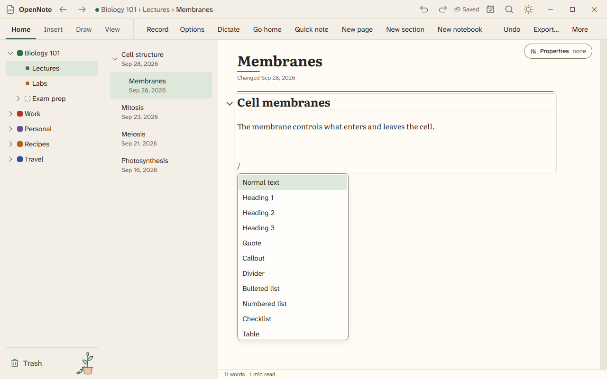

**formatting-bar.** The formatting bar over a selected sentence, with Bold, Italic, Highlight, Link, and More formatting. ([dark](screens/formatting-bar-dark.png))

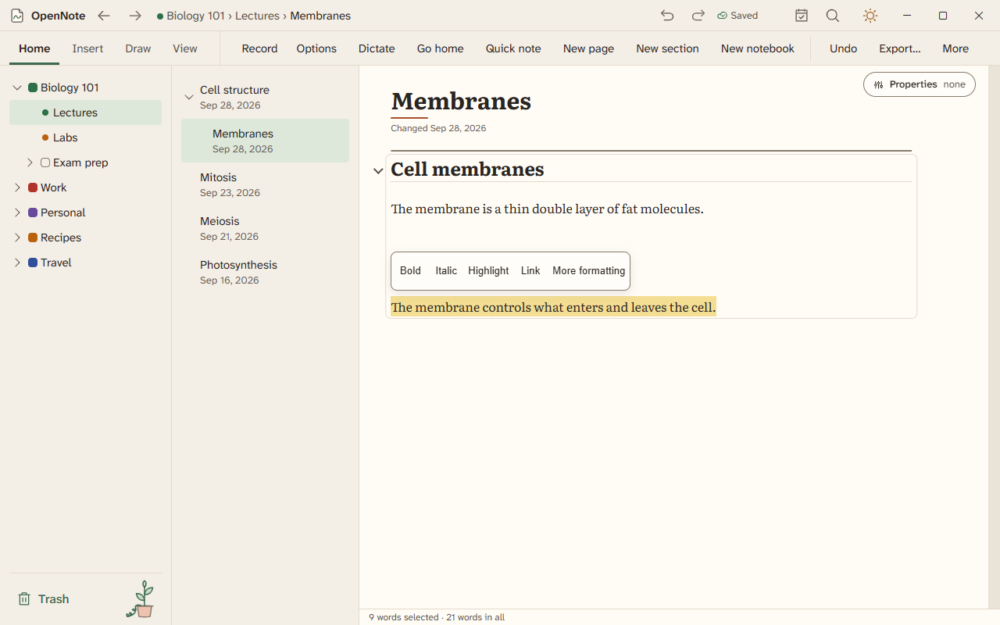

**block-callouts.** Note, tip, and warning callouts on a page, each with its own color and icon. ([dark](screens/block-callouts-dark.png))

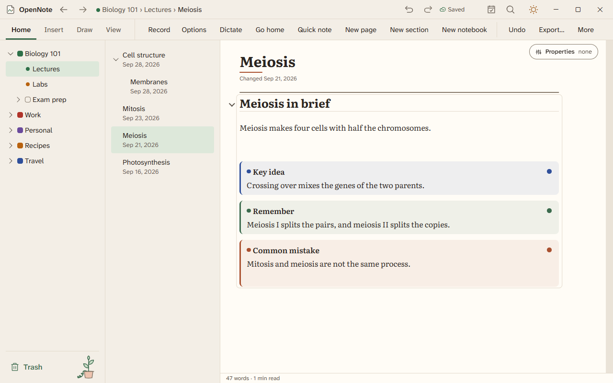

**block-code.** A code block with Python highlighting and its language label. ([dark](screens/block-code-dark.png))

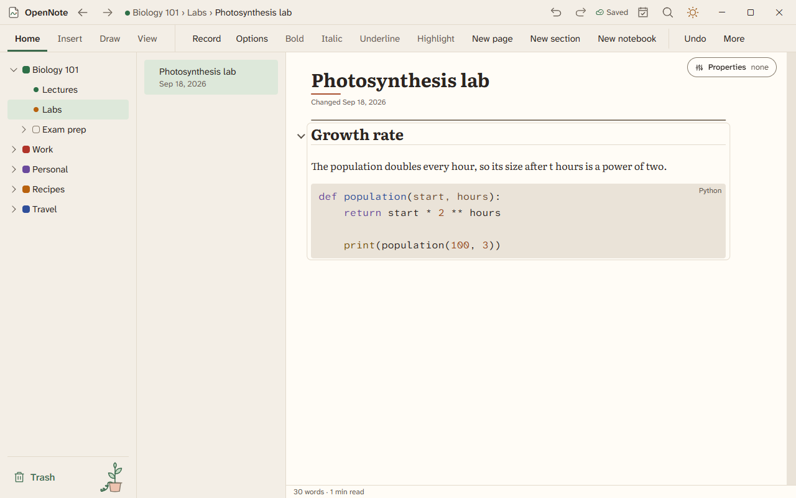

**lined-paper.** Typed notes on lined paper, with the text sitting on the rules. ([dark](screens/lined-paper-dark.png))

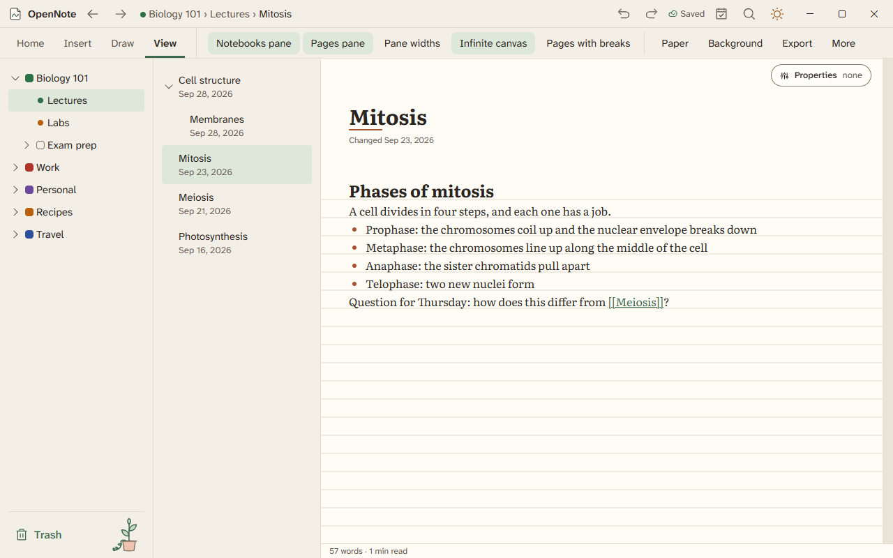

**insert-mind-map.** A mind map on a page, with a main idea and branches added under and beside it. ([dark](screens/insert-mind-map-dark.png))

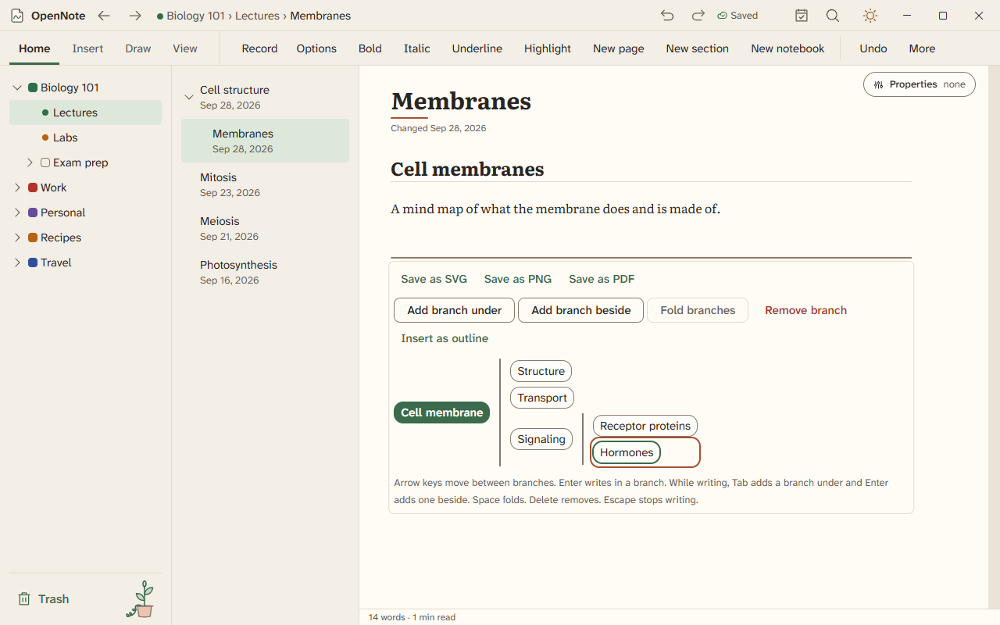

**insert-diagram.** A flowchart written as text, drawn below its source. ([dark](screens/insert-diagram-dark.png))

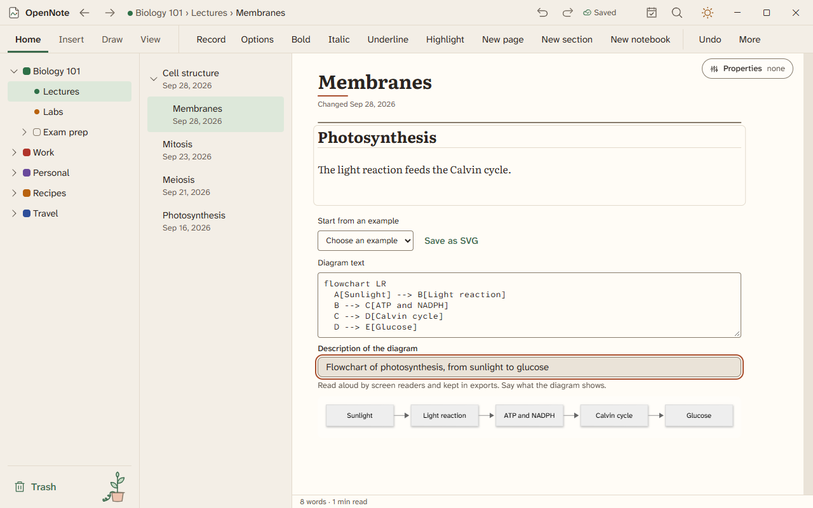

**code-cell.** A Python code cell that has run, with its output below the code. ([dark](screens/code-cell-dark.png))

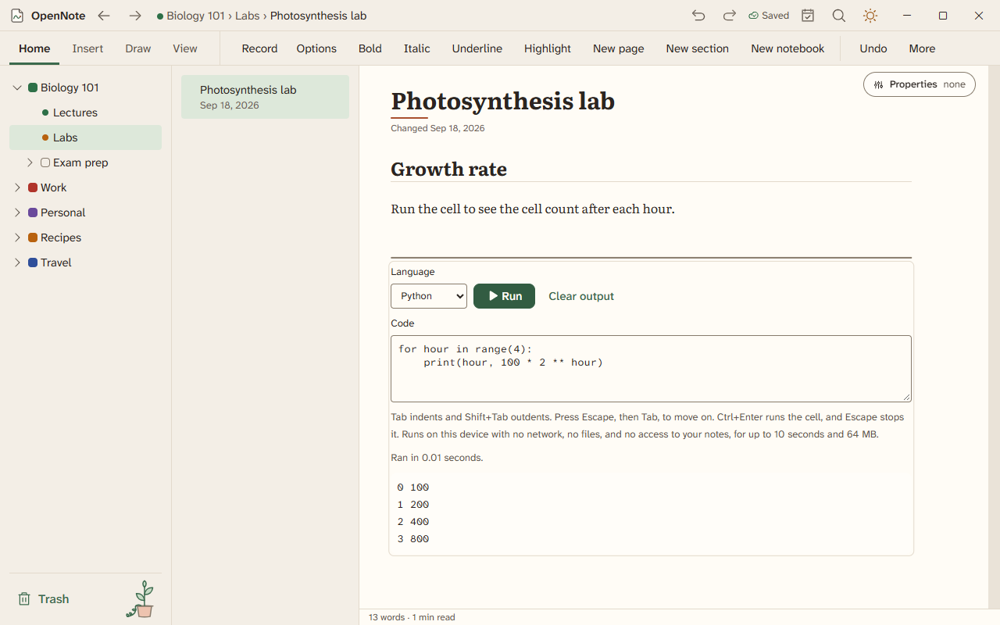

**page-templates.** The new page chooser with the Problem set, Cornell notes, and Lab report templates. ([dark](screens/page-templates-dark.png))

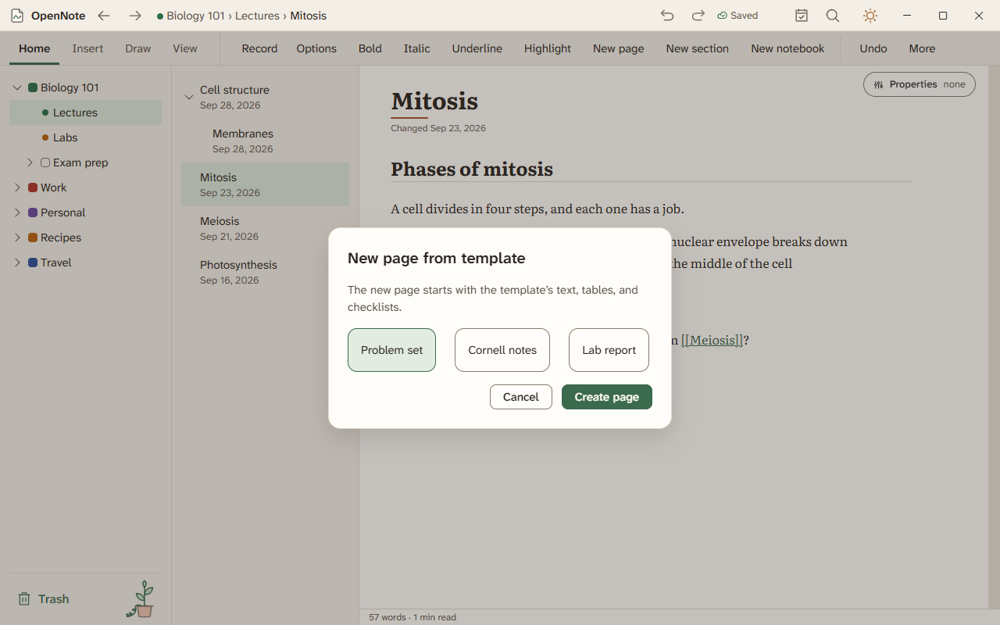

**page-history.** The page history panel with earlier versions and the compare view of one of them. ([dark](screens/page-history-dark.png))

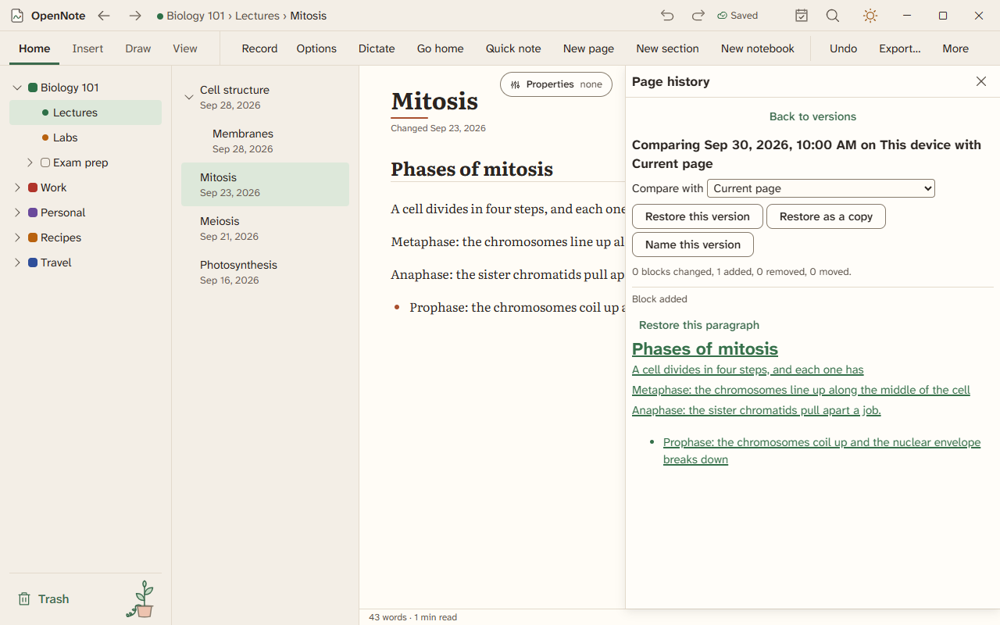

## Tables and charts

### Features

#### Smart tables and charts

- **Quick math.** Typing an expression such as `2.5*9.81=` and then Space adds the result, as in OneNote.
- **Draw a grid to make a table.** Draw a rough grid with the pen and choose "Snap shape" or "Convert to table".
- **Board, calendar, and gallery views.** A smart table can also show as a board, a calendar, a gallery of cards, or a timeline.
- **Diagrams from text.** A diagram block draws flowcharts, sequence diagrams, timelines, and class diagrams from a short text description in the Mermaid syntax, on the device.
- **Code cells.** A code cell runs a short Python or JavaScript program on the page and shows what it prints, with errors in red.
- **Mind maps.** Type an outline and see it as a mind map, or build the map with the keyboard or the pen, and the outline updates.
- **Shape libraries and text in shapes.** Shapes can hold text, and handwriting written inside a shape becomes its label when recognition is on (Phase 12).

### Commands

| Command | What it does | Default keys |
| --- | --- | --- |
| Calculated column… | Makes a column whose every row works out a formula from the row's own values. |  |
| Turn calculated column into values | Turns a calculated column into plain values. |  |
| Set column unit | Sets the unit of a table column and converts its values. |  |
| Show column in engineering notation | Shows the column's numbers in engineering notation. |  |
| Show column with SI prefixes | Shows the column's numbers with SI prefixes, such as k and m. |  |
| Show column in plain numbers | Shows the column's numbers as plain numbers. |  |
| Sort smallest first | Sorts the table by this column, smallest first. |  |
| Sort largest first | Sorts the table by this column, largest first. |  |
| Fill down | Copies the top cell of the selection down the column. | Ctrl+D |
| Fill right | Copies the left cell of the selection across the row. | Ctrl+R |
| Show rows equal to this cell | Shows only the rows whose value in this column equals this cell. |  |
| Show rows with something in this column | Shows only the rows with something in this column. |  |
| Clear filter | Shows every row again. |  |
| Automatic | Lets the column's format follow what is typed in it. |  |
| Number | Formats the column as numbers. |  |
| Currency | Formats the column as money. |  |
| Percent | Formats the column as percentages. |  |
| Date | Formats the column as dates. |  |
| More decimal places | Shows one more decimal place in the column. |  |
| Fewer decimal places | Shows one fewer decimal place in the column. |  |
| Save table view… | Saves the table's filters and sort as a view to come back to. |  |
| Show every row of the table | Shows every row of the table, without its saved view. |  |
| Choice, pick one | Makes the column a choice of one value from a list. |  |
| Choice, pick several | Makes the column a choice of several values from a list. |  |
| Choose a value… | Picks a value for the cell from the column's choices. | Alt+Down |
| Edit choices… | Edits the list of choices of the column. |  |
| Sum | Adds a total row with the sum of the column. |  |
| None | Removes the column's total. |  |
| Bar chart | Inserts a bar chart of the table. |  |
| Line chart | Inserts a line chart of the table. |  |
| Area chart | Inserts an area chart of the table. |  |
| Pie chart | Inserts a pie chart of the table. |  |
| Scatter chart | Inserts a scatter chart of the table. |  |
| Table: Summary statistics of the selection | Puts summary statistics of the selected cells, such as mean and median, on the page. |  |
| Table: Histogram of the selection | Puts a histogram of the selected cells on the page. |  |
| Table: Box plot of the selection | Puts a box plot of the selected cells on the page. |  |
| Table: Linear fit of the selection | Fits a line to the selected cells. |  |
| Table: Quadratic fit of the selection | Fits a quadratic to the selected cells. |  |
| Table: Cubic fit of the selection | Fits a cubic to the selected cells. |  |
| Table: Polynomial fit of the selection | Fits a polynomial of the degree you pick to the selected cells. |  |
| Table: Exponential fit of the selection | Fits an exponential to the selected cells. |  |
| Table: Matrix determinant | Finds the determinant of the selected matrix. |  |
| Table: Matrix inverse | Finds the inverse of the selected matrix. |  |
| Table: Matrix transpose | Finds the transpose of the selected matrix. |  |
| Table: Multiply the selected matrix by another range | Multiplies the selected matrix by another range of cells. |  |
| Table: Row reduce the selected matrix with steps | Row-reduces the selected matrix and shows each step. |  |
| Table: Matrix rank | Finds the rank of the selected matrix. |  |
| Table: Matrix eigenvalues | Finds the eigenvalues of the selected matrix. |  |
| Table: Solve the selected system Ax = b | Solves the system Ax = b from the selected cells. |  |
| Table: Linear fit of the selection as an equation | Fits a line to the selected cells and inserts it as an equation. |  |
| Table: Quadratic fit of the selection as an equation | Fits a quadratic to the selected cells and inserts it as an equation. |  |
| Table: Cubic fit of the selection as an equation | Fits a cubic to the selected cells and inserts it as an equation. |  |
| Table: Exponential fit of the selection as an equation | Fits an exponential to the selected cells and inserts it as an equation. |  |
| Table: Determinant of the selection as an equation | Inserts the determinant of the selected matrix as an equation. |  |
| Table: Inverse of the selection as an equation | Inserts the inverse of the selected matrix as an equation. |  |
| Table: Transpose of the selection as an equation | Inserts the transpose of the selected matrix as an equation. |  |
| Table: Row reduced form of the selection as an equation | Inserts the row-reduced form of the selected matrix as an equation. |  |
| Table: Rank of the selection as an equation | Inserts the rank of the selected matrix as an equation. |  |
| Table: Eigenvalues of the selection as an equation | Inserts the eigenvalues of the selected matrix as an equation. |  |
| Table: Solution of Ax = b as an equation | Inserts the solution of Ax = b from the selected cells as an equation. |  |
| Insert table | Inserts a table. |  |
| Add row above | Adds a row above the current one. |  |
| Add row below | Adds a row below the current one. | Ctrl+Enter |
| Move row up | Moves the current row up one place. | Alt+Shift+Up |
| Move row down | Moves the current row down one place. | Alt+Shift+Down |
| Add column left | Adds a column to the left of the current one. |  |
| Add column right | Adds a column to the right of the current one. |  |
| Header row | Turns the header row of the table on or off. |  |
| Delete row | Deletes the current row. |  |
| Delete column | Deletes the current column. |  |
| Column width… | Sets the width of the current column. |  |
| Select table | Selects the whole table. |  |
| Delete table | Deletes the whole table. |  |
| Fit row height to content | Makes the rows you picked as tall as their content. |  |
| Fit column width to content | Makes the columns you picked as wide as their longest text. |  |
| Distribute rows evenly | Gives the rows you picked the same height. |  |
| Distribute columns evenly | Gives the columns you picked the same width. |  |
| Hide rows | Hides the rows you picked and keeps their data. | Ctrl+9 |
| Unhide rows | Shows the hidden rows inside the rows you picked. | Ctrl+Shift+9 |
| Hide columns | Hides the columns you picked and keeps their data. | Ctrl+0 |
| Unhide columns | Shows the hidden columns inside the columns you picked. | Ctrl+Shift+0 |
| Freeze top row | Keeps the top row in view while the table scrolls. |  |
| Freeze first column | Keeps the first column in view while the table scrolls. |  |
| Freeze panes at this cell | Keeps the rows above and the columns left of this cell in view. |  |
| Unfreeze panes | Lets every row and column scroll again. |  |
| Group rows | Groups the rows you picked so they can collapse. | Alt+Shift+Right |
| Ungroup rows | Takes the rows you picked out of one level of grouping. | Alt+Shift+Left |
| Group columns | Groups the columns you picked so they can collapse. |  |
| Ungroup columns | Takes the columns you picked out of one level of grouping. |  |
| Clear row groups | Removes every row group and shows the hidden rows. |  |
| Clear column groups | Removes every column group and shows the hidden columns. |  |
| Insert cells, shift down | Inserts blank cells and moves the cells below them down. | Ctrl+Shift+= |
| Insert cells, shift right | Inserts blank cells and moves the cells beside them right. |  |
| Delete cells, shift up | Deletes the cells you picked and moves the cells below them up. | Ctrl+- |
| Delete cells, shift left | Deletes the cells you picked and moves the cells beside them left. |  |

### Pictures

**table-chart.** A smart table with its formula cell selected, showing =B2*0.6, and the bar chart made from it with its summary in words. ([dark](screens/table-chart-dark.png))

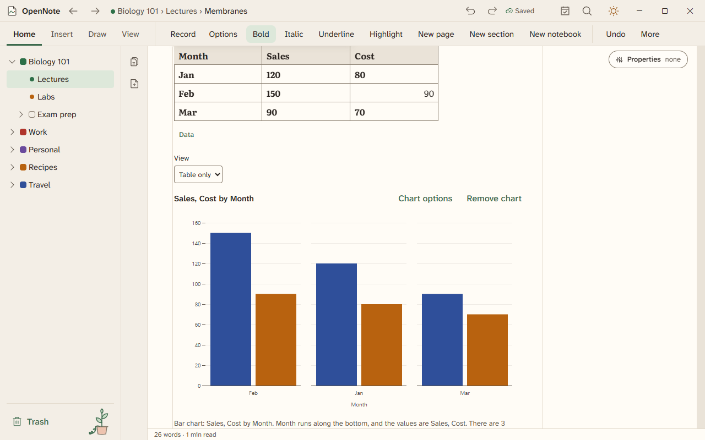

## Drawing and ink

### Features

#### Handwriting to text

- A "Writing pen" converts handwriting to typed text as the person writes, with the original ink kept one tap away.
- Math is recognized as math: subscripts, superscripts, fractions, roots, integrals, matrices, and Greek letters become editable equations.
- Special characters (°, ±, →, ≤, µ) and chemistry notation such as H₂O are kept.
- Unsure words are underlined; tapping one shows alternatives.
- Any existing ink can be converted later with the lasso.
- Handwriting and transcripts are read in the background so search finds them, and a hit is marked on the ink.

#### My handwriting

- A calibration page learns your own handwriting from the pen, letter by letter and then in sentences.
- The style stays on this device, encrypted under a key in Windows Credential Manager, and is never synced, exported, or logged.
- Uploads of the person's own handwriting (scans, photos, PDFs) add math and science symbols and layout habits once the calibration page is done.
- Math and science, an optional pen section, takes Greek letters, operators, arrows, accents, and brackets small and tall.
- Write in my handwriting turns selected typed text, and its math, into ordinary editable ink, which replaces the text or goes beside it.

#### Shapes and lines

- Draw a rough shape and hold still for half a second.
- Keep holding and move to resize or rotate it before lifting the pen.
- A held line or arrow works differently: keep holding and move, and its far end follows the pen, snapping to the paper's lines and crossings when snapping is on.
- Irregular shapes snap too: any closed outline of 4 to 7 corners becomes a clean polygon with a handle on each corner.
- Straight lines, arcs, curved arrows, and double arrows snap the same way.
- A curved arrow's head points along the arc at its tip, from the library, after a handle drag, and when recognized, at any zoom.
- Shapes keep editable handles, and connectors stay attached when shapes move.
- Editable curves (Beta): Make curve turns a line, arrow, connector, recognized shape, or freehand stroke into a curve of Bezier segments with a point at each join and two handles.

#### Ink

- **Palm rejection.** While a pen is near the screen, a resting palm never draws.
- **Insert space.** Drag a line across the page to push everything below it down, or drag up to close a gap.
- **Ink that stays with its text.** Underlines, circles, and margin notes drawn on typed text are anchored to the words they touch.
- **Zoom writing box.** A magnified strip docks at the bottom of the window.
- **Pen and touch gestures.** Scribbling over ink erases it, and circling content and then tapping inside it selects it.
- **Eraser and lasso filters.** The eraser can erase only highlighter, or only one pen type, and can switch back to the last tool when the pen lifts.
- **Pen buttons.** Settings choose what the pen's side button and eraser end do: lasso, an eraser type, highlighter, pan, or the right-click menu.
- **Pressure and steady pen.** Each pen device gets a pressure curve (soft, normal, firm, or custom, with a minimum width) and an optional stabilizer that smooths shaky strokes.
- **Pen hover preview.** When a pen hovers above the screen, a small circle shows where ink will land and how wide it will be.
- **Canvas lock.** A lock button in the toolbar stops the page from scrolling, zooming, or panning by touch, pen, or mouse wheel, so writing never moves the page.
- **Pen writing in text fields.** A pen can write straight into the search box, rename fields, and table cells, and the handwriting turns into text as the person writes.
- **Layers.** Ink, shapes, text, and images can sit on named layers, such as "Slide", "Notes", and "Teacher's marks".
- **Pen library.** The library adds a fountain pen, a brush, a calligraphy nib, and dashed and dotted line pens to the pens and pencil.

#### More

- Palm lab (Settings > Pen and touch, in Beta and dev builds) records your pen and hand for the palm test corpus.
- Pen library: fountain, brush, calligraphy, dashed, and dotted pens, and named pen sets you can save and switch between.
- Links on handwriting: lasso writing and choose Make link to open a page, a heading, a web address, or the recording at that moment.
- Ink layers: named layers you can hide, lock, rename, reorder, and export, and hidden layers stay out of print.
- Pen writing in text fields: with the setting on, the pen opens the Windows handwriting panel in the search box, rename fields, and table cells.
- Delegated ink trail: the browser's compositor draws a short trail behind the pen ahead of the page, where the system supports it.
- Smart select grows the lasso to include whole strokes, text boxes and images that it only partly touches, and trims empty margins.
- **Snap tools.** A ruler, protractor, and snap-to-grid for neat diagrams.
- **Measuring ruler, measure, and compass.** Drawing aids on the Draw tab, in the command list, and in the page's right-click menu.
- **Snap to paper lines.** On ruled, grid, and dot paper, lines, shapes, and shape handles snap to the lines the paper draws.
- **Links on handwriting.** Lasso handwriting and choose "Make link" to link it to a page, a heading, a web address, or a moment in a recording.

### Commands

| Command | What it does | Default keys |
| --- | --- | --- |
| Write in my handwriting | Writes the selected text as ink in your own handwriting. |  |
| Type as handwriting | Turns on typing that appears as your handwriting. |  |
| Canvas lock | Stops the page from scrolling or zooming while you write. | Ctrl+Alt+Shift+L |
| Pen hover circle | Shows a circle at the pen tip while the pen hovers above the screen. |  |
| Describe drawing | Adds a text description to a drawing, or marks it as decoration. |  |
| Insert space by height | Opens or closes space on the page and moves everything below it. |  |
| Ruler | Shows a ruler that straight ink follows. |  |
| Protractor | Shows a protractor for measuring and drawing angles. |  |
| Snap to grid | Snaps ink to a grid on plain paper. |  |
| Snap to paper lines | Snaps ink to the lines of ruled, grid, or dot paper. |  |
| Measure | Measures lengths and angles on the page. | Ctrl+Alt+Shift+R |
| Compass | Draws circles and arcs with a compass. | Ctrl+Alt+Shift+C |
| Measure the selected line | Shows the length of the selected line. |  |
| Units: automatic | Shows ruler units that follow your region. |  |
| Units: centimeters | Shows ruler units in centimeters. |  |
| Units: inches | Shows ruler units in inches. |  |
| Convert to table | Turns a hand-drawn grid into a table. |  |
| Shapes | Opens the shapes library so a shape can be placed on the page. |  |
| Add text to shape | Adds text inside the selected shape. |  |
| Make curve | Turns the selected stroke into a curve you can edit by its points. |  |
| Add curve point | Adds a point to the selected curve. |  |
| Remove curve point | Removes the selected point from a curve. |  |
| Smooth point | Makes the selected curve point smooth. |  |
| Corner point | Makes the selected curve point a corner. |  |
| Replay ink | Plays the ink back stroke by stroke, with the recording when there is one. |  |
| Strike through words to delete them | Turns on deleting typed words by striking through them with the pen. |  |
| Draw a line between words to add a space | Turns on adding a space by drawing a line between words. |  |
| Draw a long line between words to split the paragraph | Turns on splitting a paragraph by drawing a long line between words. |  |
| Circle words to select them | Turns on selecting typed words by circling them. |  |
| Write in a gap between words to insert text | Turns on inserting text by writing in a gap between words. |  |
| Writing pen | Picks the writing pen, which turns handwriting into typed text as you write. |  |
| Show written ink | Shows the ink that the writing pen faded after it typed the words. |  |
| Convert to text | Turns the selected handwriting into typed text beside it. |  |
| Straighten | Straightens the lines of the selected handwriting. |  |
| Even spacing | Evens out the space between the selected words. |  |
| Zoom writing box | Opens a large writing strip whose ink lands small on the page. | Ctrl+Alt+Shift+Z |
| Anchor to text | Ties the selected ink to the text under it, so it moves with the words. |  |
| Detach from text | Frees the selected ink from the text it was tied to. |  |
| Ink drawn on text follows the words | Turns on tying ink drawn on text to the words it touches. |  |
| Group | Groups the selected ink and objects so they move together. | Ctrl+G |
| Ungroup | Breaks the selected group apart. | Ctrl+Shift+G |
| Make link | Makes the selected handwriting a link to a page, a heading, a web address, or a recording. |  |
| Remove link | Removes the link from the selected handwriting. |  |
| Links on this page | Lists the links on handwriting on this page. |  |
| Layers | Opens the ink layers, which you can hide, lock, rename, and reorder. |  |
| Scribble to erase | Turns on erasing ink by scribbling over it. |  |
| Circle and tap to select | Turns on selecting ink by circling it and tapping. |  |
| Two-finger double tap to undo | Turns on undo with a two-finger double tap. |  |
| Three-finger double tap to redo | Turns on redo with a three-finger double tap. |  |
| Select and type | Picks the tool for selecting and typing. |  |
| Pen | Picks the pen. |  |
| Stroke eraser | Picks the eraser that removes whole strokes. |  |
| Partial eraser | Picks the eraser that removes only the part of a stroke it touches. |  |
| Lasso select | Picks the lasso, which selects ink by drawing around it. |  |
| Choose pen | Picks a pen from the Draw tab by number. |  |
| Pen color | Sets the color of the pen in use. |  |
| Pen width | Sets the width of the pen in use. |  |
| Ink to shape | Turns on snapping a held stroke into a clean shape. |  |

### Pictures

**ink-pens.** Ink on a page: a highlighter, three pens, and a pencil sketch (1600 by 900). ([dark](screens/ink-pens-dark.png))

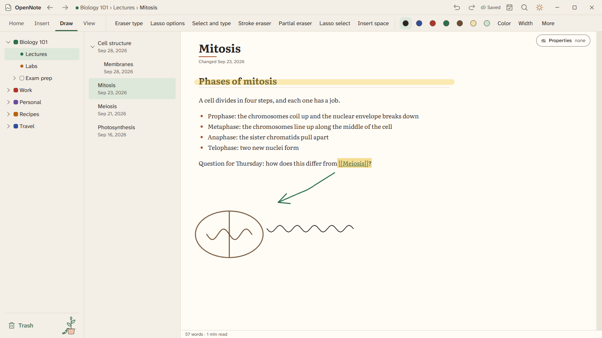

**ink-pen-types.** Lines drawn with the fountain pen, brush, calligraphy pen, dashed pen, and dotted pen. ([dark](screens/ink-pen-types-dark.png))

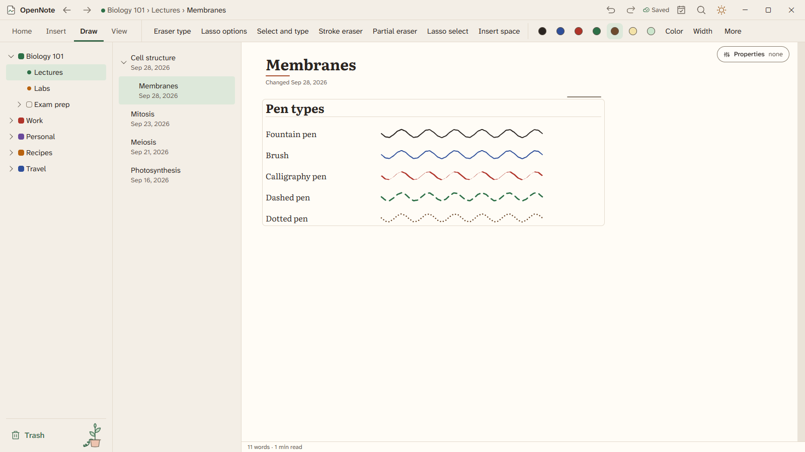

**ink-eraser.** The eraser options open on the Draw tab, with the stroke and partial erasers. ([dark](screens/ink-eraser-dark.png))

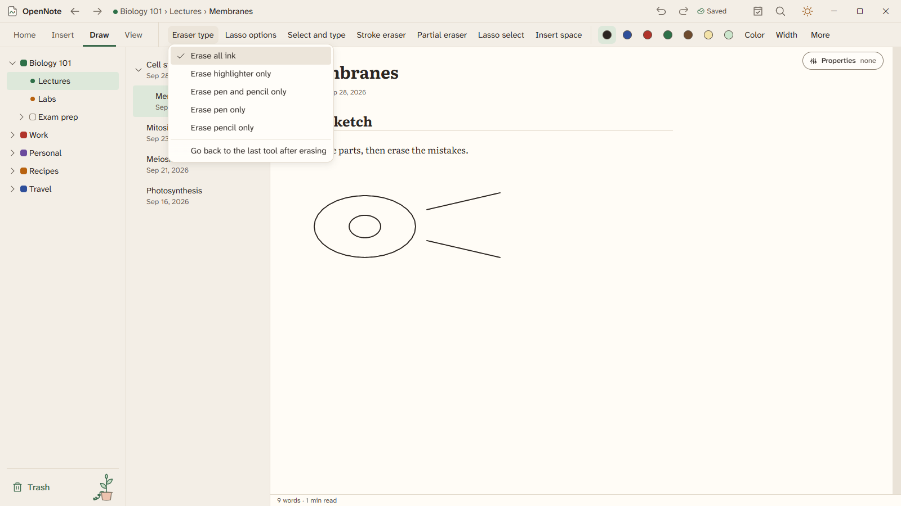

**ink-lasso.** Strokes chosen with the lasso, with the selection frame and the selection bar. ([dark](screens/ink-lasso-dark.png))

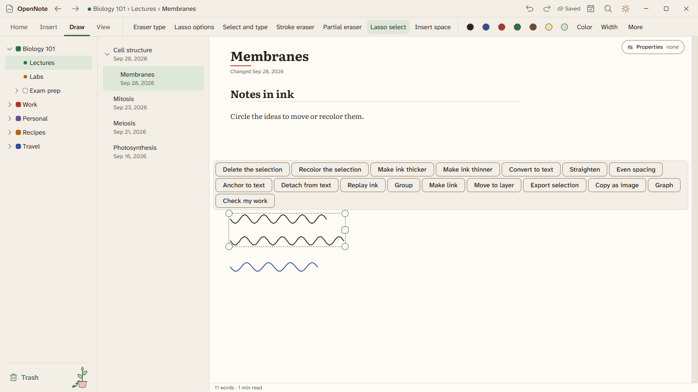

**ink-shapes.** Hand-drawn shapes snapped to a clean line, arrow, rectangle, and circle, with the Shapes menu open. ([dark](screens/ink-shapes-dark.png))

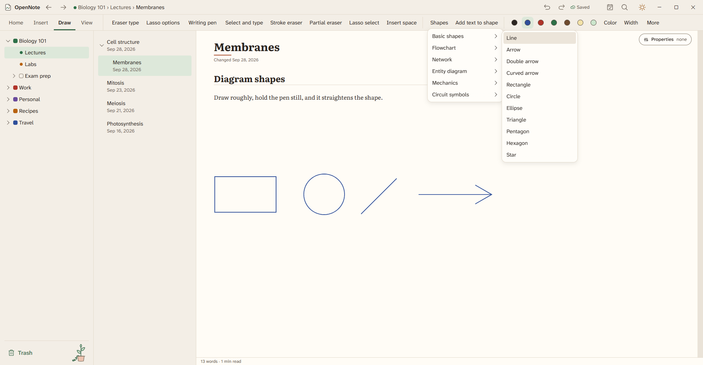

**ink-ruler.** The ruler and the protractor on a page, with a straight line drawn along the ruler. ([dark](screens/ink-ruler-dark.png))

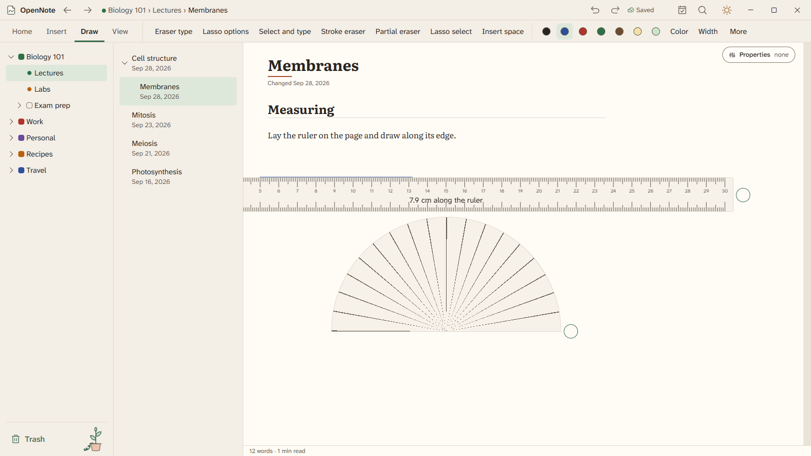

**ink-layers.** The Layers window with three layers, each with Make active, Hide, Lock, Move, Export, and Delete. ([dark](screens/ink-layers-dark.png))

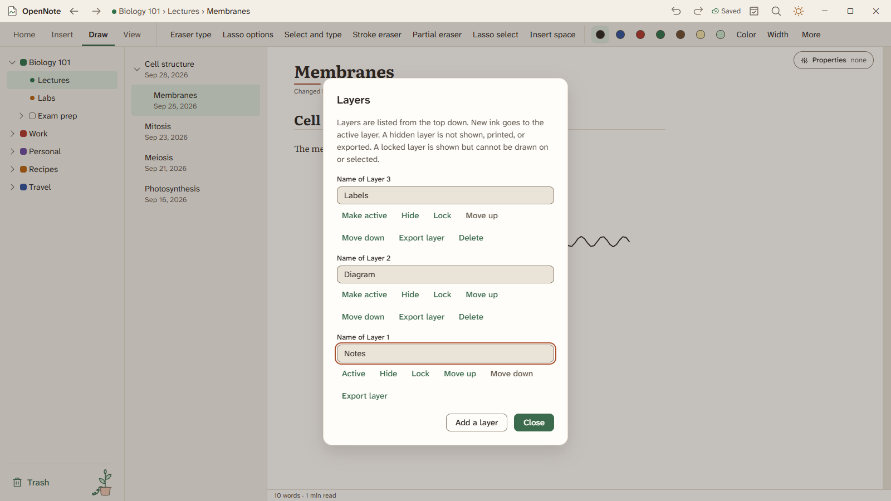

**ink-groups.** Two pen strokes lassoed and grouped, with the Ungroup button on the selection bar. ([dark](screens/ink-groups-dark.png))

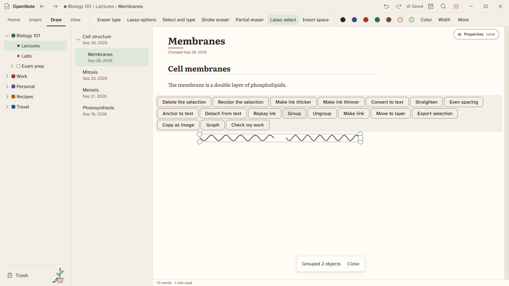

**ink-links.** The list of links on a page after a lassoed stroke was linked to a web address. ([dark](screens/ink-links-dark.png))

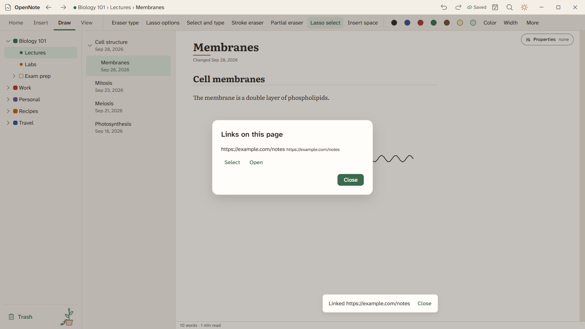

**settings-pen.** Pen and touch: the writing hand, drawing with a finger, steady pen, and the pressure curve. ([dark](screens/settings-pen-dark.png))

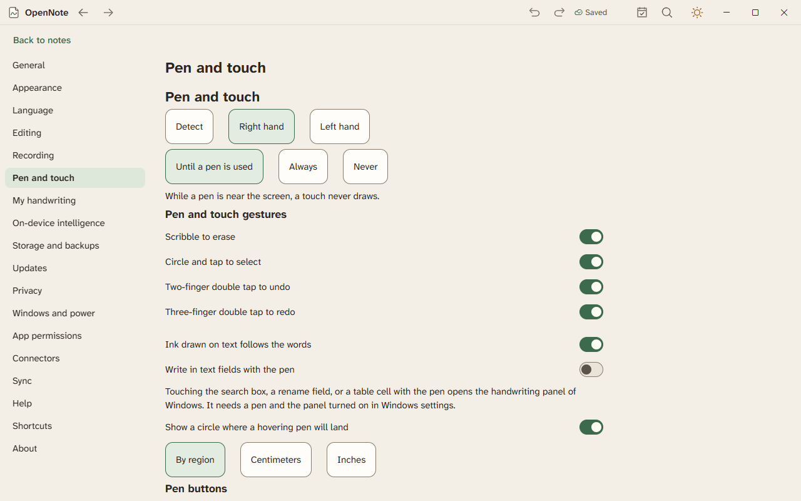

**settings-my-handwriting.** My handwriting: calibration and the symbols written in your own hand. ([dark](screens/settings-my-handwriting-dark.png))

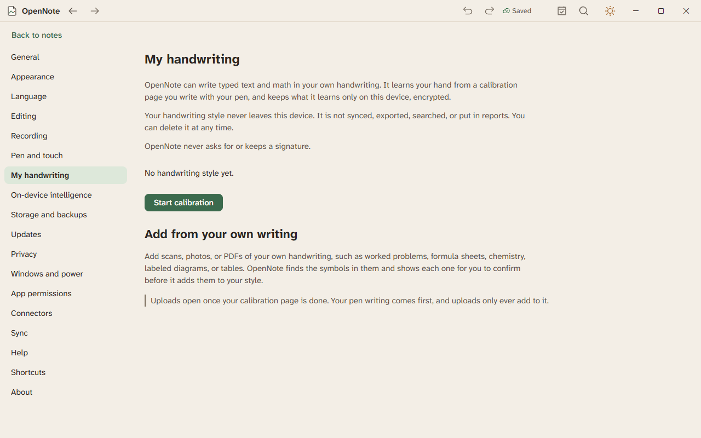

## Page views and printing

### Features

#### Page layouts

- Plain (no lines), infinite or paginated.
- Ruled: narrow (6 mm), college (7 mm), wide (8.7 mm) and custom.
- Grid: 5 mm, 1/4 in, 1 cm, and custom.
- Cornell notes, lab notebook, music staff, planner, and storyboard.
- Custom templates can be saved and shared.

#### Page views and export

- **Reading aids.** A reading view adds a line focus band, soft page tints, extra spacing, a maximum line width, and optional syllable breaks.
- **Sheet navigator.** In paginated view, a strip of sheet thumbnails and a "Go to sheet" command jump anywhere.
- **Accessible PDF export.** Exported PDFs include structure tags for headings, lists, tables, reading order, alt text, and language, so screen readers can follow them.
- **Math, graphs, and charts in PDF.** Equations print as text and shapes, a graph block as a vector drawing with its curves and axes, and the charts of a smart table right after the table.
- **Elements library.** Lasso ink, shapes, text, and images, and "Save as element" keeps them for reuse, such as a header, a signature, a labeled axis, or part of a flowchart.
- **Page gallery.** A gallery view of a section shows a thumbnail of every page with its title and date.
- **Slides from a page.** "Present as slides" splits a page at its headings or at divider lines and shows each part as a full-screen slide.

#### More

- **Export.** A whole notebook exports in one step, so data is never locked in.
- **Reading mode.** Locks the page against accidental edits and ink.
- **Presentation mode.** Full-screen pages with a laser pointer and ink that fades.
- **Page title on printouts.** Print and Export as PDF put the page title and its date at the top of the first sheet, on by default.
- **Print preview.** Shows exactly what prints, with page breaks.
- **Print to a printer.** Print (Ctrl+P) sends the page to a printer, with copies, both sides, black and white, a page range, and shrink to fit.

### Commands

| Command | What it does | Default keys |
| --- | --- | --- |
| Open the canvas | Opens a canvas board for cards, arrows, and diagrams. |  |
| Zoom page in | Zooms the page in. | Ctrl+Alt+= |
| Zoom page out | Zooms the page out. | Ctrl+Alt+- |
| Actual page size | Shows the page at its actual size. | Ctrl+Alt+0 |
| Fit page to width | Zooms the page to fit the width of the window. |  |
| Change page layout | Changes the page between the freeform canvas and a flowing column. |  |
| Switch between reading view and canvas | Switches the page between the reading view and the canvas. |  |
| Reading order | Opens the reading order pane, where you set the order a screen reader follows. |  |
| Lock page for reading | Locks the page for reading, so nothing on it changes by accident. | Ctrl+Alt+L |
| Turn typewriter scrolling on or off | Turns typewriter scrolling on or off, which keeps the caret line in the middle. |  |
| Show or hide the table of contents | Shows or hides the table of contents, made from the page's headings. | Ctrl+Alt+T |
| Print… | Prints the page. | Ctrl+P |
| Turn study tape into blanks when printing and exporting | Prints and exports study tape as blanks, so the page works as a worksheet. |  |
| Reading aids | Turns on reading aids, such as a focus line, a tint, wider spacing, and syllables. |  |
| Page gallery | Shows the section's pages as thumbnails in a grid, where you can reorder them. |  |
| Present as slides | Presents the page as full-screen slides. | F5 |
| Infinite canvas | Shows the page as one infinite canvas with no page breaks. |  |
| Pages with breaks | Shows the page as sheets of paper with page breaks. |  |
| Document flow | Lays the page out as a flowing document. |  |
| Free canvas | Lays the page out as a free canvas, where blocks go anywhere. |  |
| Fit page | Zooms so the whole sheet of paper fits in the window. |  |
| Letter | Sets the paper size to Letter. |  |
| A4 | Sets the paper size to A4. |  |
| A5 | Sets the paper size to A5. |  |
| Legal | Sets the paper size to Legal. |  |
| Tabloid | Sets the paper size to Tabloid. |  |
| Portrait | Turns the paper to portrait. |  |
| Landscape | Turns the paper to landscape. |  |
| Narrow margins | Sets narrow page margins. |  |
| Normal margins | Sets normal page margins. |  |
| Wide margins | Sets wide page margins. |  |
| Plain | Gives the page a plain background. |  |
| Lined, narrow | Gives the page narrow ruled lines. |  |
| Lined, college | Gives the page college ruled lines. |  |
| Lined, wide | Gives the page wide ruled lines. |  |
| Grid, 5 mm | Gives the page a 5 mm grid. |  |
| Grid, quarter inch | Gives the page a quarter-inch grid. |  |
| Grid, 1 cm | Gives the page a 1 cm grid. |  |
| Dot grid | Gives the page a dot grid. |  |
| Isometric | Gives the page an isometric grid. |  |
| Cornell notes | Gives the page the Cornell notes layout, with a cue column and a summary area. |  |
| Music staff | Gives the page music staff lines. |  |
| Margin line | Shows or hides the margin line on the page. |  |
| Paper (not in the palette) | Opens the menu of paper sizes, orientation, and margins. |  |
| Background (not in the palette) | Opens the menu of page backgrounds. |  |
| Lab notebook | Gives the page a lab notebook layout. |  |
| Planner | Gives the page a planner layout. |  |
| Storyboard | Gives the page a storyboard layout of frames. |  |
| Line spacing… | Sets the spacing of the lines, squares, or dots on the paper. |  |
| Layout templates… | Saves, applies, imports, and exports custom page layouts. |  |
| Use this layout for new pages in this notebook | Makes this page's layout the one new pages in the notebook get. |  |
| Stop using a layout for new pages in this notebook | Stops giving new pages in the notebook a set layout. |  |
| Sheet strip | Shows or hides a strip of sheet thumbnails beside the page. |  |
| Flip sheets one at a time | Shows one sheet at a time, like turning pages in a book. |  |
| Go to sheet… | Jumps to a sheet by its number. |  |
| Next sheet | Goes to the next sheet. | Alt+PageDown |
| Previous sheet | Goes to the previous sheet. | Alt+PageUp |
| Add a sheet | Adds a blank sheet to the end of the page. |  |
| Elements library… | Opens your saved elements, so you can place one on the page. |  |
| Save selection as element… | Saves the selection as an element you can place again later. |  |
| Copy selection as image | Copies the selection to the clipboard as a picture. |  |
| Present page with laser pointer | Presents the page full screen with a laser pointer. | Shift+F5 |

### Pictures

**canvas-view.** The canvas view, with pages and notes as cards joined by arrows. ([dark](screens/canvas-view-dark.png))

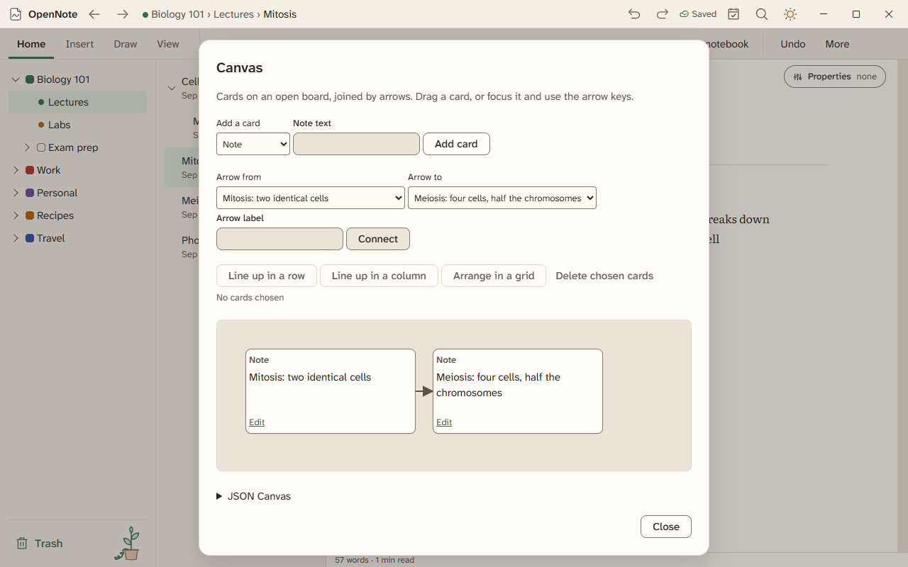

**print-preview.** The print preview of a page, with the paper size and margins beside it. ([dark](screens/print-preview-dark.png))

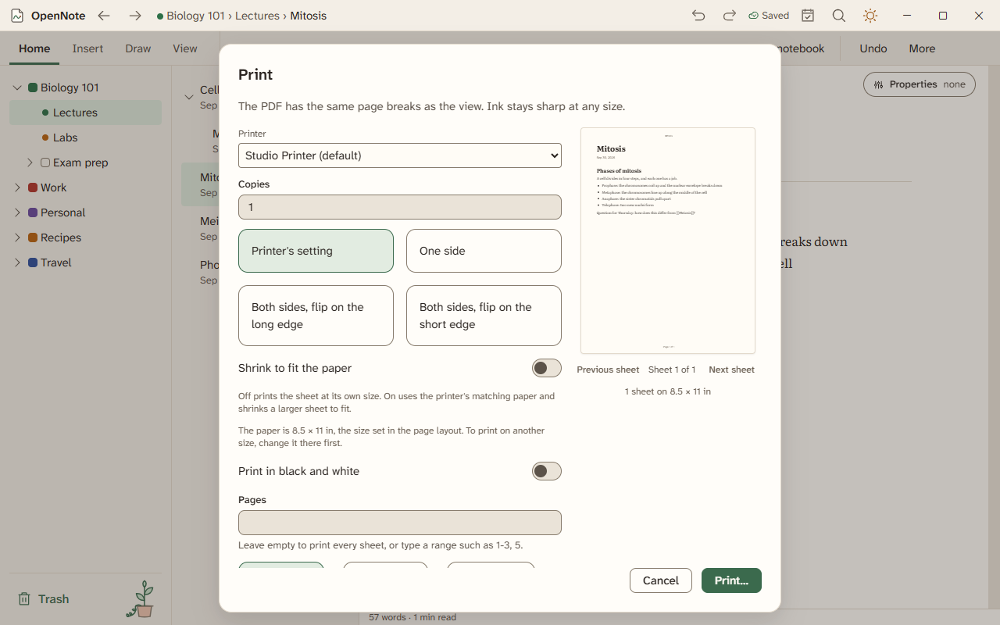

## Notebooks and navigation

### Features

#### Quality-of-life fixes

- **Versions and trash.** Page history, and a trash that keeps deleted items for 30 days.
- **Clean paste.** Pasting from the web keeps structure but drops stray fonts and colors.
- **Speed.** Large notebooks open lazily, and nothing freezes while syncing.
- **Content locks.** Text boxes and images can be locked in place.
- **Sections and pages.** Can be pinned, colored, sorted, and duplicated.
- **Tabs and windows.** Open several pages side by side in tabs or windows.
- **Offline.** Everything works offline, and conflicts are shown side by side, never silently overwritten.
- **Quick capture.** A global shortcut opens a small note window from anywhere in Windows.
- **Daily note.** One tap opens today's page, created from a template.
- **Focus mode.** Hides panes and toolbars; the page stays centered.
- **Word count and reading time.** Shown for the page or a selection.
- **Table of contents.** Built from headings, pinned to the side of long pages.
- **Recently closed.** Reopen closed pages and tabs with Ctrl+Shift+T.
- **Mini window.** Keep a page on top of other apps while watching a lecture or a video.
- **Remember position.** Each page reopens at the same scroll, zoom, and view.
- **Drag and drop.** Drop files, images, PDFs, and links from anywhere.
- **Reminders.** Due dates on checkboxes, with Windows notifications.

#### App shell and navigation

- **Subpages and section groups.** Pages can sit under a parent page, 2 levels deep as in OneNote, and fold away with it.
- **Back and forward.** Alt+Left, Alt+Right, the mouse side buttons, and toolbar arrows step through visited pages, including jumps from links and search.
- **Quick switcher.** Ctrl+O finds a page by name, with recent pages first.
- **Recent pages on small screens.** In the compact layout, More in the bottom bar lists the last few pages opened, newest first, above Settings.
- **Dock to a screen edge.** A command docks OpenNote to the left or right edge of the screen as a narrow column, and other windows resize to leave room.
- **Select several pages.** Ctrl-click and Shift-click select several pages or sections in the tree.

#### Document model and storage

- **Automatic saving and crash recovery.** Every edit is written to a journal file as you make it, and the title bar says Saved only once the change is on disk.
- **Scheduled backups.** Copies notebooks on a schedule, from hourly to weekly, to a folder the person picks, such as a USB drive or a second disk.
- **Edits from other apps.** OpenNote watches the notes folder and reloads pages that other programs change, such as Git, Syncthing, or a script.
- **Notes in OneDrive or Dropbox.** Setup and Settings notice when the notes folder is inside OneDrive, Dropbox, iCloud Drive, or Google Drive.
- **Open a notebook from any folder.** "Open folder" opens a notebook that lives anywhere: another drive, a USB stick, a network share, or a folder in a Git repository.
- **Check notebook.** Scans a notebook for damaged files, missing images and recordings, broken links, and pages whose readable copy doesn't match the page data.
- **Open-source notices.** Settings, then About, has a section with the copyright lines and license text of the bundled fonts (Atkinson Hyperlegible, Literata), as the SIL Open Font License asks.

### Title bar

- **Back.** Goes back to the page or screen you had open before.
- **Forward.** Goes forward again after Back.
- **Breadcrumb.** Shows the notebook, section, and page you are on.
- **Undo.** Undoes the last change.
- **Redo.** Redoes the change you undid last.
- **Save status.** Says Saving until an edit is written and Saved once it is, or Couldn't save, Offline, or Not responding. Choose Couldn't save to see why, then Retry or Copy text.
- **Sync.** Says Synced, Syncing, Sync paused, Sync waiting, or Sync stopped, and opens sync.
- **Working offline.** Shows that OpenNote makes no network requests right now.
- **Recording.** Shows a recording and its time, and opens the recording controls.
- **Timers.** Shows a running timer and its time left, and opens the Timers window.
- **Safe mode.** Shows that OpenNote started in safe mode, with some extras off.
- **Today.** Opens today's daily note.
- **Search.** Opens search across your notebooks.
- **Update.** Says Update available or Update ready, and opens the details.
- **Theme.** Switches between the light and dark themes.

### Commands

| Command | What it does | Default keys |
| --- | --- | --- |
| Open collections | Opens saved collections of pages, shown as tables, boards, or galleries. |  |
| Open today's note | Opens today's note, and makes it from its template if it is new. |  |
| Open the daily notes calendar | Opens a calendar of your daily, weekly, monthly, and yearly notes. |  |
| Notebooks pane | Shows or hides the notebooks pane. | Ctrl+Shift+1 |
| Pages pane | Shows or hides the pages pane. | Ctrl+Shift+2 |
| Widen the notebooks pane | Makes the notebooks pane wider. |  |
| Narrow the notebooks pane | Makes the notebooks pane narrower. |  |
| Reset the notebooks pane width | Puts the notebooks pane back to its default width. |  |
| Collapse the notebooks pane | Collapses the notebooks pane to a thin strip. |  |
| Expand the notebooks pane | Expands the collapsed notebooks pane. |  |
| Widen the pages pane | Makes the pages pane wider. |  |
| Narrow the pages pane | Makes the pages pane narrower. |  |
| Reset the pages pane width | Puts the pages pane back to its default width. |  |
| Collapse the pages pane | Collapses the pages pane to a thin strip. |  |
| Expand the pages pane | Expands the collapsed pages pane. |  |
| Pane widths (not in the palette) | Sets the widths of the notebooks and pages panes. |  |
| Go to the next region (not in the palette) | Moves the keyboard focus to the next region of the window. | F6 |
| Go to the previous region (not in the palette) | Moves the keyboard focus to the previous region of the window. | Shift+F6 |
| Go back | Goes back to the page you were on before. | Alt+Left |
| Go forward | Goes forward again after going back. | Alt+Right |
| Reveal in tree | Shows the current page in the notebooks and pages panes. |  |
| Minimize the window | Minimizes the OpenNote window. |  |
| Maximize or restore the window | Maximizes the window, or restores it to its size. |  |
| Close OpenNote | Closes OpenNote. |  |
| Open the window menu | Opens the window menu, with Move, Size, and Close. | Alt+Space |
| Reset tool windows | Puts every tool window back at its default size and place. |  |
| Insert a live collection | Inserts a live list, table, board, or gallery of pages that match your rules. |  |
| Delete section history | Deletes the saved older versions of every page in the section. |  |
| Delete notebook history | Deletes the saved older versions of every page in the notebook. |  |
| Page history | Opens the page's history to see, compare, and restore older versions. |  |
| Compare with another version | Compares this version of the page with another one. |  |
| Name this version | Gives this version of the page a name, so it is easy to find. |  |
| Delete page history | Deletes the saved older versions of this page. |  |
| Next change | Jumps to the next change between the two versions. | F8 |
| Previous change | Jumps to the previous change between the two versions. | Shift+F8 |
| Extract selection to a new page | Moves the selection to a new page and leaves a link to it. |  |
| Merge pages | Merges the selected pages into one page, each under its own heading. |  |
| Split page at headings | Splits the page into separate pages at its headings. |  |
| Open command palette (not in the palette) | Opens the command palette to find and run any command. | Ctrl+K |
| Go to a page | Finds a page by name and opens it. | Ctrl+O |
| Pin page | Pins the page to the top of the pages pane. |  |
| Unpin page | Unpins the page. |  |
| Pin section | Pins the section to the top of its notebook. |  |
| Unpin section | Unpins the section. |  |
| Duplicate | Makes a copy of the selected page or section. |  |
| Copy to | Copies the selected item to another section or notebook. |  |
| Sort (not in the palette) | Sorts the pages of the section. |  |
| Sort by title | Sorts the pages by title. |  |
| Sort by date created | Sorts the pages by the date they were made. |  |
| Sort by date modified | Sorts the pages by the date they last changed. |  |
| Archive | Archives the item, which hides it without deleting it. |  |
| Restore from archive | Brings an archived item back. |  |
| Show archived | Shows or hides archived items. |  |
| Open in new tab | Opens the page in a new tab. | Ctrl+Enter |
| Duplicate tab | Opens the current page again in a second tab. |  |
| Close tab | Closes the current tab. | Ctrl+W |
| Go to the next tab | Goes to the next tab. | Ctrl+Tab, Ctrl+PageDown |
| Go to the previous tab | Goes to the previous tab. | Ctrl+Shift+Tab, Ctrl+PageUp |
| Reopen closed tab | Opens the tab you closed last. | Ctrl+Shift+T |
| Open in new window | Opens the page in a new window. |  |
| Focus mode | Hides the panes and bars so only the page shows. | F11 |
| Keep on top | Keeps the OpenNote window on top of other windows. |  |
| Dock to the left edge | Docks OpenNote to the left edge of the screen. |  |
| Dock to the right edge | Docks OpenNote to the right edge of the screen. |  |
| Quick note | Opens a small quick note window to jot something down. |  |
| Go home | Goes to the Home page. |  |
| Open a notebook from a folder | Opens a notebook that is kept in a folder on your computer. |  |
| Check notebook | Checks the notebook's files for problems and repairs them. |  |
| Back up now | Backs up your notebooks now. |  |
| Create shortcut | Makes a shortcut that opens the selected item in OpenNote. |  |
| Open Trash | Opens the Trash, where deleted items wait. |  |
| Restore (not in the palette) | Puts the selected item back where it was. |  |
| Empty Trash | Deletes everything in the Trash forever. |  |
| Delete forever (not in the palette) | Deletes the selected item in the Trash forever. |  |
| New notebook | Makes a new notebook. |  |
| New section group | Makes a new section group to hold sections. |  |
| New section | Makes a new section. | Ctrl+T |
| New page | Makes a new page in the section. | Ctrl+N |
| New subpage | Makes a new subpage under the current page. | Ctrl+Alt+Shift+N |
| Move up (not in the palette) | Moves the selected item up in its list. | Ctrl+Shift+Up |
| Move down (not in the palette) | Moves the selected item down in its list. | Ctrl+Shift+Down |
| Make subpage | Makes the page a subpage of the page above it. | Ctrl+Shift+Right, Ctrl+Alt+] |
| Promote | Moves the subpage out one level. | Ctrl+Shift+Left, Ctrl+Alt+[ |
| Rename | Renames the selected item. | F2 |
| Color (not in the palette) | Sets the color of the selected notebook or section. |  |
| Move to | Moves the selected item to another section or notebook. | Ctrl+Shift+M |
| Delete | Moves the selected item to the Trash. | Delete |

### Pictures

**workspace.** Notebooks, pages, and a page of typed notes with a heading, a list, and a page link. ([dark](screens/workspace-dark.png))

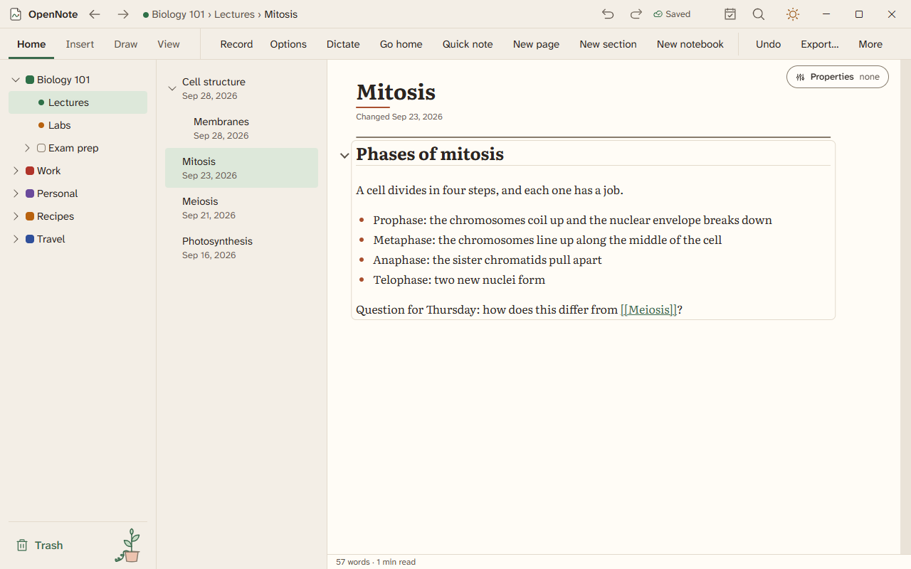

**workspace-empty.** The empty state: no notebooks yet, and an open book and candle on the page card. ([dark](screens/workspace-empty-dark.png))

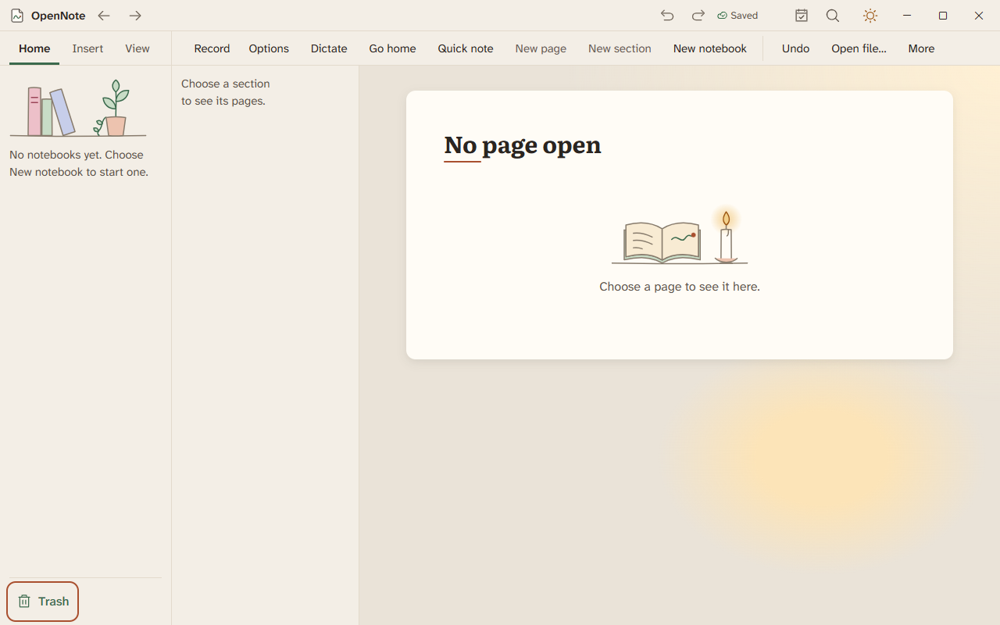

**home-screen.** The Home screen with recent pages, pinned pages, and what is coming up. ([dark](screens/home-screen-dark.png))

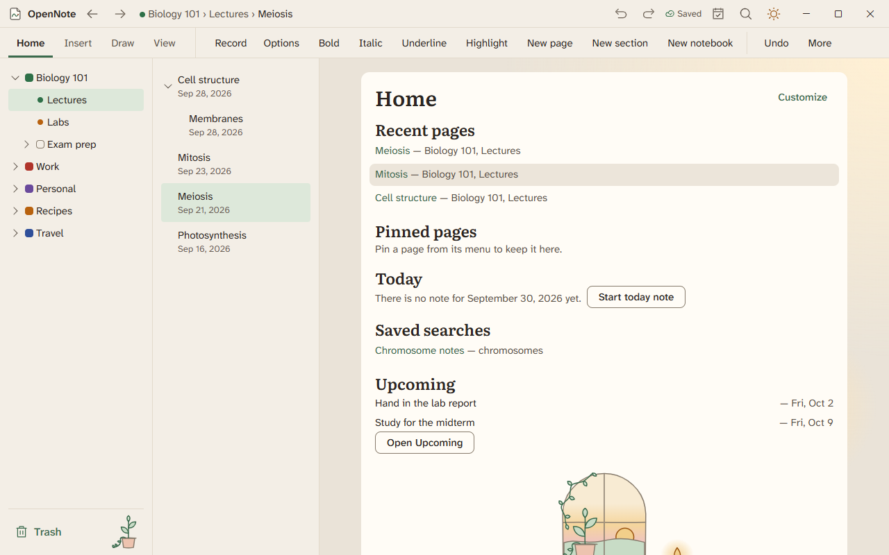

**title-bar-states.** The title bar with back and forward, the page path, the save status, and a running timer chip. ([dark](screens/title-bar-states-dark.png))

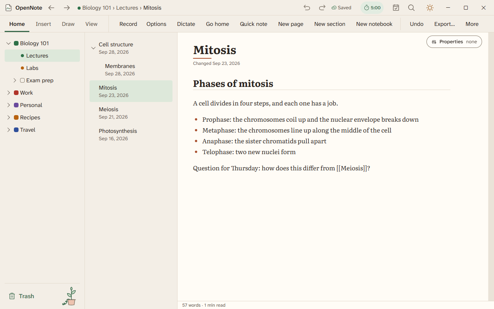

**page-tabs.** Three pages open as tabs in the strip above the page. ([dark](screens/page-tabs-dark.png))

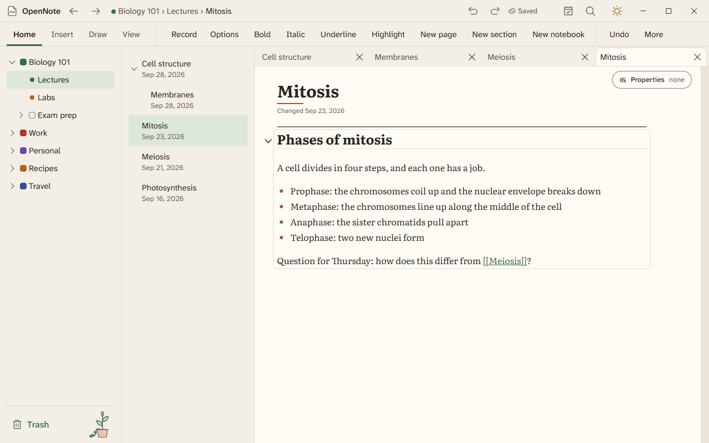

**compact-layout.** The compact layout of a narrow window, with the app bar and one pane at a time. ([dark](screens/compact-layout-dark.png))

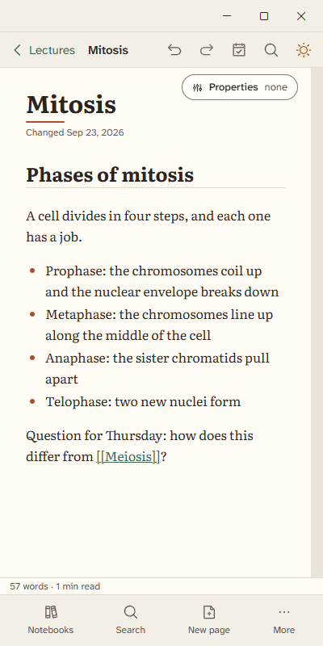

**focus-mode.** Focus mode, with the panes and the command bar hidden around the page. ([dark](screens/focus-mode-dark.png))

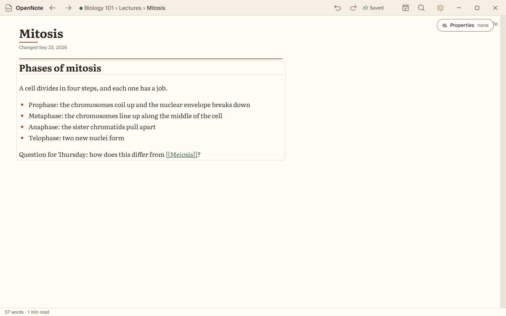

**quick-capture.** The Quick note window, which saves a note in Quick notes. ([dark](screens/quick-capture-dark.png))

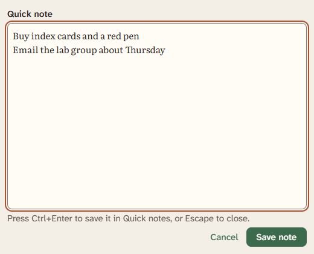

**tab-home.** The Home tab with the recording control and the formatting bar. ([dark](screens/tab-home-dark.png))

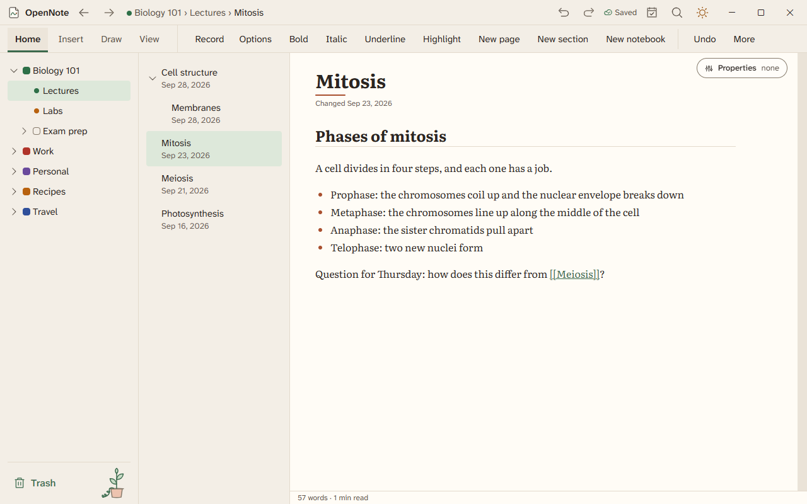

**tab-insert.** The Insert tab, with buttons for the chemistry, structure, materials, and economics tools, then Link, Insert table, and More. ([dark](screens/tab-insert-dark.png))

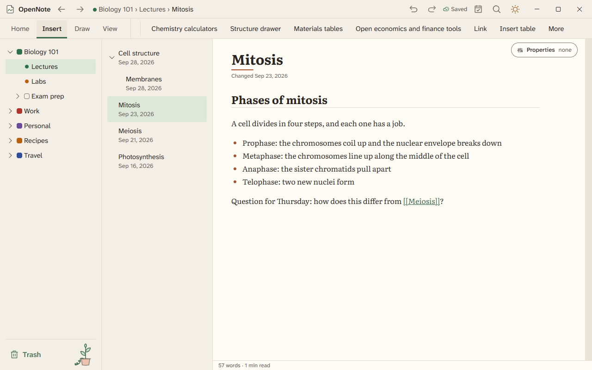

**tab-draw.** The Draw tab: the tools, the pen slots, color, and width (1600 by 900). ([dark](screens/tab-draw-dark.png))

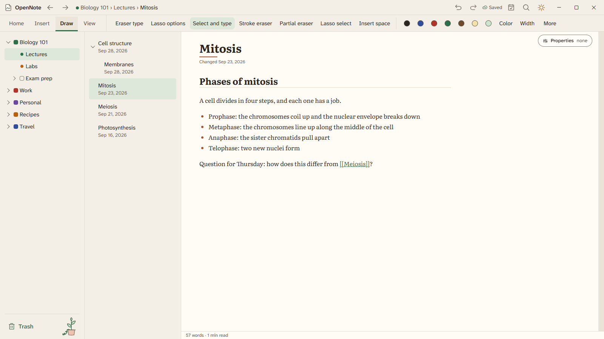

**tab-view.** The View tab: panes, page layout, paper, background, and focus mode. ([dark](screens/tab-view-dark.png))

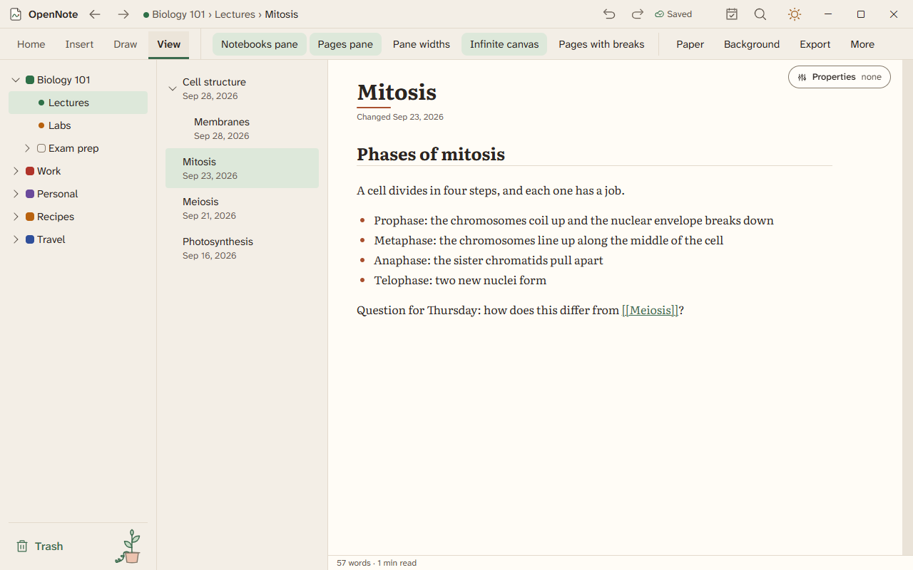

**collections.** A live collection of pages shown as a board, grouped by status. ([dark](screens/collections-dark.png))

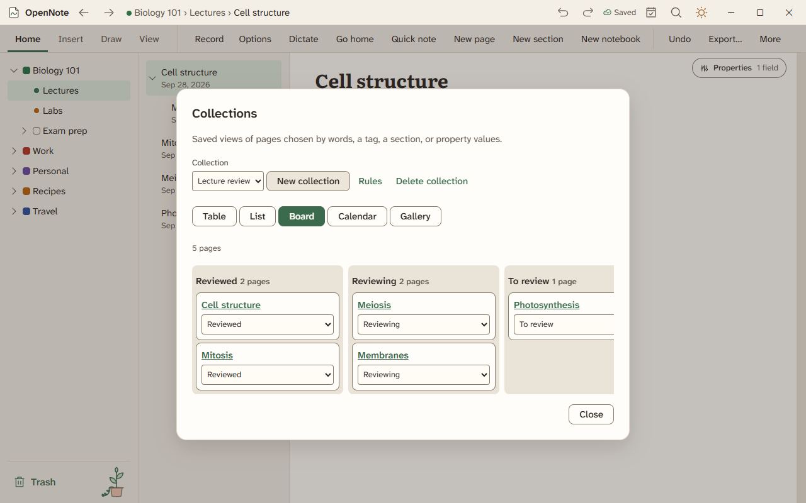

**daily-calendar.** The daily notes calendar, with today marked and buttons for the day, week, month, and year notes. ([dark](screens/daily-calendar-dark.png))

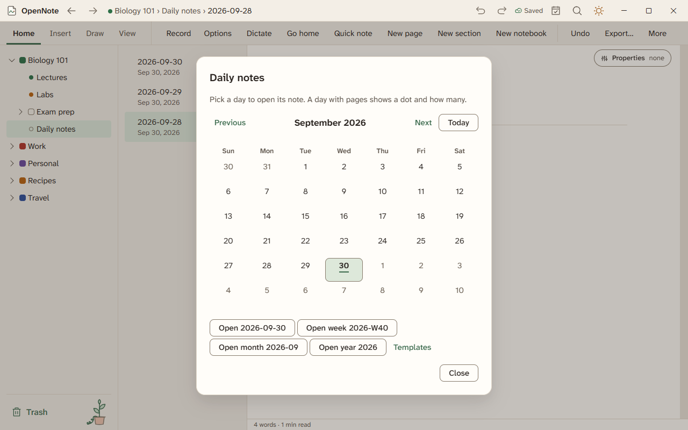

**trash.** Trash with two deleted pages and a Restore button for each. ([dark](screens/trash-dark.png))

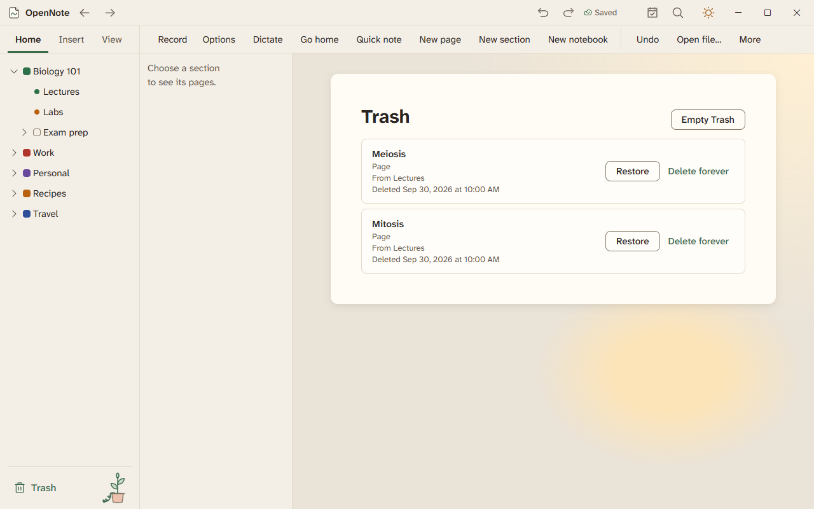

**palette.** The command palette over a page, with pages and commands. ([dark](screens/palette-dark.png))

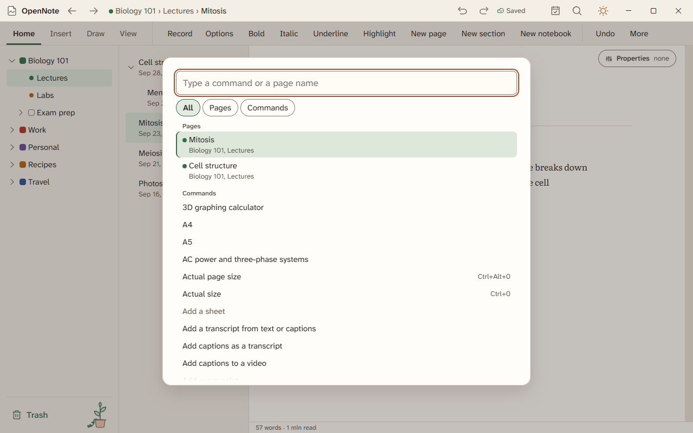

## Search and links

### Features

#### Pages and search additions

- **Attachment Save a copy and thumbnails.** Right-click an attachment, or press Ctrl+K and choose "Save a copy of the attachment", to save the file through the Windows Save dialog.
- **Crop fields in Size and position.** Size and position on a picture also shows how much to cut from each side, in percent, and Reset crop.
- **Pin sections and color pages.** Right-click a section and choose Pin section to keep it above the others in its notebook, and Unpin section to let it sort again.
- **Elements library: move and organize.** In the Elements library, Move puts an element or a folder in any folder, and Rename renames a folder.
- **Links, search, and read aloud open folds.** Links, search results, tags, Find, read aloud, and Undo open the folded heading or list item that hides their target.
- **Statistics, regression, and matrix tools for tables.** Data, Analyze (or Ctrl+K, "Table:") works from the selected cells, or the whole table.
- **Choice columns in smart tables.** Data, Format, then the format "Choice, pick one" or "Choice, pick several" makes a column a list of named, colored choices, starting from the values it already holds.
- **Saved views of a smart table.** Data, Saved views keeps a table's filters and sort under a name.

#### Search and linking

- **Line tags and tag summary.** Ctrl+1 to Ctrl+9 tag any paragraph or list item as To do, Important, Question, Idea, or a custom tag.
- **Links to paragraphs.** "Copy link" works on any page, heading, or paragraph, and `[[Page#Heading]]` autocompletes headings.
- **Link previews.** Hovering over or focusing an internal link shows a small card with the target's first lines, heading, or paragraph.
- **Unlinked mentions.** The backlinks pane has a second list of pages that mention this page's title without linking to it.
- **Tag renaming.** Rename, merge, or delete a tag everywhere, including nested tags such as `school/biology`.
- **Extract and merge pages.** "Extract to new page" moves the selected text, ink, or blocks into a new page and leaves a link in their place.
- **Daily notes calendar.** A small month calendar opens the daily note for any day.
- **Series pages.** A series groups pages that repeat, such as a weekly meeting or a lab log.
- **Page properties.** Fields on a page, such as status, due date, course, author, rating, and a link to another page.
- **Collections.** A collection is a saved view of pages chosen by a search, a tag, a section, or property values, such as "open assignments for Bio 201, grouped by due week".
- **Page embeds.** Typing `![[` and choosing a page, a heading, or a paragraph shows it live inside another page.
- **Graph view.** Shows pages as dots and links as lines, for a whole notebook or for the pages within 1 to 3 links of the open one.
- **Canvas of cards.** A canvas is an open board of cards: pages, typed notes, images, PDFs, web addresses, and groups, joined by labeled arrows.
- **Advanced search.** Search understands "exact phrases", AND, OR, NOT, a minus sign to leave a word out, and a regular expression mode.
- **Archive.** "Archive" hides finished pages, sections, and notebooks from the tree.
- **Page shortcuts and jump list.** "Create shortcut" makes a Windows shortcut that opens a page, a section, or a notebook, and you can pin it to the taskbar.
- **Home page.** A start page shows recent pages, pinned pages, today's note, saved searches, and the Upcoming list, in plain sections the person can reorder or hide.

#### More

- **Links.** Internal links survive renames and moves.
- **Find and replace.** Works on one page or a whole notebook, including recognized handwriting, and one Undo puts back a notebook-wide replace.
- **Typed #hashtags.** Typing `#word` and a space or punctuation makes it a tag of the page, listed in the Tags pane and found by `tag:` search.
- **Copy text from images.** Select text inside any image or scanned PDF.

### Commands

| Command | What it does | Default keys |
| --- | --- | --- |
| Open the graph view | Opens the graph view of your pages and the links between them. | Ctrl+Alt+Shift+G |
| Find on page | Finds text on the page, and replaces it. | Ctrl+F |
| Find and replace on page | Finds text on the page and replaces it with other text. | Ctrl+H |
| Copy link to this page | Copies a link to this page to paste anywhere. |  |
| Copy link to this paragraph | Copies a link to this paragraph. |  |
| Tag as To do | Tags the line as To Do, with a check box. |  |
| Tag as Important | Tags the line as Important. |  |
| Tag as Question | Tags the line as a Question. |  |
| Tag as Idea | Tags the line as an Idea. |  |
| Tag as Remember for later | Tags the line as Remember for later. |  |
| Tag as Definition | Tags the line as a Definition. |  |
| Tag as Highlight | Tags the line as a Highlight. |  |
| Tag as Contact | Tags the line as a Contact. |  |
| Tag as Phone number | Tags the line as a Phone number. |  |
| Tag this line | Picks a tag for this line. |  |
| Show tagged lines | Lists the tagged lines, such as to-dos and questions, with their pages. |  |
| Replace in all notebooks | Finds text in every notebook and replaces it. | Ctrl+Alt+H |
| Search notes | Searches the text of all your notes. | Ctrl+Shift+F |
| Show linked pages | Shows the pages that link to this page. | Ctrl+Alt+G |
| Manage tags | Renames, merges, and deletes tags. |  |
| Link to a page | Inserts a link to another page, as with double brackets. | Ctrl+Alt+K |
| Open the linked page | Opens the page that the link at the caret points to. | Ctrl+Alt+Enter |
| Preview the linked page | Shows a preview card of the linked page. | Ctrl+Alt+P |
| Rebuild the search index | Rebuilds the search index if search seems wrong. |  |

### Pictures

**search.** The search panel with a result, the matched word in bold, and a preview. ([dark](screens/search-dark.png))

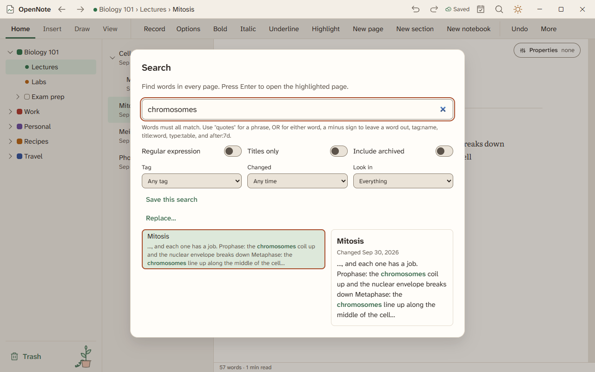

**find-replace.** Find and replace on the page, with every match highlighted. ([dark](screens/find-replace-dark.png))

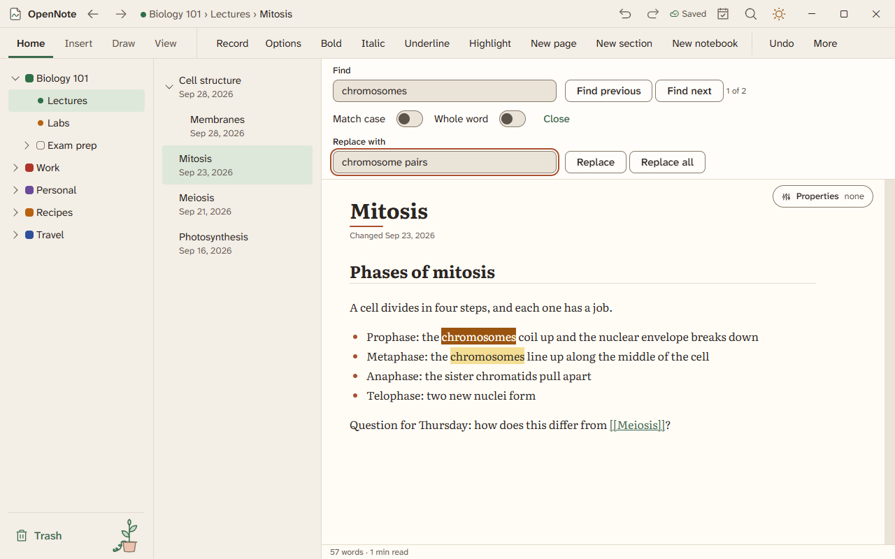

**backlinks.** The linked pages pane, listing the page that links here. ([dark](screens/backlinks-dark.png))

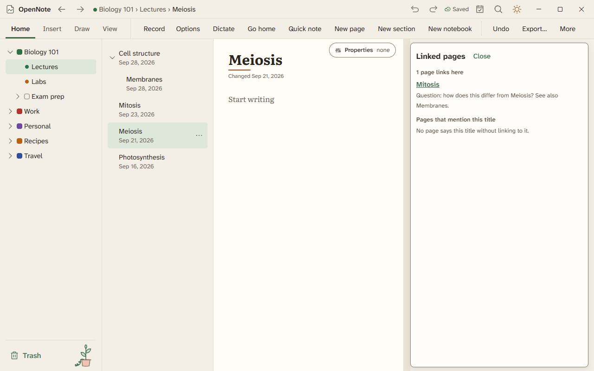

**tags-pane.** The tagged lines pane, listing each tagged line with the page it is on. ([dark](screens/tags-pane-dark.png))

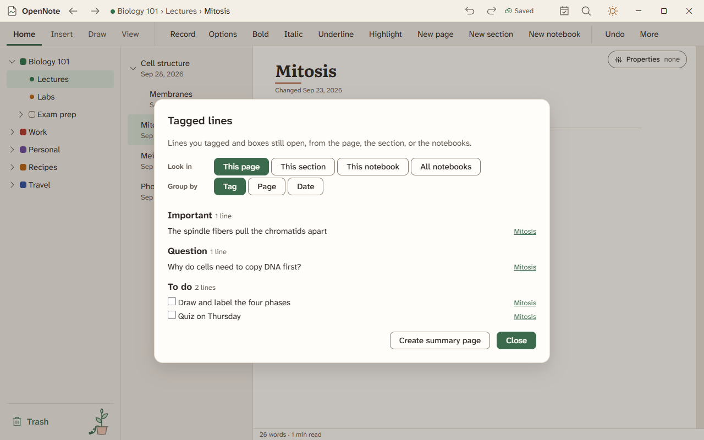

**graph-view.** The graph view, with pages as dots and their links as lines. ([dark](screens/graph-view-dark.png))

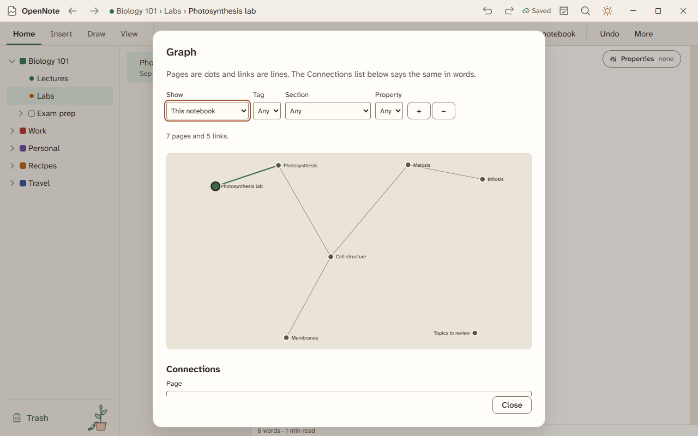

## Audio and transcription

### Features

#### Transcripts and summaries

- Every recording gets a transcript automatically, with a one-paragraph summary at the top.
- Each line starts with a timestamp.
- Different voices are labeled Speaker 1, Speaker 2, and so on.
- Transcripts are searchable and can be edited to fix mistakes.

#### Audio recording

- **Recording recovery.** If OpenNote or the PC stops while a recording runs, the audio already written is kept.
- **Playback speed and skips.** Recordings play at 0.5x to 3x without changing pitch.
- **Recording guard.** A live level meter shows while recording.
- **Trim, split, and remove parts.** Trim silence at the start or end, split a long recording, or remove an "off the record" part from both the audio and its transcript.
- **Mark moments.** A button or shortcut drops a flag at the current moment of a recording, with an optional short label.
- **Ink replay.** Plays back a page or a selection stroke by stroke, in the order it was written, with play, pause, a slider, and speed from 0.5x to 4x.
- **Voice enhancement.** "Enhance voice" reduces steady background noise and evens out loud and quiet speech, on the device.
- **Recording storage.** A list shows each recording's length and size, and the page and notebook that hold it.
- **Meeting detected prompt.** Off by default, and turned on only in Settings.
- **Snap the screen.** While recording, a shortcut captures the screen, a window, or a region, such as a slide or a whiteboard, and puts it on the page time-stamped to the audio.
- **Audio and video files.** Dropping an audio or video file onto a page adds a player with time-stamped notes, playback speed, and flags.

#### More

- **Read aloud.** Reads a page, a selection, or everything from the cursor aloud, and highlights each word as it is spoken.
- **Reading order.** A "Reading order" pane lists a freeform page's text, ink, images, and tables in the order that screen readers, read aloud, and the Tab key visit them.

### Commands

| Command | What it does | Default keys |
| --- | --- | --- |
| New meeting note | Makes a meeting note from a calendar event, with its attendees and an agenda. |  |
| Start recording | Starts recording audio on the page. | Alt+Shift+A |
| Stop recording | Stops the recording. | Alt+Shift+S |
| Recording options | Opens the recording options: the microphone, the format, and the quality. |  |
| Pause recording | Pauses the recording. | Alt+Shift+P |
| Play or pause the recording | Plays the recording, or pauses it. | Alt+Shift+K |
| Skip back 10 seconds | Skips the recording back 10 seconds. | Alt+Shift+J |
| Skip forward 10 seconds | Skips the recording forward 10 seconds. | Alt+Shift+L |
| Flag this moment | Marks this moment of the recording with a flag. | Alt+Shift+M |
| Go to the next flag | Jumps to the next flag in the recording. | Alt+Shift+N |
| Go to the previous flag | Jumps to the previous flag in the recording. | Alt+Shift+B |
| Play the recording from the caret | Plays the recording from the moment the text at the caret was written. | Alt+Shift+C |
| Play the recording from the selected ink | Plays the recording from the moment the selected ink was drawn. |  |
| Trim silence from the recording | Removes long silences from the recording. |  |
| Split the recording here | Splits the recording in two here. |  |
| Enhance the voice of the recording | Cleans up noise so the voice in the recording is clearer. |  |
| Save the recording as a WAV file | Saves the recording as a WAV file. |  |
| Save the recording as an Opus file | Saves the recording as a smaller Opus file. |  |
| Export the recording as a narrated video | Exports the recording with the page as a narrated video. |  |
| Upload the recording to YouTube | Uploads the recording to your YouTube account. |  |
| Remove a part | Removes a part of the recording that you choose. |  |
| Manage recordings and the space they take | Shows your recordings and the space they take, and compresses or removes them. |  |
| Make a transcript of the recording | Makes a transcript of the recording on this device. |  |
| Add a transcript from text or captions | Adds a transcript to the recording from pasted text or a captions file. |  |
| Copy the meeting recap | Copies a recap of the meeting, with its summary and action items. |  |
| Copy the selected transcript lines into the notes | Copies the selected transcript lines into the notes, with their times. | Alt+Shift+O |
| Snap the screen onto the page | Puts a picture of the whole screen onto the page. | Alt+Shift+X |
| Snap the window behind OpenNote onto the page | Puts a picture of the window behind OpenNote onto the page. | Alt+Shift+W |
| Snap a part of the screen onto the page | Puts a picture of a part of the screen you drag out onto the page. | Alt+Shift+Z |
| Insert video, podcast, or embed from link | Inserts a video, podcast, or embed, such as Desmos or GeoGebra, from its link. |  |
| Add captions as a transcript | Adds the video's captions to the page as a transcript. |  |
| Read aloud | Reads the page aloud, or stops. | Ctrl+Shift+U |
| Read next paragraph | Skips ahead to read the next paragraph aloud. | Ctrl+Alt+. |
| Read previous paragraph | Goes back to read the previous paragraph aloud. | Ctrl+Alt+, |
| Stop reading aloud | Stops reading aloud. |  |
| Insert video file | Inserts a video file from your computer that plays on the page. |  |
| Add captions to a video | Adds a captions file, such as WebVTT, to a video. |  |

### Pictures

**recording.** The recording options under the Record button. Nothing is recording. ([dark](screens/recording-dark.png))

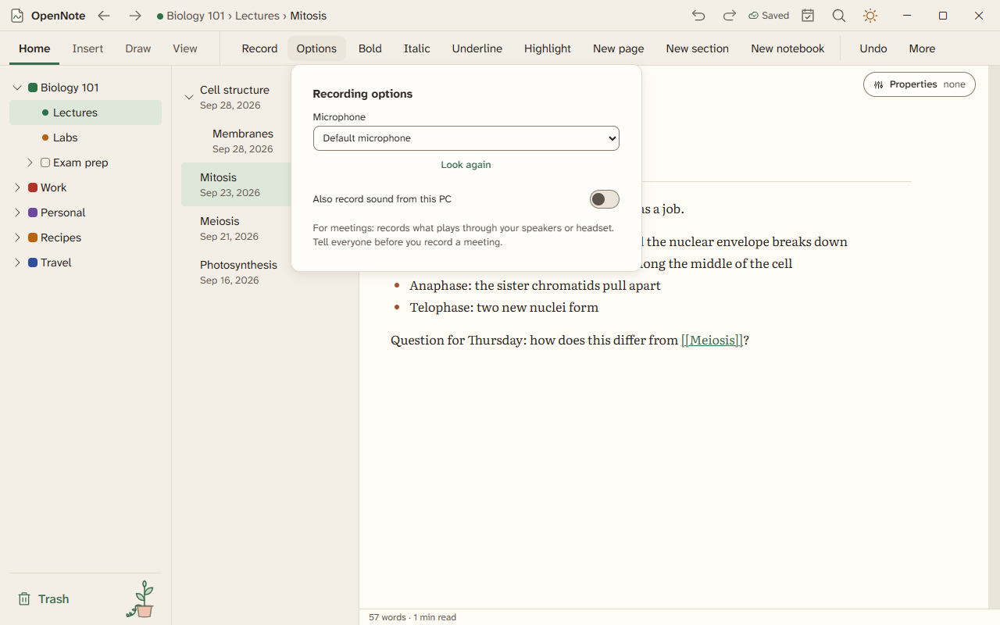

**recording-block.** A recording block on a page: its player, speed, Skip silence, and flags that mark moments, with the notes typed below it. ([dark](screens/recording-block-dark.png))

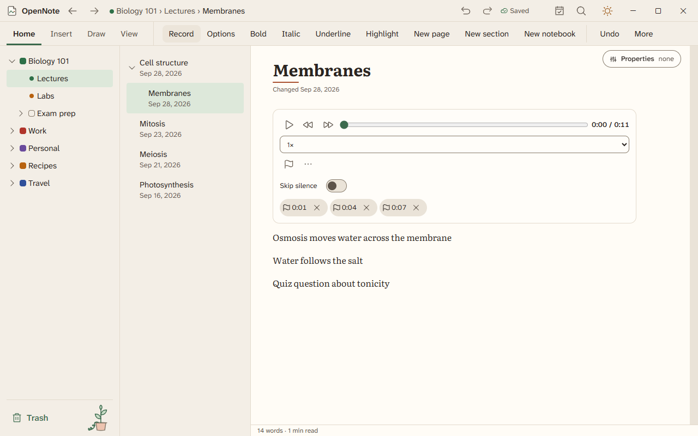

**transcript-block.** A transcript block with speaker names and time stamps under its recording. ([dark](screens/transcript-block-dark.png))

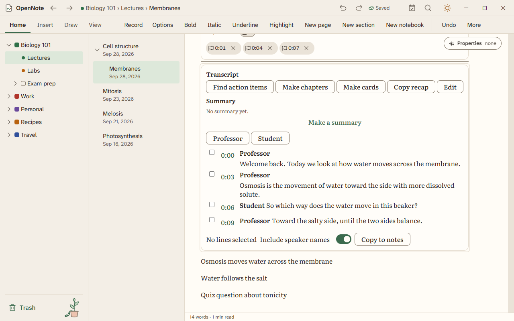

**settings-recording.** Recording: live captions, a transcript of every recording, formats, and the consent reminder. ([dark](screens/settings-recording-dark.png))

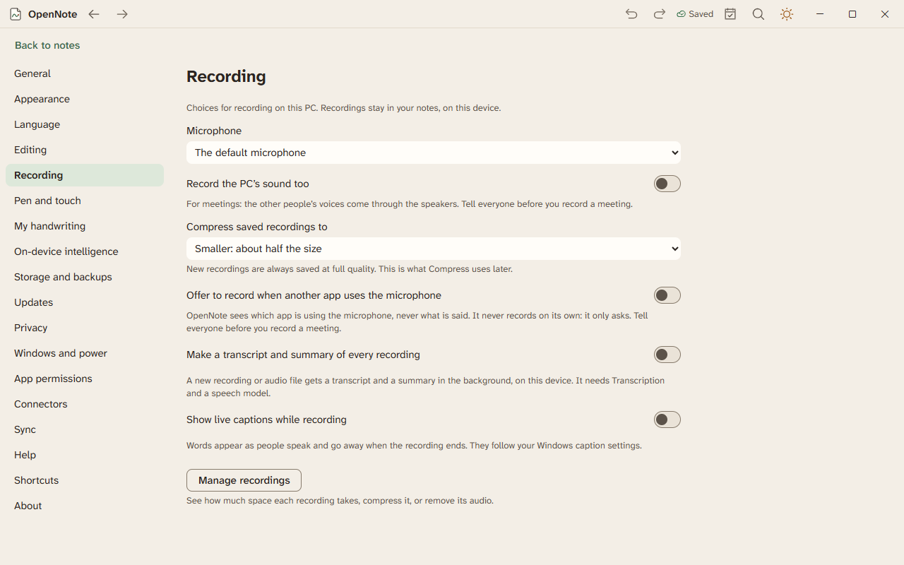

## Math and homework

### Features

#### Math and study tools

- **Check my work.** Checks worked math one step at a time, typed or handwritten, from algebra and calculus to matrices and units.
- **Tutor.** Hints one small step at a time: where to look, the idea, a question, then the next step, and the full solution only after trying, with a confirmation.
- **Visual equation editor.** Equations open in a MathLive editor with a virtual math keyboard for touch and pen, spoken output for screen readers, and a switch to LaTeX source.
- **Math with variables and units.** Write `rent = 1,200` on one line and `rent * 12 =` on another, and the result updates when the first changes.
- **Tool windows.** Small windows for tools such as timers, the calculator, Upcoming, flashcard review, the dictionary, the unit converter, and reference tables.
- **3D graphs.** A graph block or the calculator's Graphing 3D tab draws z = f(x, y) as a shaded surface, and curves and surfaces traced by t, or by u and v.
- **Live solving.** On the line being typed, an equation with one unknown shows its answer in gray, and Tab adds it as a line.
- **Graph an equation.** A selected equation, or lassoed handwriting read as math, offers Graph.
- **Steps, systems, and matrices.** The equation panel's Steps shows a derivative rule by rule, and an integral from a table of rules, with a definite integral's value.

#### 3D graphs, vectors, and motion

- **Parametric and polar curves.** Graph blocks take `(x(t), y(t))`, `r = f(θ)`, vector fields `F = (P, Q)`, and slope fields `dy/dx = f(x, y)`.
- **Lines and planes.** Distances, intersections, and angles between points, lines, and planes in 3D, with a plot.
- **Projectile simulator.** Speed, angle, height, gravity, and linear drag give the time of flight, range, highest point, and landing speed.

### Tool windows

#### Calculator

A calculator window with seven tabs.

**tool-calculator.** The scientific calculator after a unit conversion, with the answer and its Copy and Insert buttons. ([dark](screens/tool-calculator-dark.png))

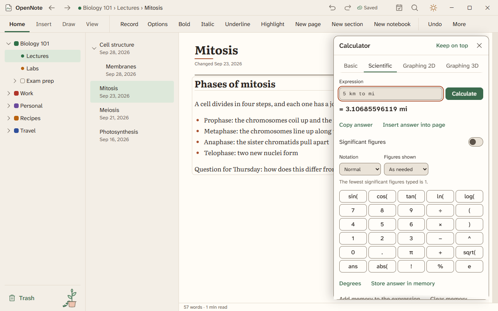

Open it with the command "Open calculator".

Commands (7):

- **Basic calculator.** Opens the calculator on its basic tab for everyday arithmetic.
- **Scientific calculator.** Opens the calculator on its scientific tab, with functions, powers, and angle modes.
- **Graphing calculator.** Opens the calculator on its graphing tab to plot functions in 2D.
- **3D graphing calculator.** Opens the calculator on its 3D graphing tab to plot surfaces you can turn.
- **Programmer calculator.** Opens the calculator on its programmer tab for hex, binary, and bitwise work.
- **Statistics calculator.** Opens the calculator on its statistics tab for lists of data.
- **Matrix calculator.** Opens the calculator on its matrix tab for matrix arithmetic.

#### Export figure

Saves a graph or diagram from the page as an SVG or as a PNG at 72 to 600 DPI, numbered and captioned, with an optional source line.

Open it with the command "Export figure as a picture".

#### Formula sheet

Collects the display equations of pages or a section into a new page of one to four columns, so it fits one sheet.

Open it with the command "Open formula sheet builder".

#### Insert LaTeX

A window with a LaTeX field, a live KaTeX preview, and a palette of snippets for fractions, roots, sums, matrices, and more.

Open it with the command "Insert LaTeX" (Ctrl+Alt+X).

#### Math solvers

One window with a tab for each solver, and each solver shows its worked steps.

**solvers-integrals.** The Math solvers window on its integrals tab, with the worked steps. ([dark](screens/solvers-integrals-dark.png))

Open it with the command "Open Math solvers" (Ctrl+Alt+Shift+M).

Commands (9):

- **Solve a double or triple integral.** Pick a region (rectangle, region between two curves, disk, box, cylinder, ball, or cone) or type your own limits, and pick rectangular, polar, cylindrical, or spherical coordinates.
- **Solve a differential equation.** Separable, first-order linear (with the integrating factor), and second-order linear equations with constant coefficients (characteristic equation, and undetermined coefficients for polynomial, exponential, sine, and cosine forcing, including resonance).
- **Find a Laplace or Fourier transform.** Forward and inverse Laplace transforms with steps, Fourier transforms of table pairs, and searchable tables of pairs and properties.
- **Expand a Taylor series.** Expands a function about a point to order n, with each derivative, an error bound, and a graph of its partial sums.
- **Find a root with Newton's method.** Newton's method, bisection, and the secant method, with an iteration table, how the run ended, and the steps drawn on the graph.
- **Propagate uncertainty or check units.** Propagates the uncertainty of independent measurements through an expression, with each partial derivative, each variable's share, and the result rounded as a lab report writes it.
- **Find a normal, binomial, or t probability.** Normal, binomial, and Student t distributions: the probability below, above, between, or outside values with the area or bars shaded, and two-sided critical values.
- **Find eigenvalues and eigenvectors.** For a 2×2 or 3×3 matrix, finds the characteristic polynomial, eigenvalues, and eigenvectors, and draws what the matrix does.
- **Simulate a projectile.** Range, highest point, time of flight, and landing speed of a projectile, with optional air resistance by Runge-Kutta.

#### Practice mode

Shows a worked problem with its solution steps hidden.

Open it with the command "Practice this problem".

#### Projectile simulator

Range, highest point, time of flight, and landing speed of a projectile, with optional air resistance by Runge-Kutta.

Open it with the command "Open projectile simulator".

#### Scientific constants

A searchable window of 23 physical constants from the 2022 CODATA values, such as the speed of light and the Planck constant.

Open it with the command "Insert a scientific constant" (Ctrl+Alt+N).

#### Significant figures

A window that counts the significant figures of a number, rounds it to a chosen count, and writes it in three notations.

Open it with the command "Open the significant-figures helper" (Ctrl+Alt+F).

#### Solids of revolution

Turns the region between two curves about y = k or x = k.

Open it with the command "Open solids of revolution".

#### Symbols

A searchable palette of Greek letters and math, science, and engineering symbols, with recent symbols first.

Open it with the command "Open the symbol palette" (Ctrl+Alt+Shift+S).

#### Unit converter

Converts length, area, volume, mass, temperature, speed, time, pressure, energy, power, angle, data size, force, frequency, density, torque, fuel economy (including liters per 100 km), electric current, voltage, and resistance.

**unit-converter.** The unit converter with a length converted from meters to feet. ([dark](screens/unit-converter-dark.png))

Open it with the command "Open the unit converter".

#### Vectors

Dot and cross products, lengths, the angle, scalar and vector projections, the unit vector, the parallelogram's area, and the triple product, with a 3D plot.

Open it with the command "Open vector tools".

### Commands

| Command | What it does | Default keys |
| --- | --- | --- |
| Simplify | Simplifies the selected expression. |  |
| Solve | Solves the selected equation. |  |
| Insert graph | Inserts a graph of functions and equations. |  |
| Insert equation | Inserts a display equation. |  |
| Insert inline equation | Inserts an equation inside the line of text. | Alt+= |
| Insert 3D graph | Inserts a 3D graph of surfaces, with contours and tangent planes. |  |
| Insert parametric or polar graph | Inserts a graph of parametric and polar curves that you can trace and animate. |  |
| Insert 3D function plot | Inserts a 3D plot of a function or a parametric surface or curve. |  |
| Graph equation | Graphs the selected equation in 2D or 3D. | Alt+Shift+G |
| Graph handwritten equation | Graphs an equation you wrote by hand and selected with the lasso. |  |
| Show steps for the equation | Shows the worked steps for the selected derivative, integral, limit, or sum. |  |
| Count significant figures of the selection | Counts the significant figures of the selected number. |  |
| Round the selection to significant figures | Rounds the selected number to the significant figures you pick. |  |
| Check my work | Checks each step of your worked math and shows where a mistake is. |  |
| Open the tutor | Opens the tutor, which helps with homework without giving the answer away. |  |
| Give me a hint | Asks the tutor for a hint toward the next step. |  |
| Explain this step | Asks the tutor to explain this step, or why it is wrong. |  |

### Pictures

**study-tutor.** The Tutor panel giving the first of four hints on a worked line, without the answer. ([dark](screens/study-tutor-dark.png))

**step-checker.** Check my work on three lines of working, with the wrong line marked and the reason. ([dark](screens/step-checker-dark.png))

**math-graph.** An inline equation in a sentence and a graph block with its function. ([dark](screens/math-graph-dark.png))

**calc-graphing.** The graphing calculator with two functions drawn, and a value read off the graph near where they cross. ([dark](screens/calc-graphing-dark.png))

**calc-graphing-3d.** The 3D graphing calculator with a surface plotted from one function. ([dark](screens/calc-graphing-3d-dark.png))

**subject-statistics.** The Statistics tab of the calculator after summarizing six numbers. ([dark](screens/subject-statistics-dark.png))

**solvers-equations.** The Math solvers window on its differential equations tab, with the solution and its steps. ([dark](screens/solvers-equations-dark.png))

**math-actions.** The math actions on an equation: a solved equation on the page, and the worked steps of a derivative inserted below an equation. ([dark](screens/math-actions-dark.png))

**graph-3d.** A 3D graph block on a page, with a surface and its axes. ([dark](screens/graph-3d-dark.png))

## Engineering kits

### Features

#### Engineering tools

- **Free-body diagram kit.** A block with a body, forces, moments, and supports that snap to the grid, with the sums of forces and moments beside it.
- **Beam and truss solver.** A beam block with pin, roller, and fixed supports, point loads, linearly varying distributed loads, and moments that slide along the beam.
- **Circuit symbols and DC solver.** A circuit block with resistors, voltage and current sources, grounds, and wires on a grid.
- **Units and engineering notation in tables.** A smart table column can carry a unit, such as kN, MPa, or N·m.

### Kits

#### Aerospace

Standard atmosphere, compressible flow, nozzles, rocket nozzles, finite wings, performance and stability, potential flow, dynamic modes, jet engine cycles, and airfoils.

**kit-aerospace.** The Aerospace kit on its standard atmosphere tab, with the values at one altitude. ([dark](screens/kit-aerospace-dark.png))

Open it with the command "Open the aerospace tools".

Commands (10):

- **Standard atmosphere.** Air temperature, pressure, density, speed of sound and viscosity at altitude, or the altitude for a value.
- **Compressible flow relations.** Every ratio of a compressible flow family from one known value: isentropic flow, shocks, expansion fans, and duct flow with friction or heating.
- **Nozzle and diffuser flow.** A converging-diverging nozzle at any back pressure: whether it chokes, where a shock stands, the exit state, and the mass flow.
- **Rocket nozzle performance.** Ideal rocket performance from the chamber state: characteristic velocity, thrust coefficient, specific impulse, thrust, and the rocket equation.
- **Airfoils.** NACA four- and five-digit sections: their coordinates, thin airfoil theory for the zero-lift angle, lift, and moment, and a vortex panel method for the pressure distribution.
- **Finite wings.** Lift, induced drag, and span efficiency of a straight wing by Prandtl’s lifting-line theory, with the spanwise load.
- **Aircraft performance and static stability.** Best speeds from the drag polar, range and endurance, climb and glide, turns, and the neutral point and static margin.
- **Potential flow.** Superpose uniform flow, sources, doublets, and vortices to see the streamlines, stagnation points, pressure, and lift.
- **Aircraft dynamic modes.** The short period, phugoid, Dutch roll, roll, and spiral modes from a state matrix or stability derivatives.
- **Jet engine cycle analysis.** On-design cycle analysis of a turbojet, turbofan, or ramjet: specific thrust, fuel consumption, efficiencies, and the total temperature and pressure at each station.

#### Circuits and energy

Transients, a circuit simulator (DC, AC sweep, transient), op-amps and filters, semiconductors, instruments, AC power, power flow, data fitting, and energy.

**kit-circuits.** The circuit simulator of the Circuits and energy kit, showing the netlist of an RC low-pass filter with its AC sweep results, the -3 dB frequency, and the magnitude and phase plots (1280 by 1560). ([dark](screens/kit-circuits-dark.png))

Open it with the command "Open the circuits and energy tools".

Commands (9):

- **First- and second-order circuits.** Natural and step responses of RC, RL, and series or parallel RLC circuits.
- **Circuit simulator.** Type a circuit as a short netlist, then find its DC operating point, AC sweep, transient response, or Thevenin equivalent.
- **Op-amp circuits and filters.** Ideal op-amp stages, active filter sections, the order and poles a filter specification needs, and passive RC and RLC filters.
- **Diodes and transistors.** Diode and zener circuits, rectifier ripple, and the bias point and gain of BJT and MOSFET amplifiers.
- **Instrumentation and measurement.** Resistor codes, bridges and strain gauges, thermocouples, RTDs, signal levels, and converter resolution.
- **AC power and three-phase systems.** Power triangles, power factor correction, transformer equivalent circuits, balanced three-phase loads, and per unit.
- **Power flow and economic dispatch.** Voltages and line flows of a small network, and the cheapest way for generators to meet a demand.
- **Lab data fitting and uncertainty.** Fit a line, polynomial, exponential, power law, or your own formula to lab data with uncertainties.
- **Energy systems and the environment.** Wind and solar estimates, emissions per kilowatt-hour, the cost of energy, and energy unit conversion.

#### Civil and chemical engineering

Works structures, soils, foundations, water, transportation, material balances, and reactors.

**kit-civil.** The Civil and chemical engineering kit on its hydrology and open channels tab. ([dark](screens/kit-civil-dark.png))

Open it with the command "Civil and chemical engineering".

Commands (9):

- **Indeterminate structures and influence lines.** Structures: continuous beams by moment distribution, fixed-end moments, influence lines, moving loads, truss influence lines, portal and cantilever methods, response spectra, and modal combination.
- **Soil properties, consolidation, and strength.** Soils: phase relations, classification, compaction, permeability, effective stress, consolidation, and shear strength.
- **Earth pressure, foundations, and slopes.** Foundations: earth pressure, retaining walls, bearing capacity, slope stability, and piles.
- **Hydrology and open channels.** Hydrology and open channels: runoff, hydrographs, routing, flood frequency, soil loss, channel flow, jumps, profiles, weirs, and pipe networks.
- **Groundwater and wells.** Groundwater and wells: Darcy flow, wells and pumping tests, flow nets, and contaminant transport.
- **Water quality and treatment.** Water quality and treatment: oxygen balance, carbonate chemistry, softening, and treatment units.
- **Traffic, highways, surveying, and site planning.** Works traffic flow, queues, highway curves, surveying, and site planning.
- **Material balances and separations.** Material balances and separations: flowsheet balances, energy balances, vapor-liquid equilibrium, flash, distillation, and absorption.
- **Chemical and biological reactors.** Chemical and biological reactors: ideal reactors, multiple reactions, temperature effects, residence times, growth, and activated sludge.

Also in this window:

- Transportation: traffic flow, queues, signals, highway geometry, travel demand, surveying, earthwork, and site planning.

#### Design tools

Tolerances and fits, machining, forming and joining, micro and nano fabrication, number representation, programming references, orthographic views, a memory tracer, and a drafting sheet.

**kit-design.** The drafting sheet of the Design kit, with a title block. ([dark](screens/kit-design-dark.png))

Open it with the command "Open the design tools".

Commands (12):

- **Drafting sheet.** Draw 2D engineering sketches with the usual line types and add dimensions that read their size from the geometry and update when it moves.
- **Orthographic views.** Build a model from unit cubes, one layer at a time, and see its front, top, and right views the way an engineering drawing shows them, with hidden edges dashed.
- **Tolerances and fits.** Stack up a chain of dimensions, check a hole and shaft fit, or test a feature’s true position.
- **Machining speeds, feeds, and tool life.** Work out spindle speed, feed rate, removal rate, and cutting time for a cut, find tool life, and read the tool forces.
- **Forming, casting, and joining.** Estimates forming forces, bend and riser sizes, casting solidification time, weld heat input, and printed-part layers.
- **Micro and nano fabrication.** Estimates what a process step can resolve or deposit, film stress on a wafer, die counts and yield, and surface binding.
- **Memory and pointer tracer.** Type a short C++ snippet and step through it one statement at a time.
- **Number representation.** See how a computer stores a number or a character: integer bits, overflow, other bases, floating-point values, and text bytes.
- **Programming references.** Quick references for learning to program: C++ types and escapes, common errors, MATLAB habits, operator precedence, and a trace table.
- **Computation paper.** Gives the page an engineering computation paper grid.
- **Three-view drawing paper.** Gives the page a paper laid out for three-view drawings.
- **Title block.** Adds an engineering title block to the page.

#### Dynamics and control

System models, root locus, Bode and Nyquist, compensators and PID, state space, digital control, probability, Markov chains and queues, reliability, and Kalman filtering.

**kit-control.** The Dynamics and control kit drawing a Bode plot for a transfer function. ([dark](screens/kit-control-dark.png))

Open it with the command "Open the dynamics and control tools".

Commands (10):

- **System models and responses.** Model a dynamic system, move between its forms, read its time response, find steady-state errors, and fit a model to a measured step.
- **Root locus and Routh-Hurwitz.** Count unstable roots with the Routh array, find the gains that keep a loop stable, and draw the root locus with every rule worked out.
- **Frequency response: Bode and Nyquist.** Draw the Bode and Nyquist plots of an open loop, read the gain and phase margins, and count encirclements of −1 to judge the closed loop.
- **Compensator and PID design.** Designs a lead, lag, or lead-lag compensator or PID gains, and checks the closed loop.
- **State-space design.** Check controllability and observability, place poles by Ackermann’s formula, design an observer, and solve the linear quadratic regulator for ẋ = Ax + Bu, y = Cx + Du.
- **Digital control.** Discretize a plant or controller, analyze a discrete transfer function against the unit circle, find the gains that keep a sampled loop stable, check aliasing, and write a digital PID.
- **Random processes and Kalman filtering.** Find the steady covariance and sample paths of a linear system driven by noise.
- **Markov chains and queues.** Type a transition matrix or a generator to classify the chain and find its long-run, n-step, and absorption behavior, or work out a queue.
- **Probability distributions and inference.** Find probabilities and quantiles of the common distributions, confidence intervals, and hypothesis tests, with the region shaded and every step shown.
- **Reliability, quality, and inventory.** Work out system reliability, life models, Weibull fits, control charts, process capability, sampling plans, and order quantities.

#### Engineering mathematics

Series, complex analysis, systems of ODEs, Fourier series and boundary value problems, numerical methods, a matrix console, a linear algebra workbench, and vector calculus.

**kit-engineering-math.** The linear algebra workbench of the Engineering mathematics kit, with a matrix and its results. ([dark](screens/kit-engineering-math-dark.png))

Open it with the command "Open the engineering mathematics tools".

Commands (8):

- **Series and convergence.** Tests a series for convergence with the ratio, root, integral, and comparison tests.
- **Complex analysis.** Works complex numbers in polar form, roots, logarithms, residues, and contour integrals.
- **Systems of ODEs.** Draws phase portraits of systems of ODEs and classifies their equilibria.
- **Fourier series and boundary value problems.** Finds Fourier series and solves heat, wave, and Laplace boundary value problems.
- **Numerical methods.** Works interpolation, splines, divided differences, and other numerical methods.
- **Matrix console.** Runs MATLAB-style matrix commands and scripts in a command window.
- **Linear algebra workbench.** Row-reduces matrices and finds inverses and other results step by step.
- **Vector calculus and optimization.** Works gradients, divergence, curl, line and surface integrals, and optimization.

#### Fluids and heat transfer

Fluid statics and Bernoulli, pipe flow and pumps, dimensional analysis, viscous and external flow, conduction, fins, transient conduction, convection, heat exchangers, radiation, and water and air properties.

**kit-fluid-heat.** The Fluid mechanics and heat transfer kit on its pipe flow and pumps tab. ([dark](screens/kit-fluid-heat-dark.png))

Open it with the command "Open the fluid mechanics and heat transfer tools".

Commands (12):

- **Fluid statics, Bernoulli, and flow measurement.** Works hydrostatic pressure, manometers, forces on gates, buoyancy, stability, and Bernoulli flow meters.
- **Pipe flow and pumps.** Finds head loss and friction factors in pipes, and sizes pumps for a system.
- **Dimensional analysis and similitude.** Finds Buckingham pi groups and scales a model to its prototype.
- **External flow, drag, and boundary layers.** Works boundary layers, skin friction, and drag on bodies in a flow.
- **Viscous and biological flows.** Works Couette and Poiseuille flows, non-Newtonian fluids, and flows in the body.
- **Conduction and thermal circuits.** Finds heat flow through walls, cylinders, and spheres as thermal resistance circuits.
- **Extended surfaces (fins).** Finds the heat flow and efficiency of straight, pin, and annular fins.
- **Transient conduction and diffusion.** Works lumped cooling and transient conduction and diffusion in time.
- **Convection correlations (heat and mass transfer).** Finds heat and mass transfer coefficients from Nusselt and Sherwood correlations.
- **Heat exchangers.** Sizes and rates heat exchangers by the LMTD and effectiveness-NTU methods.
- **Radiation heat transfer.** Works blackbody emission, view factors, and radiation exchange between surfaces.
- **Water and air properties.** Looks up the density, viscosity, conductivity, and specific heat of water and air.

#### Mechanisms and dynamics

Linkages, cams, gears, compliant mechanisms, rigid-body dynamics, Lagrangian mechanics, 3D rotations, vibration, and robot arms.

**kit-mechanisms.** The linkage analyzer of the Mechanisms and dynamics kit, with a four-bar linkage. ([dark](screens/kit-mechanisms-dark.png))

Open it with the command "Open the mechanisms and dynamics kit".

Commands (11):

- **Linkage analyzer.** Positions, velocities, and accelerations of a four-bar or slider-crank through its whole cycle, with the Grashof class, transmission angle, and coupler curve.
- **Cam designer.** A follower motion program, its SVAJ diagrams, and the cam profile, with the pressure angle and curvature.
- **Gears and gear trains.** A spur gear pair, a simple or compound train, or a planetary train: sizes, contact, speeds, and tooth forces.
- **Compliant mechanisms.** Large deflection of a flexure, solved exactly (the elastica) and by the pseudo-rigid-body model, side by side.
- **Particle and planar rigid-body dynamics.** Motion from typed coordinates, a turning body, an impact, rolling down an incline, or a rigid body under forces.
- **Three-dimensional rigid bodies and rotations.** Inertia tensors of composite bodies, principal moments and axes, Euler’s equations, and conversions between rotation matrices, Euler angles, quaternions, and axis-angle.
- **Lagrangian mechanics.** Equations of motion from the kinetic and potential energy, the equilibria and their small oscillations, and a simulation.
- **Single-degree-of-freedom vibration.** A mass on a spring and damper: natural frequency, damping, response, and isolation. x is from equilibrium, positive with the force.
- **Multi-degree-of-freedom and continuous vibration.** Natural frequencies, mode shapes, and response of a chain of masses, typed M and K matrices, or a string, bar, shaft, or beam.
- **Robot arm kinematics.** Forward and inverse kinematics of a serial arm from its Denavit-Hartenberg table, with the Jacobian and the workspace.
- **Robot dynamics and control.** The equations of motion of a planar arm of up to three links, and a simulation under a joint-space controller.

#### Signals and sound

Works spectra, filters, sampling, body signals, sound, images, medical imaging, coding, and RF lines.

**kit-signals.** The spectrum analyzer of the Signals and sound kit, with a signal and its spectrum. ([dark](screens/kit-signals-dark.png))

Open it with the command "Open signals and sound tools".

Commands (9):

- **Spectrum analyzer.** Amplitude, power, density, and spectrogram views of samples, a sound file, or a table column, with peaks and band powers.
- **Digital filter designer.** Designs FIR and IIR filters from a specification, shows every response and the pole-zero plot, and filters data.
- **Convolution and sampling.** Convolution as a flip, shift, multiply, and sum table, correlation lags, difference equations with their poles, aliasing and reconstruction, quantization noise, rate changes, and continuous convolution.
- **Neural and physiological time series.** Event-related averages, fMRI regressors and fits, spike-train statistics, ECG heart-rate variability, and electrode maps.
- **Image lab.** Adjusts, thresholds, filters, measures, and transforms images, with band math and CT reconstruction by filtered back-projection.
- **Medical imaging physics.** MRI signals and a Bloch simulator, k-space, CT numbers, ultrasound, X-ray attenuation, and PET uptake.
- **Sound analysis and acoustics.** Opens or records sound on the device and shows its waveform, spectrograms, pitch, and formants, with a tuner and audiograms.
- **Information, coding, and modulation.** Entropy, mutual information, and channel capacity; Huffman, Shannon-Fano, and LZ78 source codes; Hamming and linear block codes; standard CRCs; Viterbi decoding; and constellations, bit-error rates, and eye diagrams.
- **Transmission lines and RF.** Reflection and impedance on a Smith chart, matching networks, line types, two-ports, noise, antennas, and radar range.

#### Solid mechanics

Columns, stress and strain, sections, members, deflection, pressure vessels, thin-walled structures, composite laminates, tissues and joints, fatigue and machine elements, and a finite element workbench.

**kit-solids-fem.** The finite element workbench of the Solid mechanics kit, with a meshed part and its stresses. ([dark](screens/kit-solids-fem-dark.png))

Open it with the command "Open the solid mechanics tools".

Commands (11):

- **Columns and buckling.** Finds critical buckling loads of columns from their length, ends, and slenderness.
- **Stress and strain at a point.** Transforms stress and strain at a point and finds principal stresses with Mohr's circle.
- **Section properties.** Finds the centroid and second moments of area of a cross section.
- **Axial, torsion, and bending.** Finds stresses and deformations of members under axial load, torsion, and bending.
- **Beam deflection.** Finds the slope and deflection of beams by integration and superposition.
- **Pressure vessels, fits, and curved beams.** Finds stresses in thin and thick pressure vessels, press fits, and curved beams.
- **Thin-walled structures.** Finds shear flow and torsion in open, closed, and multi-cell thin-walled sections.
- **Composite laminates.** Works ply stiffness and laminate behavior by classical lamination theory.
- **Tissues and joints.** Models creep and relaxation of tissues with viscoelastic models, and joint loads.
- **Fatigue and machine elements.** Finds fatigue life and safety factors, and sizes shafts, bolts, springs, and bearings.
- **Finite element workbench.** Builds and solves bar, spring, and truss models by the direct stiffness method.

#### Thermodynamics kit

Statistical thermodynamics, ideal gases, steam (IAPWS-IF97), psychrometrics, R-134a, steady-flow devices, cycles, real gases and mixtures, and combustion.

**kit-thermo.** The Thermodynamics kit finding a state of water from two properties. ([dark](screens/kit-thermo-dark.png))

Open it with the command "Open the thermodynamics kit".

Commands (9):

- **Find a state of water or steam from two properties.** Finds a state of water or steam from two properties, from compressed liquid to superheated.
- **Find a state of refrigerant R-134a from two properties.** Finds a state of refrigerant R-134a from two properties.
- **Work an ideal-gas process or state with variable specific heats.** Works an ideal-gas state or process with specific heats that change with temperature.
- **Find Z and departures from a cubic equation of state, or the properties of a gas mixture.** Finds the compressibility factor and departures from a cubic equation of state, or a gas mixture's properties.
- **Balance a turbine, compressor, nozzle, or other steady-flow device with the second law.** Balances energy and entropy for a turbine, compressor, nozzle, throttle, or other steady-flow device.
- **Analyze a Rankine, Brayton, Otto, Diesel, refrigeration, or Carnot cycle.** Analyzes Rankine, Brayton, Otto, Diesel, refrigeration, and Carnot cycles.
- **Work moist-air states and air-conditioning processes.** Works moist-air states and air-conditioning processes on a psychrometric chart.
- **Balance a combustion reaction and find heating values and the adiabatic flame temperature.** Balances a combustion reaction and finds heating values and the adiabatic flame temperature.
- **Find partition functions, heat capacities, and molecular speeds.** Finds partition functions, heat capacities, entropy, and molecular speeds from statistical thermodynamics.

### Commands

| Command | What it does | Default keys |
| --- | --- | --- |
| Insert free-body diagram | Inserts a free-body diagram with forces, moments, and supports. |  |
| Insert beam solver | Inserts a beam solver that finds reactions and draws shear and moment diagrams. |  |
| Insert truss solver | Inserts a truss solver that finds member forces by the method of joints. |  |
| Insert circuit | Inserts a circuit drawing that solves its node voltages and currents. |  |

### Pictures

**kit-thermo-cycles.** The Thermodynamics kit working a Rankine cycle, with its diagram and results. ([dark](screens/kit-thermo-cycles-dark.png))

**engineering-beam.** The beam deflection tool of the solid mechanics kit: the supports and loads of a simply supported beam, its results and reactions, and its deflection curve. ([dark](screens/engineering-beam-dark.png))

**kit-design-code.** The memory and pointer tracer of the Design kit, stepping through a short program. ([dark](screens/kit-design-code-dark.png))

## Subject and catalog kits

### Features

#### Subject kit foundations

- **Data input.** A data field reads pasted text, a CSV or TSV file, or a table on the open page, with tools to clean and reshape it.
- **Distributions.** Exact and noncentral distributions, the studentized range, exact proportion and count intervals, and exact null distributions for rank tests, for every subject kit to use.
- **Curve fitting and likelihood.** Weighted Levenberg-Marquardt fitting with standard errors and bands, and maximum likelihood with standard errors and profile intervals.
- **Repeatable random results.** A seeded generator that gives the same results on every computer, with a seed field that shows, takes, and renews the seed.
- **Plots and coefficient tables.** Histograms, densities, ECDF, Q-Q, box, fit-band, step, forest, and ROC plots, and a coefficient table that states each verdict in words.
- **Tree and graph layouts.** Tidy tree layouts and layered and force-directed graph layouts, drawn as SVG for trees, networks, and diagrams.
- **Figure blocks.** A tool's diagram on the page as a picture with its description and an Open in tool button that reopens the inputs that made it.

#### More

- **Kit foundation.** Shared numerics (matrices, polynomial roots, quadrature, ODE solvers, special functions), air and water properties, 38 unit kinds, and the kit window parts.
- **Live calculation block.** A block that keeps a tool's answer, key results, and inputs on the page.

### Kits

#### Biology tools

Works with sequences, cloning, proteins, alignments, trees, crosses, population genetics, and pedigrees.

**kit-biology.** The Biology tools kit on its DNA and RNA sequences tab, with a sequence and its details. ([dark](screens/kit-biology-dark.png))

Open it with the command "Open the biology tools".

Commands (8):

- **DNA and RNA sequences.** Cleans, complements, translates, and counts a sequence and finds open reading frames, motifs, GC windows, CRISPR guides, and the effect of a mutation.
- **Cloning, PCR, and gels.** Digests DNA with 56 built-in enzymes, draws gels and plasmid maps, finds primer melting temperatures and PCR products, and works ligations.
- **Proteins and peptides.** Gives a protein's mass, isoelectric point, charge curve, extinction coefficient, and hydropathy plot.
- **Sequence alignment.** Aligns 2 DNA or protein sequences globally, locally, or semi-globally with the score matrix shown, and draws dot plots.
- **Phylogenetic trees.** Builds trees from alignments or distances by UPGMA or neighbor-joining, scores them by parsimony, and reads and draws Newick trees.
- **Genetic crosses and linkage.** Works Punnett squares for up to 3 genes, chi-square tests, 2- and 3-point gene maps, LOD scores, and carrier risk.
- **Population genetics.** Tests Hardy-Weinberg (chi-square and exact), and models selection, mutation, migration, seeded drift, effective size, linkage disequilibrium, and heritability.
- **Family, pedigree, and kinship charts.** Draws pedigrees from a typed list, checks inheritance patterns, works genotype probabilities and kinship, and draws genograms.

#### Chemical structures

Type SMILES text or choose a starting structure, and see a skeletal formula with its formula and molar mass.

**kit-chemistry-structure.** The Chemical structures window drawing aspirin from SMILES. ([dark](screens/kit-chemistry-structure-dark.png))

Open it with the command "Open the chemical structure drawer" (Ctrl+Alt+Z).

#### Chemistry and materials

Thermochemistry, equilibrium, acids and bases, electrochemistry, kinetics, solutions, crystals and diffraction, defects and diffusion, phase diagrams, and atoms and bonding.

**kit-chemmat.** The Chemistry and materials kit on its chemical equilibrium tab, solving an ICE table. ([dark](screens/kit-chemmat-dark.png))

Open it with the command "Open Chemistry and materials".

Commands (10):

- **Thermochemistry.** Reaction enthalpy, entropy, Gibbs energy, and K from standard data, and how they change with temperature.
- **Chemical equilibrium.** Solve an equilibrium exactly from its ICE table, find the solubility of a salt from Ksp, or convert between Kc and Kp.
- **Acids, bases, and buffers.** Exact pH from the charge balance for weak acids and bases, buffers, and polyprotic acids.
- **Electrochemistry.** Cell potentials, the Nernst equation, ΔG and K, concentration cells, and electrolysis with Faraday's laws.
- **Chemical kinetics.** Rate laws, half-lives, the order from data, orders from initial rates, and the Arrhenius equation.
- **Solutions and lab calculations.** Colligative properties, osmotic pressure, calorimetry, a calibration line for an unknown, and percent yield.
- **Crystal structures and diffraction.** Unit cells and density, plane spacing, angles, Bragg angles, allowed reflections, indexing a powder pattern, and crystallite size.
- **Defects, diffusion, and oxidation.** Vacancy fractions, diffusion coefficients, Fick’s laws, carburizing, dopant profiles, and thermal oxide growth.
- **Phase diagrams and mechanical behavior.** The lever rule, eutectic microconstituents, a tensile test, fracture toughness, fatigue life, and creep rupture life.
- **Atoms, light, and bonding.** Photons, the hydrogen atom, matter waves, a box, quantum numbers, configurations, shape, and molecular orbitals.

#### Chemistry calculators

One window with six tabs: balancing, molar mass, stoichiometry, gas laws, solutions, and titration.

**kit-chemistry.** The Chemistry calculators window balancing an equation. ([dark](screens/kit-chemistry-dark.png))

Open it with the command "Open the chemistry calculators" (Ctrl+Alt+Y).

#### Earth sciences

Nine tools for the atmosphere, climate, dating, structural geology, stratigraphy, air quality, seismology, geophysics, and the ocean.

**kit-earth.** The Earth sciences kit on its atmospheric thermodynamics and soundings tab. ([dark](screens/kit-earth-dark.png))

Open it with the command "Open the earth sciences kit".

Commands (9):

- **Atmospheric thermodynamics and soundings.** Works humidity, dew point, potential temperature, the lifting condensation level, and soundings.
- **Radiation, climate, and footprints.** Works the planet's energy balance, radiative forcing, climate sensitivity, and carbon footprints.
- **Geochronology, isotopes, and the time scale.** Finds radiometric ages and isochrons, and places them on the geologic time scale.
- **Stereonets and structural geology.** Plots planes and lines on a stereonet and finds poles, rakes, and intersections.
- **Stratigraphy and classification diagrams.** Draws stratigraphic columns, Harris matrices, and ternary classification diagrams.
- **Air quality and weather observations.** Finds the air quality index and models plume dispersion from weather observations.
- **Seismology and seismic surveys.** Locates earthquakes, finds magnitudes and energy, and works seismic surveys.
- **Gravity, magnetics, heat flow, and plates.** Works gravity and magnetic anomalies, isostasy, geotherms, heat flow, and plate motion.
- **Ocean, waves, and planetary flow.** Works seawater density, Coriolis and geostrophic flow, Ekman transport, and waves.

#### Economics and finance

One window with 82 calculators in eight subjects (money over time, markets, firms, consumer choice, macroeconomics, measurement, accounting, investments).

**kit-economics.** The Economics and finance kit on its markets and welfare tab, with supply and demand curves. ([dark](screens/kit-economics-dark.png))

Open it with the command "Open economics and finance tools".

Tabs (8):

- **Time value, projects, and loans.** Works single sums, annuities, interest rates, loans, savings goals, NPV and IRR, depreciation, real estate returns, and cost-effectiveness.
- **Markets and welfare.** Works supply, demand, and surplus, elasticity, taxes and price controls, trade and tariffs, externalities, and labor markets.
- **Firms and market power.** Works monopoly, price discrimination, Cournot, Bertrand, and Stackelberg competition, collusion, and market concentration.
- **Consumer and producer choice.** Works utility maximization, substitution and income effects, cost minimization, short-run supply, and two-period consumption.
- **Macroeconomic models.** Works the Keynesian cross, IS-LM, Solow growth, the Taylor rule, the Phillips curve, money, interest and price parity, and cobweb models.
- **Prices, inequality, regions, and taxes.** Works price indexes, inflation adjustment, inequality, poverty, segregation, regional economics, the Human Development Index, and tax schedules.
- **Accounting and managerial analysis.** Works statements, inventory costing, ratios, break-even, variances, process and activity-based costing, bonds payable, audit sampling, and unit economics.
- **Bonds, portfolios, options, and valuation.** Works bonds and yield curves, returns, CAPM, portfolios, options, the cost of capital, valuation, and startup funding rounds.

#### History, places, languages, and texts

Builds note frames, maps, timelines, calendars, scripts, linguistic structures, text analyses, and keys.

**kit-humanities.** The map maker of the History, places, languages, and texts kit. ([dark](screens/kit-humanities-dark.png))

Open it with the command "Open the history, places, languages, and texts kit".

Commands (9):

- **Insert a note frame.** Note structures for writing, history, law, and field work, found by subject or by searching, inserted as headings, prompts, lists, and a table.
- **Map maker.** Twelve map projections with your points, great-circle routes, choropleth layers, a legend, a scale bar, and a north arrow.
- **Coordinates and navigation.** Converts between latitude and longitude, UTM, and MGRS, measures geodesic distance and bearing, and works grid zone, site grid, land, and marine navigation problems.
- **Timeline builder.** Draws events and periods on parallel tracks with era bands and uncertainty bars, on linear, logarithmic, or broken axes.
- **Calendar and era converter.** Converts a date among thirteen calendars and counts with the steps, and lists a year's festivals.
- **Scripts, keyboards, and romanization.** On-screen keyboards for IPA and many scripts, and romanization of Korean, Japanese, Chinese, Thai, Vietnamese, and more.
- **Linguistic structures.** Syntax and dependency trees, interlinear gloss checks, feature charts, ordered rules, syllables, and vowel charts.
- **Text analysis and verse.** Readability formulas, word lists, n-grams, a concordance, keyness, version comparison, and English and Latin scansion.
- **Identification keys.** Builds a numbered dichotomous key from a character table, runs it couplet by couplet, and keeps a catalog of specimens.

#### Life science tools

Works physiology, neurons, drugs, curve fits, bench math, populations, models, and field sampling.

**kit-life-science.** The Life science kit on its population dynamics tab, with a population curve. ([dark](screens/kit-life-science-dark.png))

Open it with the command "Open life science tools".

Commands (9):

- **Physiology calculators.** Heart, lung, kidney, and metabolic calculations, from cardiac output and the alveolar gas equation to clearance and BMR.
- **Neurons and excitable cells.** Nernst and GHK potentials, Donnan equilibrium, RC charging, Hodgkin-Huxley current and voltage clamp with TTX and TEA, thresholds, integrate-and-fire, cables, conduction speed, and synaptic summation.
- **Pharmacokinetics and drug response.** One- and two-compartment models, multiple dosing, non-compartmental analysis, Michaelis-Menten elimination, BSA dose scaling, release kinetics, Emax, occupancy, therapeutic index, and linked PK-PD effect.
- **Binding, enzyme, and dose-response fits.** Enzyme, binding, and dose-response fits, with standard curves, EC50, Schild analysis, LD50, and survival curves.
- **Bench calculations.** Molarity, dilutions, master mixes, buffers, centrifuge force, cell and plate counts, MOI, growth rates, qPCR, microscopy, and calibration curves.
- **Population dynamics.** Growth models, harvesting, predator-prey, competition, metapopulations, island biogeography, species-area fits, and the logistic map.
- **Life tables and demography.** Life tables, fertility rates, R₀ and r, Leslie and Lefkovitch matrices with elasticities, cohort projections, and pyramids.
- **Compartment, reaction, and agent models.** Epidemic models fit to case counts, reaction networks, Schelling, network models, the Game of Life, and cellular automata.
- **Biodiversity and field sampling.** Diversity and Hill numbers, Chao and ACE richness, rarefaction, similarity indices, quadrat and transect sampling, dispersion, and mark-recapture.

#### Modern physics and astronomy

Works quantum wells, spin, atoms, molecules, solids, plasmas, stars, the sky, and cosmology.

**kit-modern-physics.** The Modern physics and astronomy kit on its quantum wells and barriers tab. ([dark](screens/kit-modern-physics-dark.png))

Open it with the command "Open the modern physics and astronomy tools".

Commands (9):

- **Quantum wells and barriers.** Bound states of wells and barriers, transmission through layers, wave packets in time, quantum dots, and the Gamow factor.
- **Atoms and spectra.** Hydrogen-like spectra, wavefunctions, fine structure, term symbols, Zeeman patterns, selection rules, and Moseley's law.
- **Spin and qubits.** Clebsch-Gordan coefficients, spin matrices, Stern-Gerlach analyzers, Larmor precession, and circuits of up to five qubits.
- **Molecular spectra and polymers.** Rotational, vibrational, and rovibrational spectra of diatomics; exact masses, isotope patterns, and unsaturation from a formula; first-order NMR multiplets and integration; and polymer molar masses, chain sizes, and Flory-Huggins mixing.
- **Solids and semiconductors.** The free-electron gas, Kronig-Penney bands, tight-binding and phonon dispersion, carriers and the Fermi level with incomplete ionization, transport and the Hall effect, p-n junctions, MOS capacitors, and solar cells.
- **Plasma and space physics.** Debye length, plasma and gyro frequencies, collisions, Alfvén and sound speeds, sheaths, a planet's dipole field and drift periods, the magnetopause, and the fusion triple product.
- **Stars and exoplanets.** Distances and magnitudes, blackbody light, HR diagrams with mass and lifetime estimates, the Saha equation, compact objects, the Jeans mass, and transit, radial-velocity, equilibrium-temperature, and habitable-zone numbers for exoplanets.
- **Sky positions and sun paths.** Julian Date and sidereal time, the Sun and Moon in the sky, coordinate conversions with precession, rise and set times with twilight, sun-path diagrams, and shadow and overhang sizes.
- **Cosmology and telescopes.** Distances and ages in a Friedmann universe, the Hubble law, galaxy rotation curves, telescope and sensor numbers, the CCD equation, and photons from a magnitude.

#### Music, script, camera, and studio tools

Writes scores and works music theory, ear training, tuning, scripts, camera math, and studio math.

**kit-music.** The Music, script, camera, and studio kit on its music theory tab. ([dark](screens/kit-music-dark.png))

Open it with the command "Open the music, script, camera, and studio tools".

Commands (8):

- **Score block.** ABC notation read, engraved as a picture, played, transposed by interval, to a key, or for a transposing instrument, and shown as numbered notation, sargam, or guitar tablature.
- **Music theory.** Intervals, scales and modes from several traditions, chords, keys, Roman numerals, transposition, pitch-class sets, and guitar shapes.
- **Ear training.** Seeded drills for intervals, chords, scales, melodic and rhythmic dictation, and sight-singing, graded sessions, and review dates from the flashcard schedule.
- **Voice-leading checker.** Four-part chorale rules at three strictness levels and first to fourth species counterpoint, with each problem located.
- **Script formatter.** Fountain screenplays and stage plays laid out in script format, with page and time estimates and scene, character, location, and breakdown lists.
- **Camera, timing, and lighting.** Exposure, depth of field, field of view, shutter angle, timecode, footage, animation planning, lighting, and media storage arithmetic.
- **Scale, color, and materials.** Drawing scales, grid enlargement, color contrast and vision checks, color spaces, palettes, type scales, perspective grids, and material quantities.
- **Tuning and rhythm.** Cents and temperaments, beat rates, the harmonic series, a metronome, Euclidean rhythms, polyrhythms, and rhythmic cycles.

#### Physics tools

Waves and sound, relativity, wave and geometric optics, nuclear science, spacecraft sizing, fields, and orbits and maneuvers.

**kit-physics.** The Physics kit on its electric and magnetic fields tab, with field lines around two charges. ([dark](screens/kit-physics-dark.png))

Open it with the command "Open physics tools".

Commands (9):

- **Electric and magnetic fields.** Finds electric and magnetic fields and potentials of charges and currents by superposition.
- **Waves and sound.** Works waves on strings, standing waves in pipes, sound, and the Doppler effect.
- **Geometric optics and Gaussian beams.** Traces rays through lenses and mirrors and works Gaussian beams.
- **Interference, diffraction, and polarization.** Works double-slit interference, diffraction, and polarization.
- **Special relativity.** Works time dilation, length contraction, and other results of special relativity.
- **Nuclear science.** Works radioactive decay, half-lives, activity, and decay chains.
- **Orbital mechanics.** Works two-body orbits, conic sections, and the vis-viva equation.
- **Orbital maneuvers and Lambert’s problem.** Works Hohmann and bi-elliptic transfers, plane changes, and Lambert's problem.
- **Spacecraft sizing and link budgets.** Sizes a spacecraft with the rocket equation and staging, and works link budgets.

#### Property tables

Saturated steam (by temperature or pressure, with interpolation), ideal-gas specific heats from 250 to 1000 K, and a materials table (density, modulus, yield, conductivity, specific heat).

Open it with the command "Open the steam, gas, and materials tables" (Ctrl+Alt+U).

#### Psychology and behavior

Works signal detection, psychophysics, learning, choice, response times, observation, agreement, and scales.

**kit-psychology.** The Psychology and behavior kit on its signal detection tab. ([dark](screens/kit-psychology-dark.png))

Open it with the command "Open the psychology and behavior tools".

Commands (9):

- **Signal detection.** D′, c, β, A′, and B″ from counts or rates, m-alternative forced choice, and ROC and z-ROC fits from rating data.
- **Psychophysics.** Psychometric function fits with guess and lapse rates, thresholds, PSE, JND, and bootstrap intervals; staircases; limits and adjustment; Weber, Fechner, and Stevens; visual angle, contrast, and logMAR.
- **Learning and reinforcement.** Rescorla-Wagner and Pearce-Hall over phases, TD prediction errors, grid-world planning and Q-learning or SARSA, bandit regret, reinforcement schedules, and learning curves.
- **Decision and choice models.** Drift-diffusion accuracy, decision times, densities, and simulations; speed-accuracy curves; EZ-diffusion; prospect-theory values, weights, and gamble certainty equivalents.
- **Response times and movement.** Trimming with counts removed, condition means with within-subject intervals and inverse efficiency, ex-Gaussian fits, quantile and delta plots, and Fitts' and Hick-Hyman laws.
- **Behavior observation.** Session logs typed or recorded live give rates, durations, time budgets, bouts, latencies, and transitions; interval recording; observer agreement; single-case graphs with PND, NAP, and Tau.
- **Inter-rater agreement.** Cohen's and weighted kappa, Scott's pi, Fleiss' kappa, Krippendorff's alpha, intraclass correlations, and Bland-Altman limits.
- **Scales and psychometrics.** Questionnaire scoring with reverse items and subscales, alpha, KR-20, split-half, item analysis, score transforms, System Usability Scale, and IRT curves.
- **Qualitative coding.** Code frequencies, code-by-case and co-occurrence matrices with Jaccard similarity, passages by code, two-coder agreement, a codebook with parent codes, and content-analysis tallies.

#### Reasoning kit

Logic, automata, numbers and groups, digital logic, computer systems, algorithms, optimization, and games and voting, with worked steps.

**kit-reasoning.** The logic workbench of the Reasoning kit, with a truth table. ([dark](screens/kit-reasoning-dark.png))

Open it with the command "Open the reasoning kit".

Commands (8):

- **Logic workbench.** Truth tables, normal forms, proof checking, syllogisms, models, resolution, lambda terms, argument maps, and fault trees.
- **Automata and grammars.** Finite automata, regular expressions, pumping, pushdown automata, grammars and parsing tables, Turing machines, and transducers.
- **Numbers, counting, and groups.** Number theory with every step, classical ciphers and toy public keys, exact counting, and finite groups and fields.
- **Digital logic design.** From truth tables to minimal circuits: maps, gates, timing, flip-flops, and state machines.
- **Computer systems, networks, and databases.** Caches, paging, scheduling, pipelines, deadlock, subnets, delays, routing, clocks, normal forms, relational algebra, and digests.
- **Algorithms, data structures, and networks.** Sorting and searching with counts, data structures, graph algorithms, search, dynamic programming, and network measures.
- **Optimization, projects, and decisions.** Linear and integer programs, shipping and assignment, project schedules, decisions, and queues, with every step.
- **Games, voting, and apportionment.** Solve games, tally elections under many rules, apportion seats, and measure voting power and districts.

#### Statistical models

Fits regression, causal, survival, time-series, multivariate, machine learning, and spatial models.

**kit-stat-models.** The Statistical models kit fitting a linear regression, with its fit statistics and coefficients. ([dark](screens/kit-stat-models-dark.png))

Open it with the command "Open the statistical models tools".

Commands (8):

- **Linear regression.** Fits a model formula with categorical predictors and interactions, with robust and clustered errors, diagnostics, prediction intervals, nested-model tests, moderation, mediation, and a random intercept.
- **Logistic and Poisson regression.** Fits 0/1, grouped, and count outcomes with odds or rate ratios, likelihood-ratio tests, the ROC curve, and the IRLS steps.
- **Econometrics and causal inference.** Panel fixed effects, two-stage least squares, difference-in-differences with event-study plots, regression discontinuity, propensity-score weighting and matching, and back-door sets from causal diagrams.
- **Survival analysis.** Kaplan-Meier curves with log-rank tests, Cox proportional hazards, and life tables.
- **Time series and forecasting.** Correlograms and Ljung-Box, periodograms, decomposition, exponential smoothing, AR and ARIMA forecasts with intervals, hold-out accuracy, Mann-Kendall with Sen's slope, and Dickey-Fuller with simulated quantiles.
- **PCA, factors, and clusters.** Principal components, factor analysis with rotation and parallel analysis, k-means, Gaussian mixtures by EM, hierarchical clustering with a dendrogram, a clustered heat map, and multidimensional scaling.
- **Machine learning lab.** Nearest neighbors, trees, naive Bayes, regression, and small neural networks on toy sets or your data, with cross-validation and scores.
- **Spatial statistics.** Point-pattern statistics, Moran's I and Geary's C with local clusters, semivariograms, ordinary kriging with contour maps, and inverse-distance weighting.

Also in this window:

- **Live calculation block from a model.** The Insert menu's Live calculation block keeps the tool's answer with its key results on the page.

#### Statistics: inference and design

Describes data and runs tests, epidemiology, power, resampling, Bayesian updating, and sampling.

**kit-statistics.** The Statistics kit describing a column of data, with its summary table. ([dark](screens/kit-statistics-dark.png))

Open it with the command "Open the statistics kit".

Commands (11):

- **Describe data.** Summary statistics with bias-adjusted skewness and kurtosis, trimmed and other means, outlier screens with Grubbs' test, stem-and-leaf displays, frequency tables, grouped data, and category counts.
- **Compare groups (ANOVA).** One-way and Welch ANOVA with assumption checks, Tukey, Games-Howell, and adjusted pairwise tests, contrasts, two-way (Type II and III), repeated-measures, and mixed designs, and effect sizes with exact intervals.
- **Rank-based tests.** Mann-Whitney, Wilcoxon signed-rank, sign, Kruskal-Wallis with Dunn, Friedman with Conover and Nemenyi, Hodges-Lehmann, and Kolmogorov-Smirnov tests, exact for small samples.
- **Contingency tables.** Chi-square and G tests with residuals, Fisher's exact test, McNemar, Cochran's Q, association measures, the trend test, and forecast skill scores.
- **Epidemiology and diagnostic tests.** Risk and odds ratios with intervals, Mantel-Haenszel strata with Breslow-Day, diagnostic accuracy, rates, and direct (US 2000 standard, NCHS) and indirect standardization.
- **Correlation.** Pearson, Spearman, Kendall, point-biserial, and partial correlations, matrices with adjusted p-values, and comparisons of 2 correlations.
- **Power and sample size.** Solves for n, power, the detectable effect, or alpha from exact noncentral distributions for the common tests, with a power curve.
- **Multiple testing and meta-analysis.** P-value adjustments and q-values, Fisher and Stouffer, fixed- and random-effects meta-analysis with forest and funnel plots, volcano and Manhattan plots, and printed critical-value tables.
- **Simulation and resampling.** Seeded bootstrap intervals (percentile, basic, BCa), exact or Monte Carlo permutation tests, a sampling-distribution lab, and simulations.
- **Bayesian updating.** Conjugate updates with credible intervals, Bayes factors, grid posteriors, a Metropolis sampler, and small Bayesian networks.
- **Sampling and randomization.** Assignment lists, Latin and Williams squares, factorial layouts, samples from a frame, allocation, stratified estimates, design effects, and margins of error.

### Pictures

**kit-music-score.** The Score tab of the music kit: a short melody engraved on a staff, with its results and the Play button. ([dark](screens/kit-music-score-dark.png))

## Study tools

### Features

#### Study tools

- Flashcard and quiz blocks can be embedded in any page.
- Make them by hand, or generate them from a page, a section or a recording's transcript.
- Card types: question and answer, fill-in-the-blank, multiple choice, and image occlusion (hide part of a diagram).
- A spaced-repetition schedule shows which cards are due.

#### More

- **Study tape.** Draw tape over any ink, text, or part of an image to hide it, then tap to show or hide it again.
- **Exam dates for decks.** Set an exam date on a deck, and the schedule spreads new and due cards so all are seen before that day.
- **Inline flashcards.** Type a question and an answer on one line, separated by `::`, and the line becomes a card in the page's deck.
- **Deck import.** Imports decks from Anki packages and from CSV or text files, with their images.
- **Repeating to-dos.** A due date can repeat: "every weekday", "every 2 weeks", "monthly on the 1st", or "3 days after I finish".
- **Class schedule.** A weekly schedule holds classes or meetings with their names, days, times, and rooms.
- **Exam countdown.** Add an exam, with a name, a date, and an optional time, to a notebook, a section, or a deck.
- **Reference tables.** A periodic table with name, symbol, atomic number, mass, group, and electron configuration, and tables of physical constants, metric prefixes, and Greek letters.
- **Calendar files and course imports.** Imports iCalendar files (`.ics`) from a calendar app or a school portal into the class schedule and the Upcoming pane.
- **Zotero citations in the page.** With Zotero running, the Zotero commands open Zotero's own windows and put the result in the text block at the caret.

### Tool windows

#### Citations

Keeps a list of sources for each notebook.

**citations.** The Citations window with two sources and the bibliography style. ([dark](screens/citations-dark.png))

Open it with the command "Open citations".

#### Dictionary

Select a word and press a shortcut, or type in the tool window, to see meanings, synonyms, and examples.

**dictionary.** The dictionary window with a word's definitions and related words. ([dark](screens/dictionary-dark.png))

Open it with the command "Open the dictionary".

Commands (1):

- **Look up the selected word.** Looks up the selected word in the dictionary and thesaurus.

#### Flashcards

Reviews the cards of your decks on a spaced-repetition schedule, and imports and exports decks.

**flashcard-review.** A flashcard under review, with its answer shown and the buttons to rate it. ([dark](screens/flashcard-review-dark.png))

Open it with the command "Open flashcards".

#### Practice exams

Makes an exam-style paper from a page, a section, or a notebook, with several kinds of questions, marks, and an optional timer.

**practice-exam.** A practice exam made from a page, with its questions ready to answer. ([dark](screens/practice-exam-dark.png))

Open it with the command "Open practice exams".

#### Reference tables

A periodic table you can move through with the keys, with a card of facts for each element to insert on the page.

**reference-tables.** The reference tables window with a table of standard values. ([dark](screens/reference-tables-dark.png))

Open it with the command "Open the reference tables".

#### Timers

Three kinds: a countdown, a stopwatch with laps, and a focus timer with work and break lengths the person sets, such as 25 and 5 minutes.

**tool-timer.** The timers window with a countdown running. ([dark](screens/tool-timer-dark.png))

Open it with the command "Open timers".

#### Upcoming

Any checkbox or tagged line can have a due date, typed in plain words such as "Fri 5 PM", "tomorrow", or "Dec 3".

**tool-upcoming.** The Upcoming window for tasks and due dates. ([dark](screens/tool-upcoming-dark.png))

Open it with the command "Open upcoming".

### Commands

| Command | What it does | Default keys |
| --- | --- | --- |
| Insert flashcards | Inserts a flashcard block to write cards on the page. |  |
| Insert quiz | Inserts a quiz that asks random questions from a deck and keeps the score. |  |
| Make flashcards from this page | Makes flashcards from the terms and definitions on this page. |  |
| Make flashcards from the selected text | Makes flashcards from the selected text. |  |
| Make flashcards from this section | Makes flashcards from every page in this section. |  |
| Insert bibliography | Inserts a bibliography of the page's sources in the citation style you pick. |  |
| Import cards | Imports flashcards from Anki, CSV, or text files into a deck. |  |
| Insert study tape | Inserts study tape that covers an answer until you reveal it. |  |
| Show all study tape | Reveals everything under the study tape on the page. |  |
| Hide all study tape | Covers everything under the study tape on the page again. |  |
| Make a practice exam from this page | Makes a practice exam from this page. |  |
| Make a practice exam from this section | Makes a practice exam from this section. |  |
| Make a practice exam from this notebook | Makes a practice exam from this notebook. |  |
| Retake this practice exam | Takes this practice exam again. |  |
| Add or edit citation with Zotero | Adds or edits a citation from your Zotero library. |  |
| Add or edit bibliography with Zotero | Adds or edits a bibliography of the page's Zotero citations. |  |
| Refresh Zotero citations | Updates the page's Zotero citations and bibliography from your library. |  |
| Unlink Zotero citations | Turns the Zotero citations into plain text, so they no longer update. |  |
| Zotero document settings | Sets the citation style and other Zotero settings for the page. |  |

### Pictures

**study-flashcards.** The Flashcards window, with cards made from three typed lines. ([dark](screens/study-flashcards-dark.png))

**quiz-block.** A quiz block on a page, with one answer chosen and its feedback. ([dark](screens/quiz-block-dark.png))

**practice-exam-results.** The marked results of a practice exam, with the score and each question's answer. ([dark](screens/practice-exam-results-dark.png))

## On-device intelligence

### Features

#### On-device intelligence setup

- **Recommended.** Transcription, handwriting recognition, text in images (OCR) and summaries, all running on this device.
- **Custom.** Pick each feature, and choose a local model or your own cloud key.
- **Not now.** Everything stays off and can be turned on later in Settings.

#### On-device intelligence

- **Dictation.** A Dictate button and shortcut type spoken words at the cursor, with spoken punctuation.
- **Live captions.** While a recording runs, a caption strip shows the speech as text within seconds.
- **Background work controls.** An activity panel lists queued work in plain words, such as reading text in images, recognizing handwriting, transcribing, and indexing.
- **Custom transcript vocabulary.** A word list of names, course terms, acronyms, and spellings that the transcriber prefers.
- **Transcript lines to notes.** Select lines in a transcript and press one key to copy them into the page's notes as a quote with its timestamp.
- **Pen editing on typed text.** With the pen, you can strike out words, draw a line to add space, circle words to select them, and write in a gap.
- **Reflow and tidy handwriting.** Lasso handwriting and drag its side handles, and the words rewrap to the new width.
- **Search by meaning and ask your notes.** "Find by meaning" matches pages about the same idea even when the words differ, and a Related pages list sits beside each page.
- **Writing tools.** Select text, and choose Proofread, Rewrite, Shorten, Make a list, or Tidy structure.
- **Action items and chapters.** After transcription, "Find action items" lists tasks and decisions.
- **Translate on this device.** Translates a selection, a page, or a transcript into another language and puts the translation beside or below the original, never over it.

### Commands

| Command | What it does | Default keys |
| --- | --- | --- |
| Copy text from image | Copies the text in the selected image, read on this device. |  |
| Summarize this page | Writes a short summary of the page on this device. |  |
| Convert handwriting to text | Turns the selected handwriting into typed text and keeps the ink. |  |
| Dictate | Types what you say into the page, transcribed on this device. | Ctrl+Alt+V |
| Convert handwriting to math | Turns handwritten math into a typed equation. |  |
| Translate | Translates what is on the page and adds the translation below it. |  |
| Edit custom vocabulary | Edits the names and terms that the transcriber should prefer. |  |
| Show background work | Shows what OpenNote is doing in the background, in plain words. |  |
| Find by meaning | Finds pages by what they mean, not only by the words in them. |  |
| Show related pages | Lists the pages that are about the same things as this one. |  |
| Ask your notes | Answers a question from your own notes and shows where each answer comes from. |  |
| Proofread | Suggests fixes for spelling and grammar in the selected text. |  |
| Rewrite in plain words | Suggests the selected text in plainer words. |  |
| Shorten | Suggests a shorter version of the selected text. |  |
| Make a list | Suggests the selected text as a list. |  |
| Tidy structure | Suggests headings and paragraphs for the selected text. |  |

### Pictures

**setup-intelligence.** Step 4: on-device intelligence, with Not now selected. ([dark](screens/setup-intelligence-dark.png))

**writing-tools.** The writing tools on a selected paragraph, with a suggested change to accept or reject. ([dark](screens/writing-tools-dark.png))

**speech-model.** The speech model in Settings, with its size shown before anything is downloaded. ([dark](screens/speech-model-dark.png))

**translate.** The Translate window, with the language pack and its size shown before anything is downloaded. ([dark](screens/translate-dark.png))

**settings-intelligence.** On-device intelligence: every feature off, each marked as running on this device. ([dark](screens/settings-intelligence-dark.png))

## Import and export

### Features

#### Export a selection

- Export as PDF has an Update button once a page's PDF has been saved in this session.
- Lasso any area, then choose "Export selection" to save it as PDF, PNG, SVG or `.docx`, or copy it as an image.
- This works for annotated images: import a photo, draw on it, and export just that part.

#### Import and export

- **Import reports and undo.** Each import lands in its own notebook, with a report for each page: what came over, what was simplified, and what was skipped and why.
- **Note space around slides and PDFs.** "Add note space" widens imported slides or PDF pages with a ruled or blank margin on the right, the bottom, or both.
- **Copy meeting recap.** For a page with a recording, "Copy recap" puts the summary, decisions, and action items on the clipboard as formatted text or Markdown, ready to paste into email or chat.
- **Dim PDFs in dark mode.** Imported PDFs and slides can be dimmed or color-inverted in the Evening theme, with images kept in their own colors.
- **OneNote files from disk.** Reads OneNote notebook packages (`.onepkg`) and section files (`.one`) saved on the computer, with no sign-in.
- **Import from other apps.** Imports Notion exports (Markdown and CSV, with databases becoming smart tables), Google Keep exports from Takeout, Joplin exports, Bear TextBundle files, and Logseq folders.
- **Goodnotes, Notability, and Samsung Notes.** Imports the handwriting apps' own files (`.goodnotes` and backups of them, `.note`, `.sdocx`) into a notebook, one section for each file.
- **Windows Sticky Notes.** Imports the notes from the Sticky Notes app on this PC, with their text, colors, and dates, into a notebook of their own.
- **Open single files.** "Open with OpenNote" on a Markdown or text file opens it as a page and saves back to the same file.
- **Highlights from PDFs.** Select text on an imported PDF page and press a key to highlight it in one of the highlighter colors.
- **Scan cleanup.** "Clean up" finds the edges of a photo of a page or whiteboard, straightens it, and evens out the lighting.
- **Web pages.** "Export as web page" writes one self-contained `.html` file with the text, images, ink as vector graphics, and recordings with a player that highlights notes as the audio plays.
- **Share as a file.** Saves a page, a section, or a notebook as one file that opens in OpenNote, with its structure, tags, properties, and, if chosen, history.

### Commands

| Command | What it does | Default keys |
| --- | --- | --- |
| From phone | Shows a QR code to scan with your phone, so its photos go onto the page. |  |
| Import notes… | Imports notes from Obsidian, Evernote, Notion, OneNote, Markdown, Word, HTML, and more. |  |
| Export… | Exports pages, sections, or notebooks to other formats. |  |
| Export as LaTeX… | Exports the page as a LaTeX project for Overleaf or a local TeX install. |  |
| Share as a file… | Saves a notebook or section as one .opennote file to share, with an optional password. |  |
| Open file… | Opens a Markdown or text file and edits it in place. |  |
| Make OpenNote the default app for Markdown and text files… | Makes OpenNote the app that opens Markdown and text files. |  |
| Export as PDF… | Exports the page as a PDF file. |  |
| Export as Markdown… | Exports the page as a Markdown file. |  |
| Export as Word… | Exports the page as a Word file. |  |
| Export as HTML… | Exports the page as an HTML file. |  |
| Export selection as image… | Exports the selection as an image file. |  |
| Export (not in the palette) | Opens the menu of ways to print and export the page. |  |
| Import PDF as pages | Imports a PDF as pages, one page for each sheet. |  |
| Insert PDF | Inserts a PDF onto the page as a printout. |  |
| Add note space | Adds space beside the PDF pages for notes. |  |
| Make handouts | Lays out PDF pages or slides two or three to a page, with lines beside each one. |  |
| Highlight the selected words | Highlights the selected words in the PDF. | Ctrl+Shift+H |
| PDF highlights | Lists the PDF's highlights, and exports them as notes. |  |
| Show PDF pages as they are | Shows PDF pages as they are, with white paper. |  |
| Dim PDF pages in the dark theme | Dims PDF pages in the dark theme. |  |
| Invert PDF pages in the dark theme | Inverts the colors of PDF pages in the dark theme. |  |
| Copy the text of PDF pages | Copies the text of the PDF pages. |  |
| Clean up scan | Straightens, crops, and cleans up a photo of a document or whiteboard. |  |
| Scan pages from photos | Turns photos of pages into cleaned-up scanned pages. |  |
| Restore the original photo | Puts back the original photo in place of the cleaned-up scan. |  |
| Export selection… | Exports only the selected part of the page as a file. |  |

### Pictures

**import.** The Import notes dialog before a file is chosen, with the supported sources. ([dark](screens/import-dark.png))

**import-review.** The review after choosing a file: what comes over and what does not. ([dark](screens/import-review-dark.png))

**export.** The Export dialog with a section and the Word document format chosen. ([dark](screens/export-dark.png))

**pdf-import.** A PDF inserted as locked page pictures to write on. ([dark](screens/pdf-import-dark.png))

## Sync and connectors

### Features

#### Office and Google Workspace

- **Word / Google Docs.** Imports `.docx`, `.odt`, Google Docs and exports `.docx`, Google Docs, PDF.
- **Excel / Google Sheets.** Imports `.xlsx`, `.csv`, Google Sheets into smart tables and exports `.xlsx`, `.csv`, Google Sheets.
- **PowerPoint / Google Slides.** Imports `.pptx`, Google Slides as annotatable pages and exports `.pptx` (one page per slide), PDF.
- **LaTeX.** Exports `.tex` for a page, section, or notebook; a `.zip` with `images/` and `references.bib` when there is more than one file.
- **OneNote / Evernote.** Imports Graph API, `.enex` and exports PDF, Markdown.
- **Windows metafile pictures (EMF, WMF, and EMF+): Charts and clip art saved in these formats in Word and PowerPoint files are drawn into SVG pictures on import, sharp at any size, with their text left as text. A picture that cannot be read is replaced by its description and counted in the import review. Pasting or dropping an `.emf` or `.wmf` image onto a page does the same. Status: Built, untested by hand. Always on, with Import (`interop.import`)..** .
- **Older Office and OpenDocument files.** Imports `.doc`, `.rtf`, `.xls`, `.xlsb`, `.ods`.
- People can link Google and Microsoft accounts in Settings, then Connectors, along with Slack, Dropbox, Box, Vimeo, Readwise, Canvas, and Moodle.
- The "Send to" menu converts a page, section, or selection to PDF, Word, or Google Docs, then uploads it to a chosen Google Drive or OneDrive folder.
- Favorite destinations are saved, so "Send to Drive: Biology/Lab reports" becomes one click.
- A page can stay linked to its exported copy and offer "Update the Drive copy" after edits.
- Linking is optional. Nothing is uploaded without an explicit action.

#### Video and audio platforms

- Paste a YouTube, Vimeo, or podcast link to embed a player.
- Video files (mp4 and webm, up to 200 MB) play in a block on the page, with no network.
- Transcripts come from the platform's captions when available, or from on-device transcription of audio the person has the right to use.
- Recordings can be exported as audio or as a narrated video of the page, and uploaded to a linked YouTube account as private or unlisted.

#### More integrations

- **Outlook and Google Calendar.** Opens a meeting note from any event, filled in with the title, time, attendees, and agenda.
- **Teams, Zoom, and Google Meet.** Records meeting audio without a bot (Phase 9) and links the note back to the calendar event.
- **Microsoft To Do and Google Tasks.** Two-way sync of checkboxes, due dates, and reminders.
- **Outlook and Gmail.** "Save to OpenNote" from an email keeps the text and attachments with a link back.
- **Web clipper for Edge, Chrome, and Firefox.** Clips a full page, a region, or a clean article into any section.
- **Windows share target and Snipping Tool.** "Share to OpenNote" from any app, and screenshots go straight to the current page.
- **Phone camera.** Scan a QR code shown in OpenNote to send photos and document scans from a phone.
- **Zotero and BibTeX.** Cite sources while writing and export a bibliography in any common style.
- **Canvas, Moodle, and Google Classroom.** Import assignments into a section and submit a page as PDF.
- **Desmos, GeoGebra, Figma, Miro, and Lucidchart.** Live embeds that fall back to a static image offline.
- **Kindle and Readwise.** Import book highlights into a notebook.
- **Slack and Teams chat.** Share a page as a link, PDF, or image.
- **Dropbox, OneDrive, iCloud Drive, Box, and WebDAV.** Sync folders and "Send to" destinations.
- **End-to-end-encrypted sync (Beta).** Optional sync of the notes folder between devices through a folder or a WebDAV server the person already has, with no OpenNote server ([ADR 0049](adr/0049-end-to-end-encrypted-sync.md)).
- **Webhooks and a local API.** Connect Zapier, Power Automate, or scripts to create pages and export files.
- **AI assistants (Model Context Protocol, MCP).** Lets an assistant the person chooses read or write notes, only with permission.

#### More

- **Pen settings sync.** Pens, colors, and toolbars follow the person to every device.

### Commands

| Command | What it does | Default keys |
| --- | --- | --- |
| Share page to Slack | Posts the page to a Slack channel. |  |
| Share page to Teams | Posts the page to a Microsoft Teams channel. |  |
| Bring in course assignments | Brings in course assignments from your learning system as pages. |  |
| Submit page as PDF | Turns the page into a PDF and submits it to an assignment. |  |
| Send to Google Drive | Sends a copy of the page to Google Drive. |  |
| Send to OneDrive | Sends a copy of the page to OneDrive. |  |
| Send to Dropbox | Sends a copy of the page to Dropbox. |  |
| Send to Box | Sends a copy of the page to Box. |  |
| Send to a WebDAV server | Sends a copy of the page to a WebDAV server, such as Nextcloud. |  |
| Update the copy that was sent to the cloud | Updates the copy of the page that was sent to the cloud. |  |
| Sync Dropbox, Box, and WebDAV copies | Brings the Dropbox, Box, and WebDAV copies up to date now. |  |
| Keep Dropbox, Box, and WebDAV copies up to date automatically | Keeps the Dropbox, Box, and WebDAV copies up to date as you edit. |  |
| Stop keeping Dropbox, Box, and WebDAV copies up to date automatically | Stops updating the Dropbox, Box, and WebDAV copies as you edit. |  |
| Import from Google Docs, Sheets, or Slides | Imports a Google Doc, Sheet, or Slides file as pages. |  |
| Export to Google Docs | Exports the page to Google Docs. |  |
| Export tables to Google Sheets | Exports the page's tables to Google Sheets. |  |
| Export to Google Slides | Exports the page to Google Slides. |  |
| Import OneNote notebooks from Microsoft | Imports OneNote notebooks from your Microsoft account. |  |
| Sync tasks with Microsoft To Do | Syncs the page's to-do items with Microsoft To Do. |  |
| Sync tasks with Google Tasks | Syncs the page's to-do items with Google Tasks. |  |
| Show task sync changes made in both places | Shows the task changes that were made in both places. |  |
| Sync pen settings across my devices | Syncs your pens, colors, and draw bar across your devices. |  |
| Stop syncing pen settings on this device | Stops syncing pen settings on this device. |  |
| Sync Readwise | Brings your Readwise highlights from books and articles into a notebook. |  |
| Sync now | Syncs your notebooks with your other devices now. |  |
| Pause sync | Pauses sync, or resumes it. |  |
| Preview sync changes | Shows what the next sync will change before it runs. |  |
| Change sync passphrase | Changes the passphrase that encrypts your synced notes. |  |
| Sync settings | Opens the sync settings, where you set up devices and encryption. |  |

### Pictures

**sync-settings.** Settings, then Sync: step 1 of 4, choosing where sync keeps its encrypted data. ([dark](screens/sync-settings-dark.png))

**connector-prompt.** A connector card after Connect, stopped at the sign-in step with nothing sent yet. ([dark](screens/connector-prompt-dark.png))

**settings-connectors.** Connectors: accounts that some features use, each saying "Needs setup". ([dark](screens/settings-connectors-dark.png))

## Protection and privacy

### Features

#### Hardening and beta

- **Privacy panel and Work offline.** Settings, then Privacy, lists every kind of network use the app can make, such as update checks, model downloads, embeds, and linked accounts, with when each last ran.
- **Safe start after crashes.** After two crashes in a row, the next start offers "Start in safe mode", which turns off background work, embeds, and on-device models.
- **Fuzzed importers.** Every importer that reads files from other apps (zip, Evernote, Word, OpenDocument, Excel, PowerPoint, web pages, web archives, Markdown, CSV, and SQLite) and the search indexer have fuzz targets.

#### More

- **Password-protected sections.** Encrypted on disk, unlocked with Windows Hello.
- **Lock entry.** For lab notebooks and records, "Lock entry" makes a page read-only and stamps it with the date and time from the PC's clock.
- **Protected sections lock again.** Password-protected sections lock again after a chosen idle time, when the person leaves them, and when Windows locks or sleeps.
- **App permissions and access log.** Each app connected through the local API or an AI assistant (MCP) gets its own access: read-only or read and write, all notebooks or chosen ones, and never locked sections.

### Commands

| Command | What it does | Default keys |
| --- | --- | --- |
| Check OpenNote | Checks OpenNote's version, disk space, and notebooks for problems. |  |
| Send feedback | Sends a bug report or other feedback. |  |
| Privacy settings | Opens the privacy settings for crash reports and network use. |  |
| Work offline | Turns Work offline on or off, so the app uses no network. |  |
| Lock entry | Locks a lab notebook entry with a time stamp, so it is read-only. |  |
| Unlock entry… | Unlocks a locked entry, with a reason that is kept on record. |  |
| Protect with password… | Protects a section with a password, which encrypts it. |  |
| Unlock section… | Unlocks a protected section with its password. |  |
| Lock section | Locks a protected section again. |  |
| Change section password… | Changes a protected section's password. |  |
| Remove protection… | Removes the password protection from a section. |  |
| Unlock with Windows Hello | Lets you unlock protected sections with Windows Hello. |  |
| Stop unlocking with Windows Hello | Stops unlocking protected sections with Windows Hello. |  |
| Lock all protected sections | Locks every protected section that is unlocked. |  |

### Pictures

**protected-section.** A password-protected section after it locks, with the Unlock section button. ([dark](screens/protected-section-dark.png))

**settings-privacy.** Privacy: work offline and a plain list of every network use. ([dark](screens/settings-privacy-dark.png))

**settings-app-permissions.** App permissions: the local API and the apps allowed to use it. ([dark](screens/settings-app-permissions-dark.png))

## Settings and accessibility

### Features

#### Appearance and layout

- **Themes.** Light, Dark, or Match Windows, from Settings, the moon button in the title bar, or the command palette.
- **Page color in dark mode.** A page can match the dark theme or stay paper white.
- **Text size.** Scales everything. Ctrl+= and Ctrl+- change it from anywhere, and Ctrl+0 resets it.
- **Reduce motion.** Matches the Windows setting, or always reduces motion.
- **Size of buttons and rows.** Automatic follows the pointer you used last, Standard sizes them for a mouse, and Large gives every pointer touch-size targets.
- **Windows contrast themes.** When a Windows contrast theme is on, Windows sets the colors, and your theme choice applies again when it is off.
- **Compact layout.** A narrow window or a tablet shows an app bar, one pane at a time, a drawer, and a notebooks rail.

#### More

- **Spell check.** Several languages at once, and a personal dictionary.
- **Shortcut cheat sheet.** Ctrl+/ shows every shortcut, and each one can be changed.
- **OneNote shortcuts.** Setup offers a "OneNote" shortcut set, so switchers keep their habits, such as Ctrl+1 to Ctrl+9 for tags, Ctrl+Alt+1 to 6 for headings, and Ctrl+E to search.
- **Interface size.** Scales sidebars, toolbars, and menus from 90% to 150% without changing the page zoom.
- **Language and spelling.** American English is the default, even when Windows uses another language.
- **Accessible charts.** Each chart gets an editable text summary of its type, axes, range, trend, and highest and lowest values.
- **Math that screen readers speak.** Equations carry MathML behind the rendered math, so screen readers can speak them, show them in braille, and move through them term by term.
- **Accessibility checker.** "Check accessibility" lists problems on a page or section, each with a fix.

### Settings sections

- **General.** Sets the notes folder, where OpenNote lives, the Start menu entry, and what opens at start-up.
- **Appearance.** Sets the theme, the page color in dark mode, the text and interface size, and reduced motion.
- **Language.** Sets the app language and the spelling dialect, with American English as the default.
- **Editing.** Turns Markdown shortcuts, the slash menu, and AutoCorrect on or off.
- **Recording.** Sets live captions, transcripts of recordings, audio formats, and the consent reminder.
- **Pen and touch.** Sets the writing hand, finger drawing, the steady pen, and the pressure curve.
- **My handwriting.** Calibrates the app to your handwriting and the symbols you write by hand.
- **On-device intelligence.** Turns each on-device intelligence feature on or off, and shows what it runs on.
- **Storage and backups.** Sets scheduled backups and portable mode, and finds notebooks that have moved.
- **Updates.** Sets the update channel, checks for updates, and goes back to the last version.
- **Privacy.** Turns on Work offline and lists every way the app uses the network.
- **Windows and power.** Sets quick capture and its shortcut, keeping OpenNote on top, docking, low-power mode, and Start on Home.
- **App permissions.** Turns the local API on or off and lists the apps allowed to use it.
- **Connectors.** Connects and disconnects the accounts that some features use.
- **Sync.** Sets up optional encrypted sync between your devices.
- **Help.** Shows this copy of OpenNote and the ways to get help or send feedback.
- **Shortcuts.** Picks one of the two shortcut sets and rebinds any command.
- **About.** Shows the version, the update channel, the license, and the feature flags.

### First-run setup steps

- **Welcome to OpenNote.** Says what OpenNote is, and that your notes stay in files you own.
- **Choose your look.** Picks the light or dark theme, preselected to match Windows.
- **Language and spelling.** Picks the app language and the spelling dialect.
- **On-device intelligence.** Turns on the on-device intelligence features you want, which are all off by default.
- **Keys and pen.** Picks the shortcut set you know and shows how to use the pen’s top button.
- **Where to keep things.** Picks where your notes and the app are kept.
- **Bring in your notes.** Starts with a new notebook, or brings in notes from another app when setup is done.

### Commands

| Command | What it does | Default keys |
| --- | --- | --- |
| Check accessibility | Checks the page or section for accessibility problems, such as missing alt text. |  |
| Open settings | Opens the settings. | Ctrl+, |
| Back to notes | Leaves the settings and goes back to your notes. |  |
| Show keyboard shortcuts | Shows the list of keyboard shortcuts. | Ctrl+/ |
| Toggle dark mode | Switches between the light and dark themes. | Ctrl+Shift+D |
| Use the light theme | Uses the light theme. |  |
| Use the dark theme | Uses the dark theme. |  |
| Match the Windows theme | Follows the Windows light or dark setting. |  |
| Open appearance settings | Opens the appearance settings. |  |
| Zoom in | Makes the whole interface larger. | Ctrl+= |
| Zoom out | Makes the whole interface smaller. | Ctrl+- |
| Actual size | Puts the interface back to its actual size. | Ctrl+0 |

### Pictures

**setup-welcome.** Step 1 of 7: the welcome desk by the window. ([dark](screens/setup-welcome-dark.png))

**setup-look.** Step 2: the Light, Dark, and Match Windows preview cards. ([dark](screens/setup-look-dark.png))

**setup-language.** Step 3: the language and spelling choice, with American English as the default. ([dark](screens/setup-language-dark.png))

**setup-keys-and-pen.** Step 5: the shortcut set and the pen top button. ([dark](screens/setup-keys-and-pen-dark.png))

**setup-storage.** Step 6: the notes folder and the first notebook. ([dark](screens/setup-storage-dark.png))

**setup-import.** Step 7: bringing in notes from another app. ([dark](screens/setup-import-dark.png))

**settings-general.** General: the notes folder and start-up. ([dark](screens/settings-general-dark.png))

**settings-appearance.** Appearance: theme cards, page color, text size, and interface size. ([dark](screens/settings-appearance-dark.png))

**settings-language.** Language: the language and spelling choices, with American English as the default. ([dark](screens/settings-language-dark.png))

**settings-editing.** Editing: Markdown shortcuts, the slash menu, and AutoCorrect. ([dark](screens/settings-editing-dark.png))

**settings-storage.** Storage and backups: backups and the notebooks that cannot be found. ([dark](screens/settings-storage-dark.png))

**settings-updates.** Updates: the update channel, checking for updates, and going back to the last version. ([dark](screens/settings-updates-dark.png))

**settings-windows.** Windows and power: quick capture and its shortcut. ([dark](screens/settings-windows-dark.png))

**settings-help.** Help: this copy of OpenNote and the ways to get help. ([dark](screens/settings-help-dark.png))

**settings-shortcuts.** Shortcuts: the two sets and the list of commands to change. ([dark](screens/settings-shortcuts-dark.png))

**settings-about.** About: version, channel, license, and the window drawing. ([dark](screens/settings-about-dark.png))

**accessibility-checker.** The accessibility checker's report on a page, with each problem and how to fix it. ([dark](screens/accessibility-checker-dark.png))

## Platforms

### Features

#### macOS and Linux

- **macOS and Linux builds.** `OpenNote_macOS.dmg` (one universal app for macOS 11 and later) and `OpenNote_Linux.AppImage` (64-bit, glibc 2.35 or later), unsigned until the owner adds the signing secrets.
- **Menu bar on macOS.** The Mac menu bar lists OpenNote's commands, one menu per category, with each command's key equivalent.
- **Save as PDF and Print on macOS and Linux.** Save as PDF and Print use the same print window, range, and headers as on Windows.
- **Read aloud and spell check on macOS and Linux.** Read aloud uses the system voices (`say` on a Mac, `espeak-ng` on Linux), with each word marked as it is read.
- **Command line on macOS and Linux.** The `opennote` command is built for both Mac processors and Linux, and OpenNote puts it at `~/.local/bin/opennote` each time it starts.
- **Sign-ins and sync keys on macOS and Linux.** Connector tokens and sync keys go in the login Keychain on a Mac, and in the Secret Service (GNOME Keyring or KWallet) on Linux.
- **Text in pictures and handwriting on macOS and Linux.** Text in pictures is read on the device by Apple's Vision on a Mac, and by Tesseract on Linux when it is installed.

#### More

- **Low-power mode.** Reduces animations and background work on battery.
- **Portable mode.** A file named `portable` next to the program keeps settings, caches, and downloaded models in that folder instead of the Windows profile.
- **Command-line tool.** An `opennote` command creates pages, appends text to the daily note, searches, exports, and runs a backup from a terminal or a script.
- **Installed apps entry.** The installer is per user, needs no administrator rights, and adds OpenNote to Windows Installed apps so it can be removed there.
- **Updates that resume and wait for an unmetered network.** An update download that stops partway, because the PC slept or the network dropped, continues from where it stopped next time instead of starting again.
- **Update downloads that resume.** If an update download stops partway, the next try continues from the part already saved, after it is checked again.

### Commands

| Command | What it does | Default keys |
| --- | --- | --- |
| Add the opennote command to PATH (not in the palette) | Adds the opennote command to PATH, so other programs can find it. |  |
| Show what works on this computer | Shows which features work on this computer's operating system. |  |
| Check for updates | Checks for a new version of OpenNote. |  |
| Restart to update | Restarts OpenNote to finish installing the update. |  |
| Go back to the previous version | Goes back to the version you had before the last update. |  |
| Download the update | Downloads the update that is ready. |  |
| Skip this update (not in the palette) | Skips this update. |  |
| Install the skipped update (not in the palette) | Installs an update you skipped before. |  |
| Open the release notes (not in the palette) | Opens the release notes of this version. |  |
| Report a problem with an update (not in the palette) | Reports a problem with an update. |  |
| Add OpenNote to the Start menu (not in the palette) | Adds OpenNote to the Start menu. |  |
