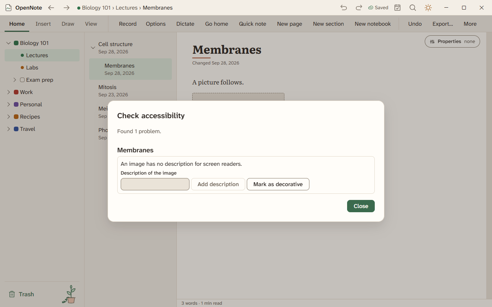

# Accessibility checker

The accessibility checker looks for things on a page that are hard for a screen reader or a low-vision reader. It lists each problem and offers a fix.

## Open it

Choose **Check accessibility** on the View tab, in the command palette (Ctrl+K), or in the menu of a page or section in the pages pane. A section checks the pages inside it.

## What it finds

| Problem | The fix it offers |
|---|---|
| An image has no description for screen readers. | Type a description and choose **Add description**, or choose **Mark as decorative**. |
| A heading jumps from one level to a lower one, such as 1 to 3. | Use the next heading level. |
| A table has no header row. | Make the first row a header. |
| Text is in a color that is hard to read. The report gives the contrast ratio. | Use the normal text color. |
| Color may be the only sign of a text's meaning. | Also make the colored text bold. |
| A free-form page has objects but no reading order. | Set the order from top to bottom. |

If there is nothing to fix, the report says **No accessibility problems found.**

## Before you export, print, or send

Turn on **Check accessibility first** and OpenNote checks the pages before Export, Print or PDF, and Send. The choice is remembered. If it finds problems, you can **Review and fix** them or **Continue anyway**. Pages with no problems go straight through.

## Other accessibility features

- Every control can be reached with the keyboard. F6 and Shift+F6 move between the main regions.
- Windows contrast themes are respected, and Settings, then **Appearance** has text size, interface size, and reduce motion. See [Settings](settings.md).
- The test list for a screen reader is in [the keyboard and screen reader checklist](../testing/keyboard-and-screen-reader.md).
