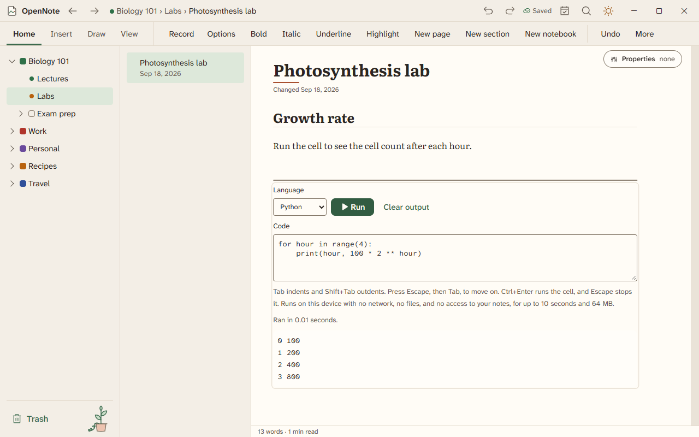

# Code cells

Write a short program on a page and run it there. Use it to check a worked problem, try Newton's method, or print a table of values. Code cells are in Beta.

## Add a code cell

- Open Insert, then Code cell. Or type `/code cell` in text, or press Ctrl+Alt+Shift+K. The command palette (Ctrl+K) finds it too.
- Choose a language from Language: Python, JavaScript, TypeScript, SQL, Lua, C, or C++. The cell starts with an example you can change or delete.
- For Python, Engine picks Quick (MicroPython, built in) or Full (Pyodide, a download).
- Write your code in the Code box. It is the same editor as the Code studio, with line numbers, colors, bracket matching, and find. To move on with the keyboard, press Escape, then Tab. The keys are in the table below.
- Errors are underlined as you type, and a list of names appears as you write. Press Ctrl+Space to ask for the list.
- A cell that needs a newer app version (TypeScript, SQL, Lua, C, C++, or Full Python) opens read-only in an older version of OpenNote.

## Keys

These keys work while the code box has focus.

| Key                                        | What it does                                                          |
| ------------------------------------------ | --------------------------------------------------------------------- |
| Tab                                        | Indents. Shift+Tab outdents.                                          |
| Ctrl+Tab                                   | Accepts the suggestion, or asks for one when none shows.              |
| Ctrl+Right                                 | Accepts one word of the suggestion.                                   |
| Escape                                     | Dismisses the suggestion.                                             |
| Escape, then Tab                           | Leaves the editor. After that, Ctrl+Tab switches page tabs.           |
| Ctrl+Shift+Tab, Ctrl+PageDown, Ctrl+PageUp | Switch page tabs from inside the editor.                              |
| Ctrl+M                                     | Makes Tab move focus instead of indenting. Press it again to go back. |
| Accept button                              | Accepts the suggestion by touch or pen.                               |

Every chord can be changed in Settings, then Shortcuts.

## Open it in the Code studio

- Press Open in Code studio, or run Open code cell in Code studio from the command palette. OpenNote asks first, then turns the cell into a code project with the same text and opens the studio. One undo takes the change back.

## Run it

- Press Run, or Ctrl+Enter in the code. What the program prints appears under it, and errors show in red.
- In JavaScript and TypeScript, use `console.log` or `print`. The value of the last line is shown after an arrow.
- In Python, use `print`. Python cells use MicroPython, which has most of the language and modules such as `math`, `random`, `json`, and `re`. It has no NumPy, and no `asyncio.run` or `input`.
- Press Stop, or Escape in the code, to end a run. Clear output removes what was printed.
- Code runs only when you press Run. Opening a page, or a page someone shared with you, never runs it.

## What a cell can and cannot do

Each run starts in a sandbox of its own, on this device, and works offline.

- It has no network, so it cannot download or send anything.
- It cannot open your files or your notes, and cannot change the page or the app. A Python cell's `open` works only on a short-lived, empty in-memory disk.
- It stops after 10 seconds and when it uses more than 64 MB. The first 100,000 characters of output are kept, and the cell says when the rest was cut.
- A function that calls itself without end stops with a stack overflow error.
- Nothing is kept from one run to the next. The page saves the code, not the output.

A language shows a message instead of output when its runtime is not part of this version yet.

A cell made by a newer version of OpenNote, in a language this version does not run, opens read-only. It shows the code and says it needs a newer version, and it is never changed or run.

## In exports and other apps

A code cell exports as a code block with its language, in Markdown, PDF, and web page exports. Search finds the code.

Code cells are built and have been checked by automated tests only.
