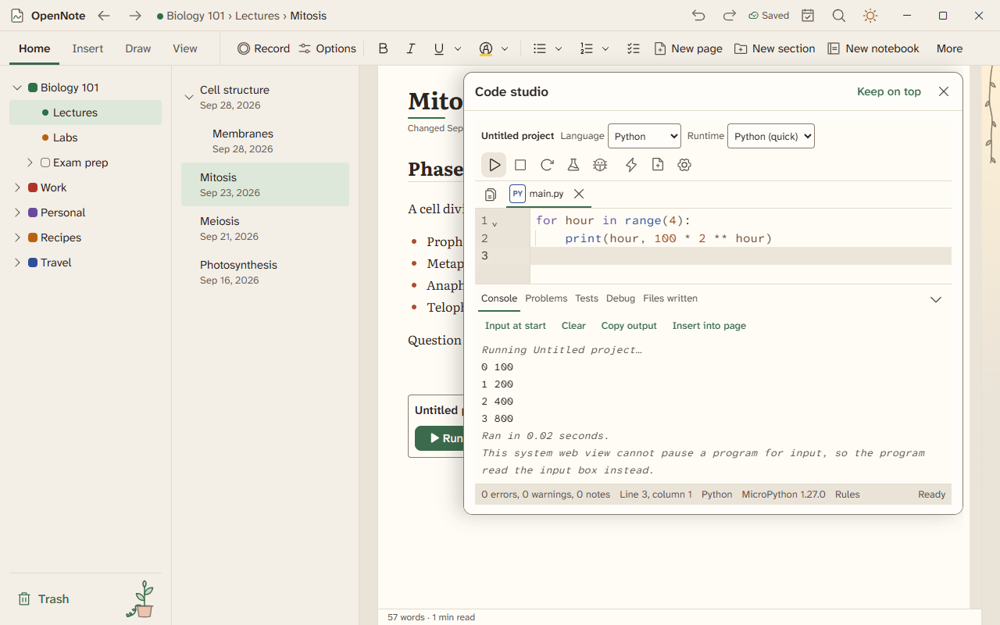
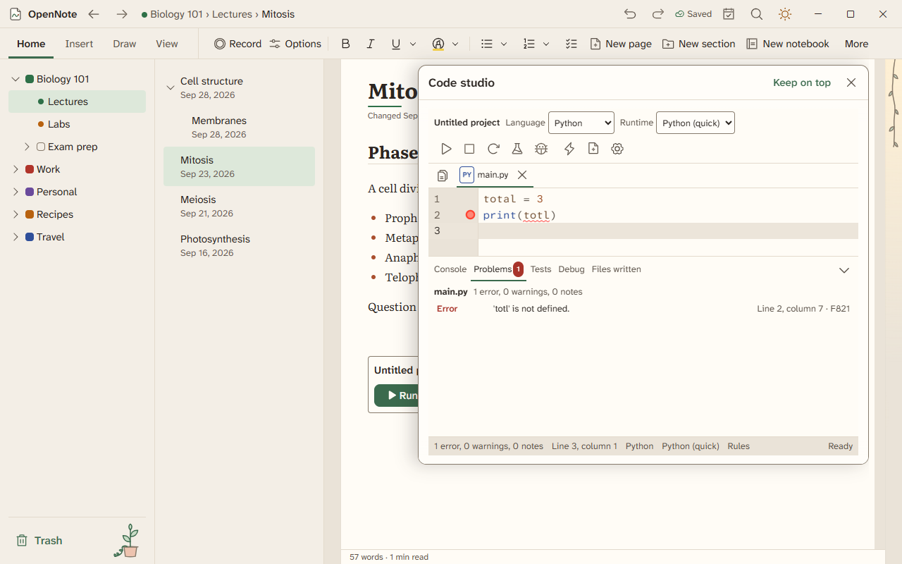

# Code studio

The Code studio is a tool window for writing, running, and testing code projects. It is in testing and is on in Beta and Nightly builds only.

## Open it

- Open Code studio is in the command palette (Ctrl+K).
- New code project puts a project block on the page and opens it in the studio. With no page shown, it starts a scratch project.
- Open code block in Code studio turns the code block at the caret into a project.
- The studio can pop out into a window of its own. It still edits the project block on your page.

## The window

- The toolbar picks the language and the runtime, and has Run, Stop, Restart, Run tests, Snippets and examples, New project, and Settings. A runtime that needs a pack has a Get button.
- Files show as tabs, or as a file tree when the window is wide. A dot marks a file the page has not saved yet.
- The bottom panel has the Console, Problems, Tests, Debug, and Files written. Debug is a placeholder until the debugger lands (see Debugging).
- The status bar shows the line and column, the runtime, and how many errors and warnings there are.

## Console

- The console shows what the program prints, in color when the program asks for it.
- To give a program input, open Input at start, and type the lines before you run. A program cannot wait for typing during a run yet.
- A file name and line in an error message is a link. It opens that line.
- Copy the output, clear it, or insert it into the page.

## Problems

- Errors show while you type. The fast checks run first, then each language's own engine: full Python, SQLite, Lua, and clang for C and C++.
- Problems lists them by file, with counts. Settings, then Code, chooses errors only, errors and warnings, or everything.
- A run's errors join the list too.

## Quick fixes and explanations

- Point at a problem, or put the cursor on it and press Ctrl+., to see its fixes.
- Fixes include a name you likely meant (such as `console.log` for `console.lgo`), a missing import or include, and a closing bracket or quote.
- Other fixes add indents, a missing colon or semicolon, or a missing self. They also change = to == and fix SQL typos.
- Fix all fixes every problem of one kind in the file.
- Explain the problem says what the error means, in plain words. It works for Python, JavaScript, C, C++, SQLite, and Lua errors.

## Tests

- The Tests panel lists your test cases and the tests found in your code, grouped by class or describe block.
- Add a case with Add. An input case gives the program input and checks what it prints. A call case calls a function with JSON arguments and checks the value it returns. An SQL case checks the rows a query returns, in order or in any order.
- Each case picks how to compare: exact, trim spaces, words, numbers with a tolerance, lines in any order, or a pattern. Each case has its own time limit.
- The panel also runs Python unittest tests (full Python), Jest-style tests in JavaScript and TypeScript, and failed asserts in C and C++.
- Run all, Run one, or Run failed. A failed test shows its message, a link to its line, and a diff that marks each line Expected, Actual, or Same.

## Keys

### Run and problems

These keys work while the studio's editor has focus.

| Key                   | Action                  |
| --------------------- | ----------------------- |
| Ctrl+Enter or Ctrl+F5 | Run the project         |
| Shift+F5              | Stop the run            |
| Ctrl+Shift+F5         | Restart the run         |
| Ctrl+Shift+M          | Show the Problems panel |
| Ctrl+.                | Show the quick fixes    |

### Editor and suggestion keys

| Key                                        | What it does                                                          |
| ------------------------------------------ | --------------------------------------------------------------------- |
| Tab                                        | Indents. Shift+Tab outdents.                                          |
| Ctrl+Tab                                   | Accepts the suggestion, or asks for one when none shows.              |
| Ctrl+Right                                 | Accepts one word of the suggestion.                                   |
| Escape                                     | Dismisses the suggestion.                                             |
| Escape, then Tab                           | Leaves the editor. After that, Ctrl+Tab switches page tabs.           |
| Ctrl+Shift+Tab, Ctrl+PageDown, Ctrl+PageUp | Switch page tabs from inside the editor.                              |
| Ctrl+M                                     | Makes Tab move focus instead of indenting. Press it again to go back. |
| Accept button                              | Accepts the suggestion by touch or pen.                               |

Every chord can be changed in Settings, then Shortcuts.

## Suggestions and privacy

- Ghost text shows a gray suggestion at the caret. Ctrl+Tab accepts it. A screen reader says the suggestion and the Accept chord once, then says what was inserted.
- Suggestions come from your own code and the language's names, made on this device. Your code is never sent anywhere to make them.
- A code project runs in a sandbox with no network and no access to your files or notes. Crash reports hold code positions only. They never hold block data. They never hold your code.

## What each language can and cannot do

| Language                  | Can                                                  | Cannot                                                                                                        |
| ------------------------- | ---------------------------------------------------- | ------------------------------------------------------------------------------------------------------------- |
| Python (Quick)            | Most of the language, `math`, `random`, `json`, `re` | NumPy, waiting for typed input during a run (type the input before the run), tests that need the full runtime |
| Python (Full)             | Full Python, `unittest`, standard library            | Network and files outside the project                                                                         |
| JavaScript and TypeScript | Modern syntax, Jest-style tests                      | Network, `require` of outside packages                                                                        |
| SQL (SQLite)              | Tables, queries, rows checked in tests               | Files outside the project                                                                                     |
| Lua                       | Lua, and test calls that pass JSON arguments         | Files and network                                                                                             |
| C and C++                 | Compile and run with clang, failed asserts in tests  | Network, files outside the project                                                                            |

Each run stops at its time and memory limit, which Settings, then Code, sets (up to 60 seconds and 256 MiB).

## Runtime packs

A runtime that is not built in needs a pack. The Get button in the toolbar downloads it once, shows its size first, and keeps it on this device. After that, the language works offline.

## Debugging

Stepping through a run is not in this version yet. Console output, Problems, and Tests are.

## Examples

Examples come in each language, with tests of their own. Insert one into a project, then run its tests.

## Settings, then Code

Set indents for each language, the Python runtime, the run time and memory limits, suggestions, how many problems show, and the C and C++ standards and warnings.

## Languages

- [Python in code projects](python-projects.md)
- [JavaScript and TypeScript in code projects](javascript-and-typescript-projects.md)
- [SQL and Lua in code projects](sql-and-lua-projects.md)
- [C and C++ in code projects](c-and-cpp-projects.md)
