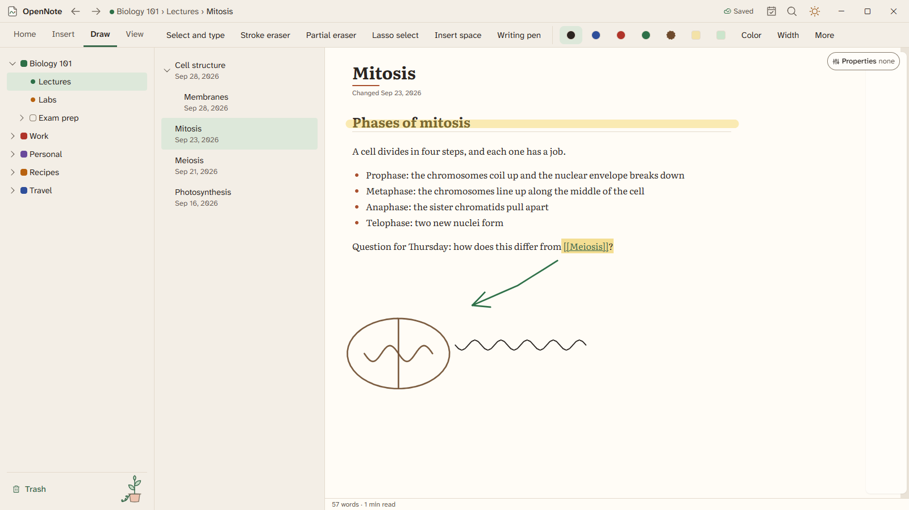
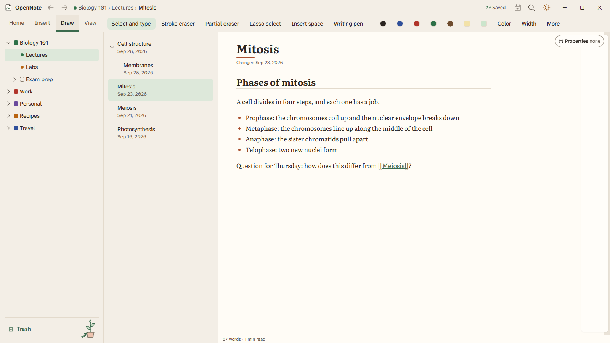

# Ink and palm rejection

Draw with a pen or a finger on any page. Open the Draw tab to pick a tool, a color, and a width.

## Pens and erasers

The Draw tab has pens, a highlighter, two erasers, the lasso, and shapes. In a wide window the pen slots sit in the bar. In a narrow one they sit under More.

- The stroke eraser removes a whole stroke. The partial eraser cuts a stroke where you rub.
- Turn the pen over to use its eraser end.
- The lasso selects strokes. Drag them to move them. Ctrl+Z and Ctrl+Y undo and redo.
- Filters let the eraser or lasso touch only highlighter, or only ink.

## Palm rejection

Rest your hand on the screen and write. While a pen is near the screen, a touch never draws. A palm does not scroll or select either.

OpenNote judges each touch from its size, how fast it grows, where on the hand it is, and how it moves. Touch ink is kept so OpenNote can take it back if the touch turns out to be a palm.

Open Settings, then Pen and touch, to change this.

| Setting                 | Choices                                                                |
| ----------------------- | ---------------------------------------------------------------------- |
| Writing hand            | Detect, Right hand, or Left hand                                       |
| Draw with a finger      | Until a pen is used, Always, or Never                                  |
| Pen buttons             | What the side button and the eraser end do, set for each pen           |
| Pressure and steady pen | A pressure curve from light to firm, and smoothing for a steadier line |

## Shapes and gestures

- Draw a rough shape and hold the pen still. It snaps to a clean circle, rectangle, triangle, star, or arrow. Keep holding to resize it before you lift. Uneven outlines with 4 to 7 corners, such as a trapezoid or a house, snap to a clean polygon you can reshape by its corner handles.
- Scribble over words to erase them. Circle something, then tap, to select it.
- Double tap with two fingers to undo. Double tap with three to redo.
- On typed text, the pen edits: strike through words to delete them, draw a short line between words to add a space or a long one to split the paragraph, and circle words to select them. With on-device handwriting recognition on, write in a gap between words, or where the cursor is, and a moment after you stop the words are typed in there. Each edit shows Undo, and each can be turned off: press Ctrl+K and type "pen edit".
- Draw a grid of at least three lines each way, and OpenNote offers Convert to table. You can also lasso a grid you drew earlier and choose Convert to table on the bar, or press Ctrl+K and type it. With on-device handwriting recognition on, what you wrote in each cell becomes the cell's text. One Ctrl+Z puts the lines and the writing back.

## Helpers

Press Ctrl+K and choose one of these by name.

| Name                                | What it does                                                    |
| ----------------------------------- | --------------------------------------------------------------- |
| Insert space                        | Drag down to push everything below further down.                |
| Zoom writing box                    | Write large in a box. It lands small on the line.               |
| Replay ink                          | Plays your strokes back, and plays a recording along with them. |
| Ruler, Protractor, and Snap to grid | Help you draw neat diagrams.                                    |
| Measure, Compass                    | Measure distances, and draw circles and arcs.                   |

### Measure and draw with the ruler and the compass

Turn on Ruler in the Draw tab. Drag it to move it, and drag its round handle to turn it. With it selected, the arrow keys move it a millimeter (or a sixteenth of an inch) and the bracket keys turn it; hold Shift for bigger steps.

- **Straight lines:** start a stroke at either long edge and it runs straight along it. The ruler shows the line's length as you draw.
- **Units:** the ruler shows centimeters or inches. Choose Units in the Draw tab: Automatic follows your region, or pick Centimeters or Inches.
- **Measure:** choose Measure in the Draw tab, or press Ctrl+Alt+Shift+M. Drag from one point to another, or tap one point and then the other. The page shows the distance and the angle, and nothing is drawn. Points snap to the ruler's edge and to the paper's lines.
- **Length of a line:** select a line or a shape, then press Ctrl+K and choose Measure the selected line.
- **Compass:** choose Compass in the Draw tab, or press Ctrl+Alt+Shift+C. Tap to set the center. Drag out from the center to open the compass; the radius shows as you drag and snaps to the paper's lines or the grid when snapping is on. Then sweep around the center to draw an arc, or all the way around for a circle. It is saved as a shape, so you can reshape it by its handles. Tap somewhere else to move the center and keep the radius.
- **Compass by keyboard:** while the compass is out, its center has the keyboard. The arrow keys move it, plus and minus open and close it, Enter draws a circle, and Escape puts it away.
- Choosing a pen, the eraser, or the lasso puts the measure and the compass away. Hold Alt to place a point without snapping.

### Snap to paper lines

On lined, grid, or dot paper, lines, arrows, and shapes snap to the paper's own lines as you draw them.

On grid paper a corner near a crossing lands on it, and on dot paper it lands on a dot. On lined paper a shape snaps to the rules and to the margin line (turn it on with Margin line in View, Background), and a line drawn close to level and near a rule lies on it.

A point snaps only when it is near a line, within about a third of the spacing, so a line drawn in the page's header or midway between two rules stays where you drew it. Rectangles and ellipses keep their sizes in whole squares. Moving or resizing a shape by its handles snaps too, and the arrow keys move a selected shape one square at a time. A small ring shows where a point snapped.

- Hold Alt while you draw or drag to place a shape freely, just that once.
- Turn it off with Snap to paper lines in the Draw tab, or under More when the window is too narrow to show it. The setting is remembered. On plain paper the same switch is Snap to grid, with its own grid size.
- Handwriting and other freehand ink never snap.

## Export a selection

Lasso ink, text, or pictures, then choose Export selection or Copy as image on the bar above the selection, or in its right-click menu. Point at either button to see a dashed outline of the area you will get.

In the export dialog, Area chooses how the edges are cut:

- **Smart** fits the edges to what you selected, with a small margin.
- **Exact** keeps the shape you drew with the lasso.

OpenNote remembers your choice for next time. Copy as image uses it too. You can save the selection as a PDF, PNG, SVG, or Word file.

## Handwriting to text

Lasso your writing and choose Convert to text. The Writing pen converts as you write. Both use on-device intelligence, which you turn on in Settings. See [on-device intelligence](on-device-intelligence.md).

Arrows, signs, and formulas come out as you meant them: `->` becomes →, `>=` becomes ≥, and H2O becomes H₂O. When OpenNote isn't sure of a word, it draws a thin amber line under it. Tap the line, or Tab to it and press Enter, to see other readings. Choose one to put it in the text, or choose Keep to remove the line. Ctrl+Z undoes the change.

Ink and palm rejection are built. They have been checked by automated tests only, and the real-pen test in [palm-rejection.md](../testing/palm-rejection.md) is waiting for a person with a pen.

## Group things together

Select two or more things with the lasso (ink, text boxes, pictures) and choose Group, or press Ctrl+G. A group moves, resizes and deletes as one, and one Undo takes each of those back. Ungroup (Ctrl+Shift+G) lets them go again; reading order is not changed.

## More pens

On the Draw tab, pick a pen, open **Width**, and choose a pen type to change it to a fountain pen, brush, calligraphy pen, dashed pen, or dotted pen. The fountain pen and brush draw wider when you press harder or move slowly, and thinner when you move fast. The calligraphy pen has a flat nib held at a fixed angle, so strokes across the nib are broad and strokes along it are fine. The dashed and dotted pens draw a broken line. Each keeps its own sizes and colors, and screen readers hear its name.

The same menu has **Save these pens as a set**, which saves the pens on your palette under a name, so you can switch between a writing set and a drawing set. Choose a set to bring its pens back, or its Delete entry to remove it. You can keep 12 sets.

## Links on handwriting

Lasso some writing and choose **Make link** (on the bar above the selection, or in the command list). The link can go to a page, to a heading on a page, to a web address, or to the recording at the moment you wrote it. The writing keeps its link when you move or resize it. Choose **Remove link** to take it off.

**Links on this page** in the command list opens a list of every link. For each one you can **Select** its writing, which draws the selection outline around it, or **Open** it. The list works with the keyboard and screen readers. A link to a page counts in that page's backlinks.

## Layers

Choose **Layers** in the command list to keep ink apart. Each layer has a name, and you can hide it, lock it, move it up or down, make it the one new ink goes to, export it on its own, or delete it (its ink goes to the first layer). A hidden layer isn't shown, printed, or exported. A locked layer is shown, but the pen, the erasers and the lasso pass over it, so you can trace over a drawing without moving it. To move writing to another layer, lasso it and choose **Move to layer**. A layer made for an imported PDF or slide is locked and stays at the bottom.

## Writing in text fields with the pen

In Settings, Pen and touch, turn on **Write in text fields with the pen**. Then touching the search box, a rename field, or a table cell with the pen opens the handwriting panel of Windows, and what you write there is typed into the field. The panel is Windows' own. If it doesn't appear, check that the handwriting panel is turned on in Windows settings under Bluetooth & devices, Pen & Windows Ink. Fingers and the mouse work as before.
