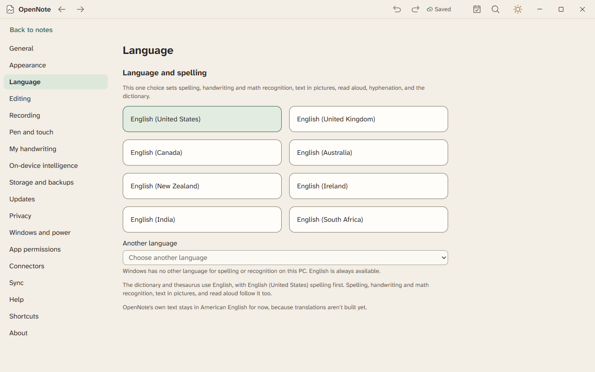

# Language and spelling

OpenNote uses American English until you choose another language. That holds even when Windows itself uses a different language. One choice sets the language for everything that reads or writes words.

## What the language sets

| Part of OpenNote | What the language does |
|---|---|
| Spell check and autocorrect | Checks words in your language. Choose extra spelling languages in Settings, Editing, Spelling. |
| Dictionary and thesaurus | Looks words up in English, with your dialect's spelling first. American English puts American spellings first. |
| Hyphenation and syllable marks | Breaks English words into syllables. Other languages are left whole. |
| Read aloud | Picks a voice for your language before it falls back to the Windows default. A voice you chose yourself always wins. |
| Handwriting and math recognition | Reads your writing in your language. |
| Text in pictures | Reads in your language, and uses the Windows languages if that language has no text recognizer installed. |
| My handwriting | Asks you to write sentences in your language. Only English sentences exist so far. |

## Choose a language

Setup has a step called Language and spelling. It shows English (United States) already chosen. You can pick another English dialect: United Kingdom, Canada, Australia, New Zealand, Ireland, India, or South Africa. Under Another language, the list shows the languages Windows can spell-check or recognize on this PC. OpenNote opens nothing outside the app to make that list.

You can change it later in Settings, under Language.

## Language and direction of a passage

These are on the beta branch behind a flag that is off.

- Select text, or put the cursor in a paragraph, and choose Language on the Review tab. Pick a language, or Use the page language. Spell check then checks that text in its own language. A language with no spelling dictionary on this PC is left unchecked.
- Choose Do not check spelling for text such as code names or citations. Choose it again to check that text once more.
- On the Home tab, choose Right-to-left text direction to make the paragraph read from the right. Left-to-right text direction sets it back. Start alignment follows the direction, so a right-to-left paragraph starts on the right.
- On the Layout tab, Automatic hyphenation breaks the paragraph's words by its language.

## What stays in American English

OpenNote's own text stays in American English for now, because translations are not built yet. There is one dictionary pack, the English one. A language with no dictionary yet gets a calm note saying so. The English dictionary stays available. Spelling, recognition, and read aloud still use your language.
