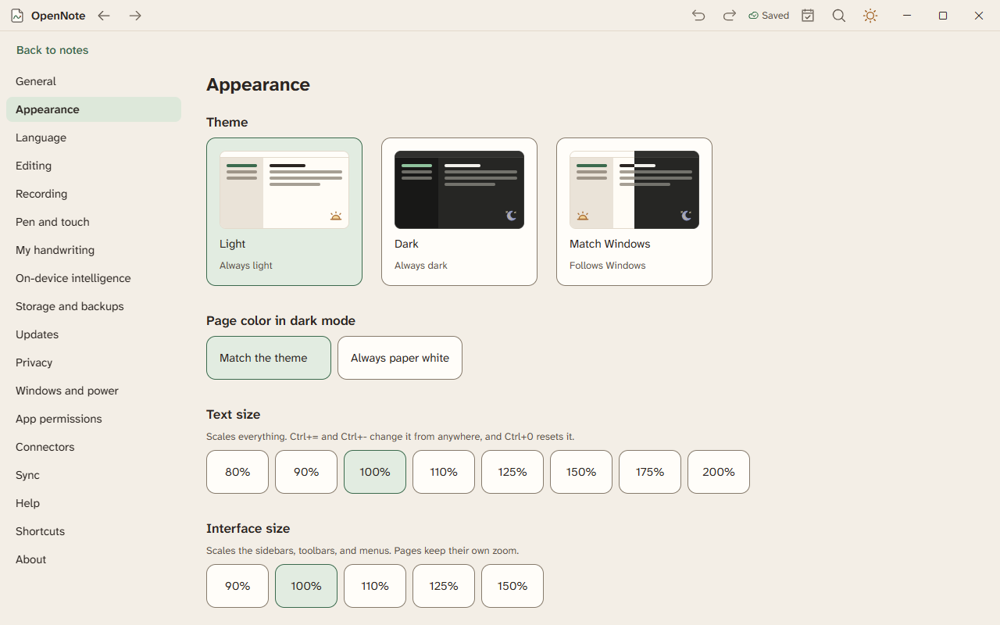
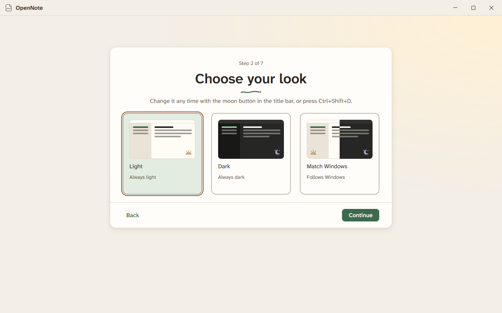

# Settings

Press Ctrl+, to open Settings. A list of sections is on the left. Choose a section to see its options. Choose **Back to notes** to return. Changes take effect as you make them.

## The sections

| Section | What it holds |
|---|---|
| General | The notes folder, where OpenNote lives, the Start menu entry, and what opens at start-up. |
| Appearance | Theme (Light, Dark, or Match Windows), page color in dark mode, text size, interface size, the size of buttons and rows, and reduce motion. |
| Language | The language and the spelling dialect. American English is the default. See [Language and spelling](language-and-spelling.md). |
| Editing | Markdown shortcuts, the slash menu, and AutoCorrect. |
| Recording | Live captions, a transcript of every recording, formats, and the consent reminder. See [Recording](recording.md). |
| Pen and touch | The writing hand, drawing with a finger, steady pen, and the pressure curve. See [Ink and palm rejection](ink-and-palm-rejection.md). |
| My handwriting | Calibration and the symbols in your own hand. See [My handwriting](my-handwriting.md). |
| On-device intelligence | Each feature, off by default, and what it runs on. See [On-device intelligence](on-device-intelligence.md). |
| Storage and backups | Scheduled backups, notebooks that cannot be found, and portable mode. |
| Updates | The update channel, checking for updates, and going back to the last version. |
| Windows and power | Quick capture and its shortcut, keeping OpenNote on top, docking, low-power mode, and **Start on Home**. |
| Privacy | Work offline and a plain list of every network use. See [Privacy and Work offline](privacy-and-work-offline.md). |
| App permissions | The local API and the apps allowed to use it. See [The local API](local-api.md). |
| Connectors | Accounts that some features use. See [Connectors](connectors.md). |
| Sync | Optional encrypted sync. See [Sync](sync.md). |
| Help | This copy of OpenNote and the ways to get help. |
| Shortcuts | Two shortcut sets and the list of commands you can rebind. |
| About | The version, the channel, the license, and the list of feature flags. |

## Appearance

- **Theme.** Light is warm paper. Dark is a neutral charcoal gray. Match Windows follows your PC. If a Windows contrast theme is on, Windows sets the colors.
- **Text size.** Scales everything. Ctrl+= and Ctrl+- change it from anywhere, and Ctrl+0 resets it.
- **Interface size.** Scales the sidebars, toolbars, and menus. The pages keep their size.
- **Page color in dark mode.** Choose Match the theme or Always paper white.
- **Size of buttons and rows.** Automatic follows the pointer you used last. Standard and Large set it yourself, and Large gives every pointer touch-size targets.
- **Reduce motion.** Choose Match Windows or Always reduce motion.

## Shortcuts

Settings, then **Shortcuts** lists every command with its keys. Filter the list by name or by key. Choose a command to rebind it. OpenNote warns you when two commands share a key, and you can reset a command. A few keys, such as Tab, Escape, and the arrow keys, always work. They cannot be changed.

## Setup

First-run setup has seven steps. When an update adds a step you have not seen, setup opens it on the next start.

