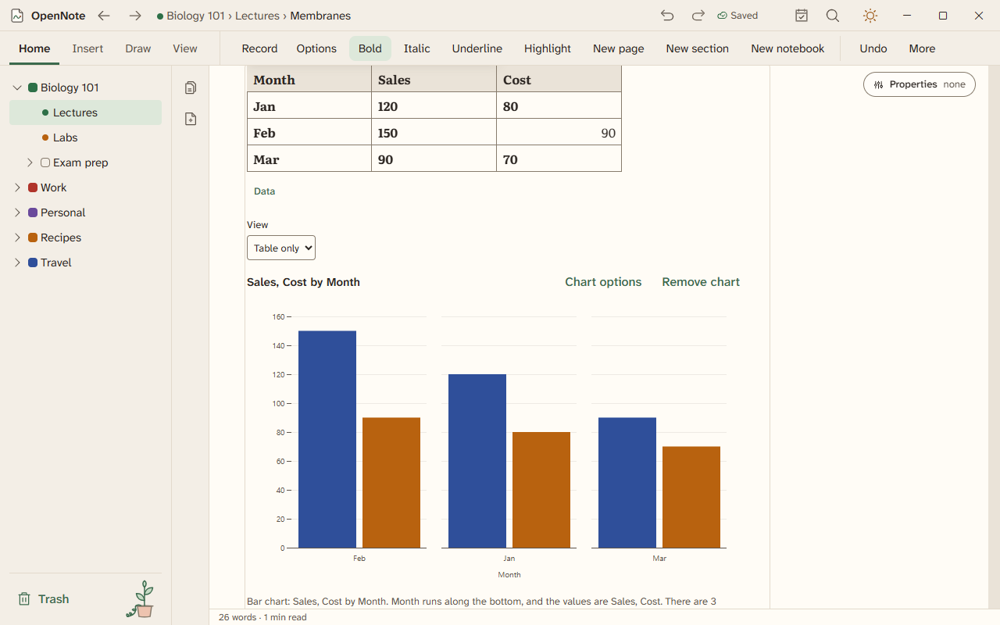

# Tables and charts

A smart table holds typed columns, formulas, and several views of the same rows. A chart reads its numbers from a table.

## Make a table

- Open Insert, then Smart table.
- Format a column as number, currency, percent, date, or text. Sort and filter the rows, and use Board to group rows by any column of repeating text (the stand-in for a choice column).
- Draw a grid with the pen and it becomes a table.
- Import an Excel file and each sheet becomes a table page.
- Right-click a cell, or press Shift+F10 or the Menu key in it, to open the table's menu. It has Cut, Copy, Paste, and Select all. Below those are the table's own commands. They add a row or a column, move a row, set the header row, change a column width, and delete a row, a column, or the table.
- Give a number column a unit, such as kN or mm, and cells in other units of the same kind convert to it. See [Engineering tools](engineering-tools.md#units-in-tables).

## Analyze

- Select cells, with or without the header row, and choose a tool under Analyze: statistics, a histogram, a box plot, a fit, or a matrix tool. The answer lands below the table. A box plot or a fit adds two tables together, and one Undo takes both away.
- A tool that cannot run says why on the screen, for example when a cell in a matrix is not a number.

## Formulas

Add a calculated column and type a formula, such as `=Price * Qty`. The column fills in for every row and stays up to date as you edit.

Formulas follow Excel's rules. Beyond math, text, and dates, they have these families:

- Logic and information: IFS, SWITCH, XOR, IFNA, the IS functions, CELL, INFO, TYPE, and ERROR.TYPE.
- Lookup: XLOOKUP, XMATCH, INDEX, MATCH, VLOOKUP, HLOOKUP, OFFSET, INDIRECT, ROW, COLUMN, FORMULATEXT, and HYPERLINK.
- Arrays: FILTER, SORT, SORTBY, UNIQUE, SEQUENCE, TAKE, DROP, VSTACK, HSTACK, MMULT, MINVERSE, and the LAMBDA helpers MAP, REDUCE, SCAN, BYROW, BYCOL, and MAKEARRAY. An array result spills into the cells beside it.
- Statistics: averages, deviations, ranks, percentiles, distributions such as NORM.DIST and T.DIST, regression such as LINEST, and FORECAST.ETS. These load the first time a formula uses one, so the cell shows #BUSY! for a moment.

The places where OpenNote's answers differ from Excel's are listed in the engine's DIFFERENCES.md.

## Views

A table can show its rows as a board, a calendar, a gallery, or a timeline. The rows do not change. Only the view does.

## Charts

Insert a chart from a table and change its type. Edit a number in the table and the chart updates.

Every chart has a text summary and a data table, so a screen reader can read it. Press Tab to reach a chart.

## Take a table out

Export a table as an Excel file (`.xlsx`) or as `.csv`. Both are in the Export dialog.

A page exported to Word, HTML, or Markdown keeps each table's last results. Word and HTML also keep fills, borders, alignment, fonts, and merged cells. When a table's results are out of date, the export report names it.

Smart tables and charts are built. They have been checked by automated tests only. The [feature list](../FEATURES.md) shows their status.

## Choices

To pick a value from a short list, such as a status or a tag, click in a column, open the Data menu, choose Format, then pick the format "Choice, pick one" or "Choice, pick several". The column starts with the values it already holds. Each value is a named, colored choice.

Press Alt+Down in a cell, or use Choose a value in the Data menu, to see the list. A column that picks several stays open after each choice, so you can pick more. Choose Done or press Escape to finish. You can still type in the cell. Text that is not one of the choices has a dashed outline and is kept.

Choose Edit choices to add a choice, rename it, give it another color, move it up or down, or delete it. Renaming changes every cell that has it. Deleting a choice leaves the cells' text alone. A choice name cannot have a comma.

Sort orders rows by the order of the choices. Under Filter, Show only a choice shows just those rows. A board puts one lane on the screen for each choice. A formula reads a choice as its text, so `[Status] = "Done"` works. Export writes the names, and an Excel file gets a drop-down list for a column that picks one.

## Analyze: statistics, regression, and matrices

Select some cells, or just click in a table to use all of it, then open the Data menu and choose Analyze. Or press Ctrl+K and type "Table:". The answer is added as a new table below, so your data is never changed. Rows hidden by a filter are left out.

- **Statistics** gives count, sum, mean, median, mode, standard deviation and variance (sample and population), minimum, maximum, and the quartiles for each column. Histogram adds a table of bins with a bar chart. Box plot adds a box plot chart of the values, with the five numbers beside it.
- **Regression** fits two selected columns, x then y (one column uses 1, 2, 3 for x). Choose a linear, quadratic, cubic, any polynomial up to degree 6, or exponential fit. You get the equation, r², and a table of the points and the fitted values with a scatter chart.
- **Matrix** treats the selected numbers as a matrix. Choose determinant, inverse, transpose, multiply by another range (type it, such as D1:E2), row reduce with steps, rank, eigenvalues, or Solve Ax = b. For Solve, select the coefficients with the answers in the last column. Eigenvalues are listed when real, for matrices up to 8 by 8.

To get an answer as a display equation instead of a table, choose Analyze, then Insert as an equation. It works for fits, matrix tools, and the box plot, and the equation is added as its own block below the table.

A number can have a unit, such as 12.5 kg. When all the numbers in a column share a unit, the statistics keep it. If they differ, nothing is added and you are told why.

## Saved views

In the Data menu under a table, choose Saved views, then Save filters and sort as a view. Pick a view later to see the same rows in the same order. Each table keeps its own views.

## Format cells

When a table is current, a second row of tools sits under the table tools. It sets the font, size, bold, italic, underline, and strikethrough, the text and fill colors, borders, alignment, wrapping, rotation, and the number format. It also has Currency, Percent, the thousands separator, more and fewer decimals, and Clear formats.

Select whole cells and a tool formats the cells. Select text inside one cell and the same tool formats only that text. Each change is one undo step.

The Borders button draws the last border you used. Its arrow opens all 16 borders, the line style, and the line color. In a narrow window, the least used tools move into a More menu. Press Ctrl+K and type "Cell:" to find every format by name.

## Spreadsheet keys

A table can use spreadsheet keys. In Grid mode the arrow keys move between cells, Shift extends the selection, and Ctrl jumps to the edge of the data. Type to replace a cell, or press F2 to edit it with the caret at the end. Esc puts the old content back. Enter and Tab move to the next cell, and inside a selection they cycle through it.

Ctrl+D and Ctrl+R fill down and right, and formula references move with them. Ctrl+; enters today's date and Ctrl+: the time. Alt+Enter starts a new line in a cell.

Choose Use document keys in this table to get the old keys back, where Enter starts a new line. A setting chooses the keys for new tables. A screen reader hears each cell's position, column name, value, and formula. Keyboard shortcuts lists every key.

## Conditional formatting

A rule can color a cell by its value, its text, a date, blanks, errors, top or bottom values, values above or below the average, duplicates, or a formula. Color scales, data bars, and icon sets show a range at a glance. Rules run in priority order, and Stop if true keeps lower rules from applying.

To manage rules, run Cell: Conditional formatting rules from the command palette (Ctrl+K) or the table's context menu. A window lists the rules of the selection, the table, or the page. You can raise or lower a rule, turn Stop if true on or off, or delete it. Undo takes each change back. Making a new rule from a window is not built yet.
