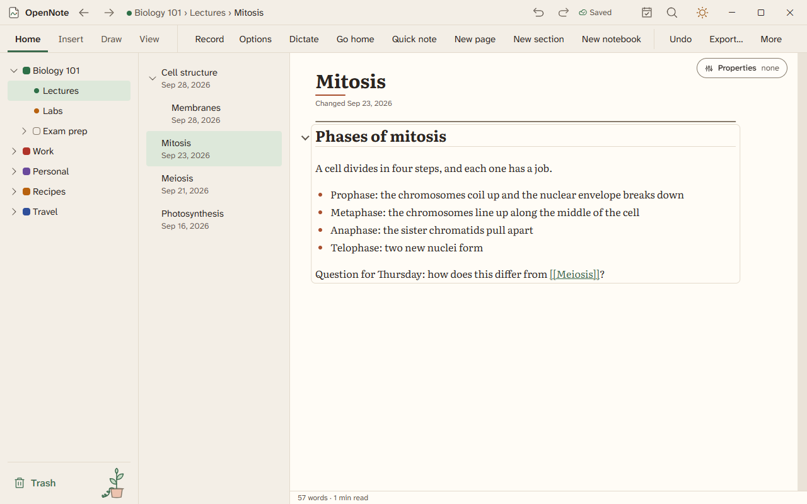

# Typed notes

A page holds text boxes, headings, lists, checklists, quotes, code, callouts, tables, and pictures. This page covers the everyday keys and menus.

## Add things to a page

| To do this | Do this |
|---|---|
| Insert a table, code block, callout, divider, or date | Type `/` on an empty line to open the slash menu. The Insert tab has the same items. |
| Make a heading | Press Ctrl+Alt+1, Ctrl+Alt+2, or Ctrl+Alt+3. |
| Make text bold | Press Ctrl+B. |
| Link to another page | Type `[[` and pick a page. |
| Show another page inside this one | Type `![[` and pick a page. To show one paragraph, write `![[Page#^id]]` with the paragraph ID you copied. When you export, the embedded text is included. |
| Paste with the structure and without stray fonts | Press Ctrl+V. Press Ctrl+Shift+V to paste plain text. A table from a web page or a spreadsheet, or cells copied as tab-separated text, becomes a table. |
| Copy text to another app | Press Ctrl+C. The other app gets the words as plain text, with list markers and without Markdown marks, or the formatted text if it takes that. |
| Paste a screenshot | Press Win+Shift+S, then Ctrl+V. |

Moving around without a mouse is in [moving between blocks](moving-between-blocks.md).

## Checklists

Press Ctrl+Enter to check or uncheck an item. Finished items move down, and the list shows a count. Choose Check all to finish a whole list. Choose Show done count to turn the count on or off; it shows beside each checklist and the command says which it did.

## Callouts, dividers, equations, and code

- In a callout, press Tab in the title to reach the type button and again for the fold button. Enter or Space opens the type menu or folds the callout, and Escape returns to the text. Each of the eleven types has its own symbol and color.
- Type `---`, or `***` or `___` and Enter, on a line of its own to make a divider.
- A page that ends on an equation always has an empty line below it to continue on. Escape in the box of a new equation that is still empty takes the equation away.
- A code block has a Copy button beside its language button. It copies the whole block.

## Find, count, and navigate

| To do this | Do this |
|---|---|
| Find on the page | Press Ctrl+F. |
| Replace on the page | Press Ctrl+H. |
| See the word count and reading time | Press Ctrl+K and choose Word count. |
| Jump between headings | Press Ctrl+K and choose Contents. Select a heading to go to it. |
| Stop accidental edits and ink | Press Ctrl+K and choose Lock page. Choose it again to turn the lock off. |
| Make the caret easier to see | The caret follows the Windows text cursor settings: its thickness, its blinking, and the indicator color. Turn on Settings, Accessibility, Text cursor in Windows, or choose a width in OpenNote's settings. |

### Find by format, special characters, and patterns

- Choose Format in the Find bar to find text by bold, italic, underline, font, size, text color, highlight, or character style. Turn on Any for a color or highlight to find every one. In Replace, choose Format to set formats on the replacement, or on the found text when the replacement is empty.
- Choose Special to add a paragraph mark (^p), tab (^t), any character (^?), digit (^#), letter (^$), manual line break (^l), nonbreaking space (^s), or caret (^^). Replacing a paragraph mark joins that paragraph with the next one.
- Turn on Wildcards for ?, *, [abc], [!abc], <, >, {n,m}, and @. Wildcards always match case.
- Turn on Regular expressions to use a full pattern. In the replacement, $1 to $9 give the parts in parentheses.
- A pattern may have at most 250 characters. A pattern that takes more than a moment stops with a message. Make it simpler.

## Templates, series, and the source

- Start a page from a template when you make it.
- Choose Next in series to make the next numbered page, such as the next lecture.
- Choose Show pages in this series to list every page of the series, oldest first, and open any of them.
- Press Ctrl+K and choose Markdown source to edit the page as Markdown. The page updates as you type.
- Lasso handwriting, or select blocks, and choose Extract to new page to move them out. A link takes their place; pictures and attachments stay. Select two pages and choose Merge pages, or choose Split at headings. Each one is a single Undo, and Page history gets an entry. Press Ctrl+Z straight away to undo it.

## Pictures and files

- Right-click a picture and choose Alt text to get a first draft you can edit.
- Choose Wrap on a picture to set text around it on a document page.
- Choose Size and position on a picture to type its size and how much to crop from each side. Reset crop puts the whole picture back.
- Drop a file, a PDF, or a link on the page to attach it. A Word file you edit and save comes back into the page.
- Documents, pictures, audio, video, and ZIP files open in their own app. Other files are shown in their folder, and programs and scripts never open from a note.
- A PDF or Office attachment shows its first page on the card. Right-click the attachment and choose Save a copy of the attachment to keep a file outside the note. The note keeps its own copy.

## Spelling and reading aloud

A misspelled word is marked. Right-click it for fixes. Select text, open the command palette, and choose Read aloud to hear it in a Windows voice. Nothing is sent anywhere.

The [feature list](../FEATURE-LIST.md) has one sentence on every typed-note feature.
- In the Elements library, choose Move to put an element in another folder. Folders have Rename and Move too.

## Checking accessibility before you export

Turn on Check accessibility first in the Export, Print or PDF, or Send dialog. OpenNote then looks for problems such as images with no description before it writes the file. You can continue anyway, review and fix, or cancel. The choice is remembered.

## Menus with a pen or a finger

Every menu that opens with a right-click opens another way on a touch screen. Press and hold a finger or a pen on a block, a table, or an empty part of the page, and keep still, to open its menu. With a pen, press its side button and lift without dragging. Right-click empty page for Insert table and Insert image.
