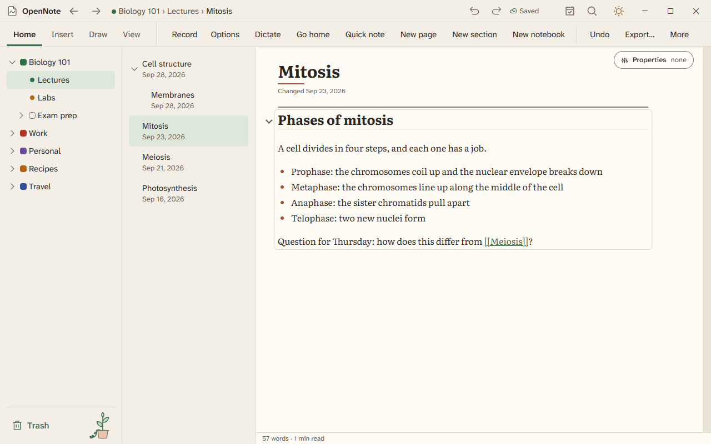
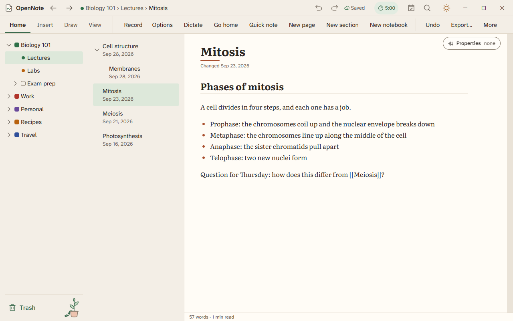
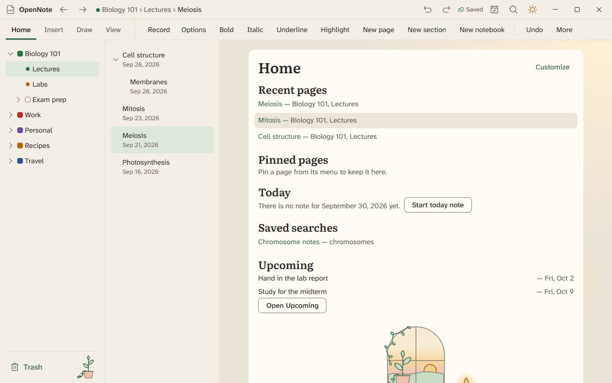
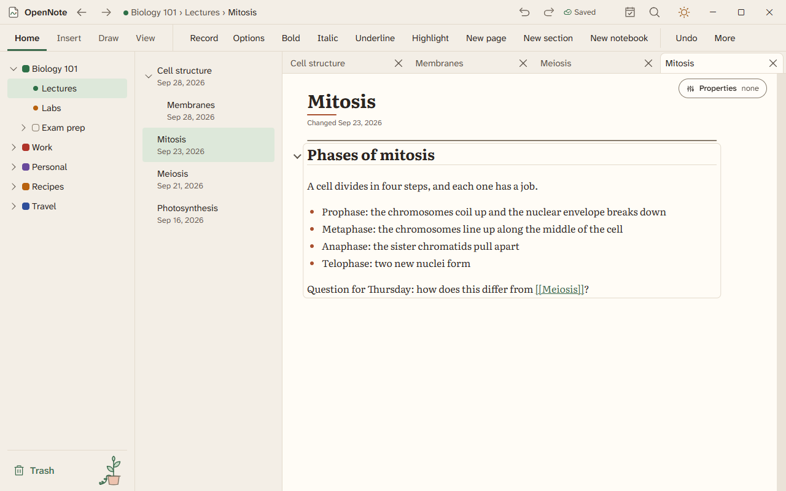
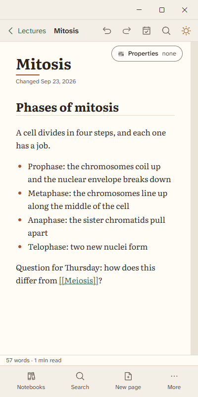
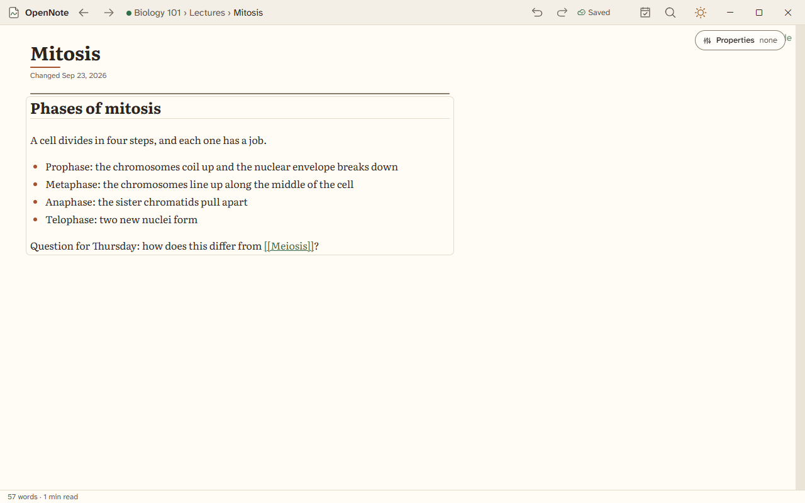
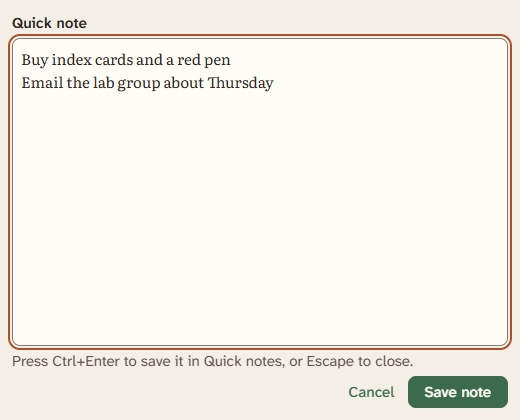
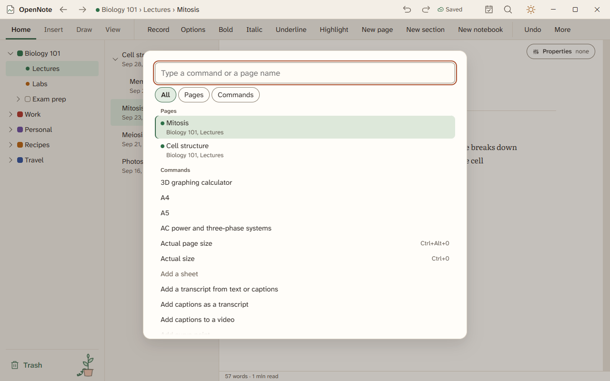

# The workspace, title bar, and windows

The workspace is the main screen. It holds the notebooks pane, the pages pane, and the page. This guide covers the title bar, the command bar, the Home screen, page tabs, the compact layout, focus mode, the mini window, and quick capture.

## The layout

- **Title bar.** Back and forward, the page path, undo and redo, search, the save status, and a few chips that appear only when they matter.
- **Command bar.** The tabs Home, Insert, Draw, and View. In a narrow window, the least-used buttons move into **More**.
- **Notebooks and pages panes.** Drag a splitter to resize a pane. Double-click it to reset it. Press Ctrl+Shift+1 or Ctrl+Shift+2 to hide or show a pane.
- **Regions.** Press F6 and Shift+F6 to move between the title bar, command bar, panes, and page.

## The title bar

| Item | What it does |
|---|---|
| Back and forward | Move through the pages, Settings, and Trash you visited. |
| Page path | Shows the notebook, section, and page. Click a part to go there. |
| Undo and redo | Undo text and ink first, then changes to notebooks, sections, and pages. |
| Search | Opens search (Ctrl+Shift+F). |
| Daily note | Opens today's note. |
| Save status | Says Saved, Saving, Offline, Couldn't save, or Not responding. Saving stays until the edit is written. Choose Couldn't save to see which page failed and why, then Retry to save it now, or Copy text to keep what you wrote elsewhere. What you typed stays on the page while OpenNote tries. |
| Sync chip | Shows the state of [sync](sync.md). |
| Timers chip | Shows a running timer or stopwatch. |
| Update chip | Appears when an update is ready. |
| Offline chip | Appears when [Work offline](privacy-and-work-offline.md) is on. |
| Safe mode chip | Appears when OpenNote started in safe mode. |
| Audio indicator | Appears while [recording or playing audio](recording.md). |
| Theme toggle | Switches between light and dark. |

A chip shows only in its own state, and each one opens its panel when you click it.

## The Home screen

Home has five sections: Recent pages, Pinned pages, Today, Saved searches, and Upcoming. Choose **Customize** to move a section up or down or to hide it. Settings, then **Windows and power** has a **Start on Home** switch. When it is off, OpenNote opens the last page you used.

## Page tabs

- Press Ctrl+Enter on a page in the pages pane to open it in a new tab.
- Press Ctrl+Tab and Ctrl+Shift+Tab to switch tabs. Press Ctrl+W to close one, and Ctrl+Shift+T to reopen the last one you closed.
- Drag a tab to reorder it. Open its menu to duplicate it or open it in a new window.

## Compact layout

In a narrow window or on a tablet, OpenNote shows one pane at a time. A drawer holds the notebooks, and a bottom bar switches between notebooks, pages, and the page. Undo and redo stay on the title bar.

## Focus mode, keep on top, and docking

- **Focus mode.** F11 hides the panes and bars. Press F11 again to bring back the same layout.
- **Keep OpenNote on top of other windows.** The window floats above other apps.
- **Dock to the left edge** and **Dock to the right edge.** The window fills half the screen. Turn docking off to restore the old size.

Focus mode, Keep on top, and Dock to the right edge are on the View tab. All of them, and Dock to the left edge, are in the command palette. Keep on top and both docking buttons are also in Settings, then Windows and power.

## Quick capture

Quick capture opens a small Quick note window over any app. It is off until you turn it on in Settings, then **Windows and power**. The shortcut starts as Win+Shift+Q, and you can change it. Type a note and press Ctrl+Enter to save it in Quick notes. Press Escape to close it without saving. The first line is the title.

## The command palette

Open the command palette (Ctrl+K) to find any command or page by name. Many actions that have no button are only here.

## More windows

A tool, such as the timers or the calculator, can pop out into its own window. A page can open in a new window from its tab menu. Both stay in sync with the main window.
